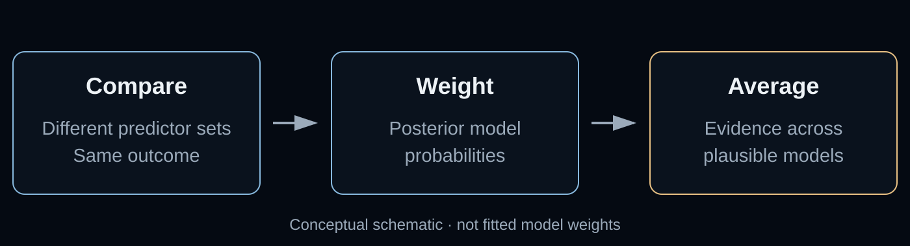
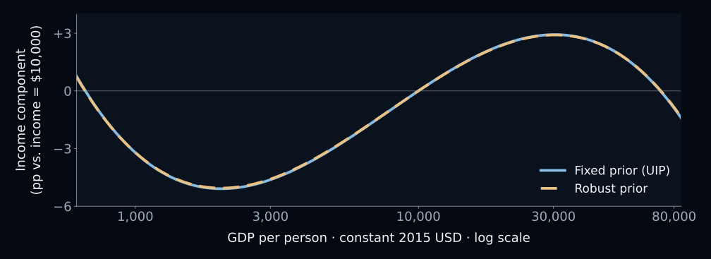
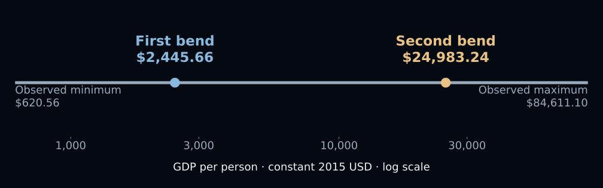

# Does becoming richer eventually mean less obesity? {#tension .divider background-color="#22303e"}

[The tension · One turning point may be too simple]{.act}

::: {.notes}
This teaching and research overview explains the published paper; it is not a new estimation exercise. All figures are original diagrams or reconstructions from published numerical tables. Space and the next arrow advance through the full sequence. M opens the menu; O opens overview; S opens speaker view; B opens the chalkboard. On narrow screens Reveal switches to scrolling. Full citation and verified resources appear near the end. The date on the title is the deck preparation date, distinct from the October 8 publication date.
:::

## A single rise and fall is a hypothesis to test {#hypothesis}

The familiar **Obesity Kuznets Curve** predicts:

[Income rises → obesity rises → obesity falls]{.big-line}

But what if the answer changes with the controls we choose?

[The paper tests both the curve's shape and the choice of model.]{.takeaway .fragment}

::: {.notes}
Source: abstract and introduction, PDF pp.1–3. The conventional inverted-U is a hypothesis, not an established law. Earlier findings are mixed, partly because authors choose different variables and specifications. The verbal sequence on this slide is conceptual and contains no estimated turning point. The paper's main finding will instead be a decline–rise–decline income component.
:::

## The panel links adult obesity to national development {#sample}

| Measurement | What enters the analysis |
|:---|:---|
| **Obesity** | Age-standardized prevalence, adults 18+ |
| **Income** | GDP per person, constant 2015 US dollars |
| **Coverage** | 84 countries, 2000–2020 |
| **Main BMA sample** | 1,195 country-year observations |

[These are national aggregates, not individual weight records.]{.takeaway .fragment}

::: {.notes}
Sources: Data section, PDF p.3; Table 2 p.5; Table 5 p.11. Obesity means BMI at least 30 kg/m². WHO age-standardized adult obesity estimates draw on NCD-RisC; explanatory variables come from World Development Indicators. The main panel comprises 29 advanced and 55 emerging economies. Not every country is observed in every year; 84 multiplied by 21 is not the estimation sample. The controlled TWFE model has 1,190 observations, not 1,195.
:::

# Let the evidence weigh competing models {#investigation .divider background-color="#22303e"}

[The investigation · From model uncertainty to a curve]{.act}

## Fixed effects separate country differences from time changes {#within-country}

:::: {.columns}
::: {.column width="48%"}
### Country effects

Absorb persistent differences between countries.
:::
::: {.column width="48%"}
### Year effects

Absorb shocks shared in a given year.
:::
::::

[Neither removes unobserved factors that change differently across countries.]{.takeaway .fragment}

::: {.notes}
Sources: Methodology, PDF pp.3–4; Table 4 p.7. Country and year fixed effects are always included in BMA. The interpretation centers on within-country changes over time after conditioning on common time effects and included covariates. Fixed effects do not establish causality and do not eliminate time-varying confounding. The two columns explain the role of the effects; they do not depict estimated effect magnitudes.
:::

## Model averaging avoids betting on one control set {#model-averaging}

{height=340 fig-alt="Conceptual workflow: compare candidate models, weight them by posterior support, then average their estimates. No numerical weights are assumed."}

[Country and year effects stay in every model.]{.takeaway .fragment}

::: {.notes}
Source: Methodology, PDF pp.3–4, equations 1–4. There are 61 potential covariates in the model-averaging process besides the always-included fixed effects. Posterior model probabilities update prior model probabilities using the data. The MC3 sampler visits promising models rather than fitting every possible subset exhaustively. The drawing is a teaching schematic, not an empirical model-weight plot. The paper compares a fixed unit-information prior (UIP) with a robust g-prior under a uniform model prior.
:::

## Inclusion probability measures support across models {#inclusion}

$$\operatorname{PIP}(X_k)=\sum_{M_j\,\text{containing}\,X_k}P(M_j\mid D)$$

[Add the posterior probabilities of models that retain a predictor.]{.comment}

**PIP near 1:** the predictor is retained across almost all posterior model weight.

[High inclusion support is not proof of a causal effect.]{.takeaway .fragment}

::: {.notes}
Source: equation 4, PDF p.4. This is the paper's definition with the indicator function written as a restriction on the summation. PIP is not a frequentist p-value and is not the probability that a policy works. It is conditional on the specified model space, priors, data and likelihood. A coefficient excluded from a model contributes zero in model averaging. Values reported as 1.00 should be understood at the paper's printed precision.
:::

## Three income terms allow two changes in direction {#cubic-model}

$$f(x)=\beta_1x+\beta_2x^2+\beta_3x^3,\qquad x=\ln(\mathrm{GDPpc})$$

[This is the income component, with other predictors held fixed.]{.comment}

One linear term fixes the slope. A quadratic can bend once. **A cubic can bend twice.**

[Read all three coefficients together.]{.takeaway .fragment}

::: {.notes}
Sources: Data and Methodology, PDF pp.3–4; Results and Table 3, pp.5–7. This is the partial cubic income component, not the whole regression or a complete prediction of obesity. The three terms use natural-log GDP per capita. Country effects, year effects and other selected predictors are omitted here solely to explain shape. A cubic need not have two real turning points: the next evidence slides check this rather than inferring it from the coefficient signs alone.
:::

## Both priors retain the same income pattern {#coefficients}

| Income term | Fixed prior (UIP) | Robust prior |
|:---|---:|---:|
| Log GDP per person | −189.358 | −187.464 |
| Squared log GDP | 21.620 | 21.405 |
| Cubed log GDP | −0.804 | −0.796 |

[Posterior means · Table 2 · PIP = 1.00 for every term under both priors]{.comment}

[The income relationship survives this change in prior specification.]{.takeaway .fragment}

::: {.notes}
Source: Table 2, PDF p.5. Exact printed posterior means and PIPs. UIP is the fixed unit-information g-prior; the robust g-prior permits adaptive shrinkage. These coefficients are not the change in obesity for a one-dollar increase in income. Interpretation requires combining the linear, squared and cubed natural-log terms. Main BMA N=1,195. Similar priors' results support sensitivity to this particular choice; they do not establish robustness to every model or dataset.
:::

## The estimated income component falls, rises, then falls {#income-curve}

{height=390 fig-alt="Both Table 2 posterior-mean curves form an inverted N. GDP per person is on a logarithmic axis; the outcome is a percentage-point difference relative to income of 10,000 constant 2015 US dollars."}

[Original reconstruction · Tables 2 and 7 · Means only; no uncertainty band]{.comment}

[The two priors produce almost overlapping curves.]{.takeaway .fragment}

::: {.notes}
Source: Table 2, PDF p.5, and Table 7, p.13. For each model, the plot is f(ln GDPpc) minus f(ln 10000), evaluated across the observed range USD 620.560–84,611.100. Centering at USD 10,000 changes only the vertical origin, not the shape or turning points. Values below zero mean a lower income component than at the reference income, not negative obesity prevalence. Both series are computed from the exact printed coefficients on the prior slide. They are posterior means; no covariance or joint posterior was available for a valid uncertainty band. This is not the paper's pooled scatterplot and not a causal prediction.
:::

## The cubic has two real turning points in each main model {#shape-check}

$$D=\beta_2^2-3\beta_1\beta_3>0$$

| Specification | Reported discriminant |
|:---|---:|
| Two-way fixed effects + controls | 4.97 |
| BMA · fixed prior | 10.69 |
| BMA · robust prior | 10.51 |

[Table 3 · This is a shape check on point estimates, not a confidence interval.]{.takeaway .fragment}

::: {.notes}
Source: Table 3, PDF p.7. A positive discriminant yields two distinct real roots of the cubic derivative. The displayed discriminants are quoted as published; do not recompute them from rounded printed coefficients and claim extra precision. Combined with the coefficient pattern and observed-range check, they establish the estimated inverted-N geometry. High PIPs alone would not prove that the curve bends inside the observed range. This mathematical check is not a posterior probability of the shape or an inferential test of uncertainty in the turning points.
:::

## The controlled panel model turns within the income range {#turning-points}

{height=335 fig-alt="The controlled TWFE model's reported turning points, 2,445.66 and 24,983.24 constant 2015 US dollars, lie inside the observed income range."}

[Table 4, column 5 · Point estimates, not policy thresholds]{.comment}

[The two bends are not extrapolations beyond the sample's income range.]{.takeaway .fragment}

::: {.notes}
Sources: Table 4 column 5, PDF p.7, and Table 7 p.13. Values USD 2,445.66 and 24,983.24 are quoted directly from the controlled TWFE model; they are not calculated from the rounded coefficients and are not BMA turning points. The observed income range is USD 620.560–84,611.100. This model uses N=1,190 with country and year effects and 61 controls. The diagram locates the point estimates on a log income scale and conveys no confidence interval. A country's future path need not follow this estimated curve.
:::

## Pooled pictures and panel estimates answer different questions {#pooled-panel}

| Pooled OLS · Figure 1 | BMA / controlled TWFE |
|:---|:---|
| Combines differences across countries | Uses within-country time variation |
| No country fixed effects | Country and year effects included |
| N-shaped all-economy fit | Inverted-N income component |

[The pooled all-economy graph is not the evidence for the main inverted-N claim.]{.takeaway .fragment}

::: {.notes}
Sources: Figure 1 note, PDF p.6; Table 4 and discussion, p.7. The pooled all-economy curve is descriptive. Its second turning point, about USD 645,344, lies beyond observed support. Do not borrow its USD 10,802 first turning point as a BMA threshold, or equate a pooled country-group curve with the panel income component. Different sources of variation and conditioning can yield different shapes. The deck therefore uses the main BMA reconstruction rather than relabeling the pooled figure.
:::

## Robust correlates extend beyond national income {#correlates}

| Selected Table 2 predictor | Posterior-mean sign | PIP, both priors |
|:---|:---:|---:|
| Forest area | Negative | 1.00 |
| Renewable energy share | Negative | 1.00 |
| Population density | Negative | 1.00 |
| Arable land per person | Positive | 1.00 |

[Different units prevent ranking effect sizes from these signs.]{.takeaway .fragment}

::: {.notes}
Source: Table 2, PDF p.5. This is an explicitly selected subset, not the full variable ranking. Forest area means are −0.348 and −0.343; renewable energy share −0.147 and −0.148; population density −0.039 and −0.039; arable land per person 7.354 and 7.175. Only signs and printed inclusion probabilities appear on-slide. These are aggregate conditional associations. The analysis does not identify a causal benefit from expanding forest cover or a harmful causal effect of arable land.
:::

## Five-year lags preserve the signs on all three income terms {#lagged-check}

| Income term | Lagged UIP mean | Lagged robust mean |
|:---|---:|---:|
| Log GDP per person | −233.992 | −231.340 |
| Squared log GDP | 27.135 | 26.840 |
| Cubed log GDP | −1.037 | −1.026 |

[Table 11 · 802 observations · PIP = 1.00 for all six entries]{.comment}

[This check changes the timing and sample; it does not establish causality.]{.takeaway .fragment}

::: {.notes}
Source: Table 11, PDF p.19. Obesity is measured at year t; all explanatory variables, including GDP terms, are measured at t−5. N=802, not the main BMA sample's 1,195. Both priors retain the income terms and the negative–positive–negative sign sequence. The paper reports positive discriminants and two turning points for this specification too. Lagging can lessen concern about contemporaneous reverse causality, but time-varying confounding, anticipation and selection remain possible. This is not an experiment.
:::

## Stable model results still leave important uncertainty {#uncertainty}

::: {.incremental}
- **Curve uncertainty:** no joint posterior here for a valid band.
- **Coverage:** sparse, less reliable evidence at very low incomes.
- **Aggregation:** national patterns need not describe individuals.
:::

[Robustness within this framework is narrower than universal certainty.]{.takeaway .fragment}

::: {.notes}
Sources: discussion and concluding remarks, PDF pp.8–11; Table 2. The publication supplies marginal coefficient standard deviations, which are insufficient to reconstruct uncertainty for a cubic curve without joint covariance or posterior draws. The low-income segment relies on fewer countries with less reliable obesity surveillance. National-level estimates cannot be used to infer individual weight responses, and the paper explicitly calls for gender-disaggregated and subnational work. The figure's lack of a band is a data limitation, not a claim of zero uncertainty.
:::

## Model averaging cannot remove every source of bias {#objection}

[Objection.]{.objection} Could omitted changes drive both income and obesity?

. . .

[Response.]{.rebuttal} Yes. Averaging addresses model selection, not causal identification.

[Treat the curve as evidence about associations, not a growth prescription.]{.takeaway .fragment}

::: {.notes}
Source: Concluding remarks, PDF p.11. The authors describe robust correlates rather than causal effects and note that time-varying confounders cannot be ruled out without a credible identification strategy. More candidate regressions do not produce an instrument or random assignment. The strongest result is that the simple one-turning-point story is inadequate within the studied data and model framework, not that income growth alone will make a population healthier.
:::

# Look beyond a single income threshold {#resolution .divider background-color="#22303e"}

[The resolution · Multiple stages, conditional associations]{.act}

## Economic growth alone does not guarantee lower obesity {#implication}

**The finding:** a decline–rise–decline income component survives two priors.

**The implication:** examine the food, urban and environmental context at each stage.

**The next step:** test mechanisms with finer data and credible causal designs.

[A model-based turning point is not a universal target for policy.]{.takeaway .fragment}

::: {.notes}
Sources: abstract p.1 and concluding remarks p.11. The policy motivation is stage-specific, but this deck deliberately distinguishes associations from established interventions. Development can change food availability, activity patterns, urban environments and institutions. The estimated thresholds should not be treated as automatic triggers that every country will cross. Subnational and gender-disaggregated data and stronger causal identification could help connect aggregate findings to mechanisms.
:::

## The published tables make every claim inspectable {#resources}

[**Published paper · open access**](https://doi.org/10.1007/s10198-026-01998-1)

[**Full paper PDF · tables and appendix**](https://link.springer.com/content/pdf/10.1007/s10198-026-01998-1.pdf)

[**Website summary & infographic**](https://carlos-mendez.org/articles/20261008-ejhe/)

[**Download the Quarto source**](slides.qmd)

[The full study dataset is available from the corresponding author on reasonable request.]{.takeaway}

::: {.notes}
Restrepo Gómez, K., Du, H., & Mendez, C. (2026). Wealth and weight revisited: A Bayesian model averaging approach to the Obesity Kuznets Curve. The European Journal of Health Economics. https://doi.org/10.1007/s10198-026-01998-1 . Version of record published October 8, 2026; online first, without volume, issue or page range. The paper is CC BY-NC-ND 4.0. These teaching figures are original numerical plots and a labeled conceptual diagram; no publisher figure is altered. Data availability statement: full dataset on reasonable request to the corresponding author. No public replication notebook is claimed. Figure generation and the evidence ledger accompany this deck as figures.py and EVIDENCE.md.
:::

# Wealth and obesity are linked through several stages, not one universal turning point. {#closing .divider background-color="#22303e"}

::: {.notes}
Return to the opening question. The central evidence is the inverse-N partial income relationship in BMA and TWFE panel estimates, with careful separation from the descriptive pooled curves. Model averaging makes the result less dependent on selecting one set of predictors. It does not make the relationship causal, remove sample limitations or turn point estimates into precise universal thresholds.
:::
