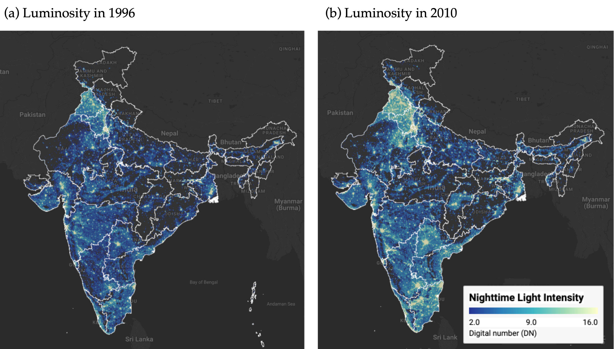
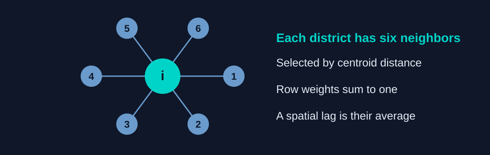
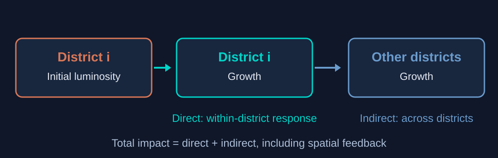
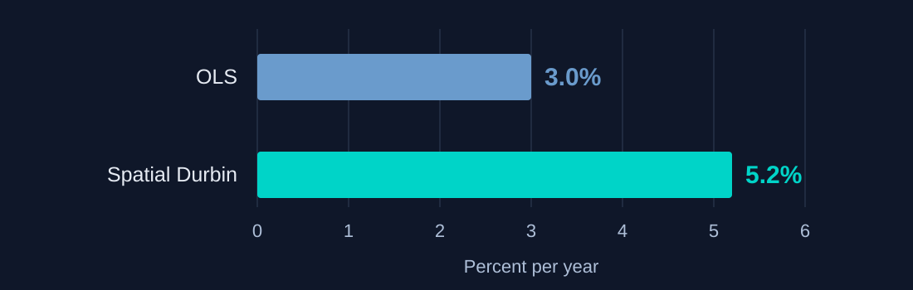
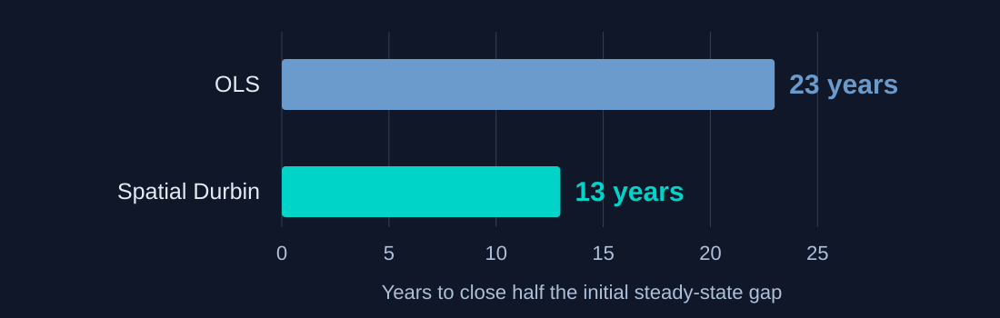
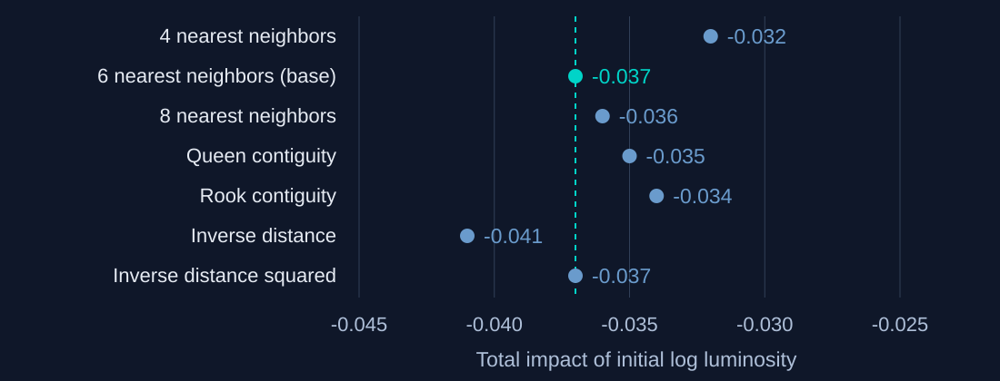

# The Tension {#tension .divider background-color="#d97757"}

[Does brighter mean more equal?]{.act}

::: {.notes}
This deck explains the published paper, not a new empirical analysis. The title reports the preferred conditional Model 4: controls and state fixed effects, with six-nearest-neighbor spatial weights. Annual speed 5.2% and half-life 13 years are rounded values reported in Table 3, p.184. Use Space to advance through the full sequence; arrow keys navigate the tutorial-style vertical stacks. M opens the menu; O or Escape opens overview; S opens speaker notes; B toggles the chalkboard; ? displays keyboard help.
:::

## Before you look: can a brighter map prove catch-up? {#before-map background-color="#1a3a8a"}

Suppose almost every district becomes brighter.

**A.** Regional gaps must be shrinking.

**B.** We still need to compare growth with initial conditions.

::: {.notes}
Invite a prediction. B is correct. A map can reveal expanding luminosity, but convergence asks whether initially poorer districts grow faster. Nighttime luminosity is a proxy for economic activity, not observed income. The published Figure 1 follows.
:::

## India brightens, but convergence needs a growth comparison {#published-map}

{height=430}

[A change in brightness alone does not establish catch-up.]{.takeaway .fragment}

::: {.notes}
Unaltered author image: https://quarcs-lab.github.io/project2025s-py/images/luminosity_map.png . Published Figure 1, p.179, CC BY 4.0. The map displays regional luminosity; the regressions use per-capita luminosity. Do not treat the map's DN scale as income or as the regression outcome. For exploration: https://carlos-mendez.projects.earthengine.app/view/rc-dmsp-ntl .
:::

## One long growth interval links 520 districts {#sample}

| What is observed? | What it means |
|:---|:---|
| **520 districts** | Comparable subnational units |
| **1996–2010** | One 14-year growth interval |
| **Lights per person** | A proxy for economic activity |

[The analysis is a cross-sectional long difference, not an annual panel.]{.takeaway .fragment}

::: {.notes}
Sections 2.1 and 2.3, pp.174–177. The district analysis uses radiance-calibrated DMSP-OLS nighttime lights throughout; this mitigates top-coding in bright areas. Six composite dates are available within the sample window, but the regressions explain average annual growth from 1996 to 2010. Luminosity also reflects electrification, urbanization and infrastructure. These qualifications matter for both interpretation and extensions.
:::

# The Investigation {#investigation .divider background-color="#6a9bcc"}

[From satellite patterns to spatial estimates]{.act}

## Three empirical fronts connect maps to a spatial model {#three-fronts}

::: {.incremental}
1. **Visualize** regional convergence interactively.
2. **Test** whether neighboring districts are correlated.
3. **Model** spatial spillovers with a spatial Durbin model.
:::

[A reproducible workflow connects every step to code and output.]{.takeaway .fragment}

::: {.notes}
The published abstract explicitly describes three empirical fronts extending Chanda and Kabiraj (2020). The spatial-culture exercise is a separate exploratory extension in section 4.3, not a fourth front in the abstract. Python/Jupyter notebooks combine narrative, code and results; Quarto embeds identified notebook outputs into the manuscript. Source: abstract p.173 and section 2.2 pp.175–176.
:::

## Catch-up means lower initial luminosity predicts faster growth {#convergence-model}

$$g_t = \beta_1 x_{t-1} + X_t\alpha + \varepsilon_t$$

[$g_t$: average annual growth · $x_{t-1}$: initial log lights per person]{.comment}

. . .

**Negative $\beta_1$:** initially dimmer districts grow faster, conditional on the controls.

[Conditional convergence allows districts to have different steady states.]{.takeaway .fragment}

::: {.notes}
Equation 2, p.176. The unconditional specification omits controls; the conditional models include district characteristics and/or state fixed effects. The 16 controls cover geography/agro-climate, demographics/human capital, and infrastructure, adopted from Chanda and Kabiraj (2020). Demographic, human-capital and electrification controls are from 1996; paved roads are from 2000. Do not describe every control as measured in 1996. A negative growth slope is evidence of beta convergence, not a guarantee of complete equality.
:::

## Six nearby districts define the baseline neighborhood {#neighbors}

{height=365}

[The weights matrix makes “neighbor” explicit and testable.]{.takeaway .fragment}

::: {.notes}
Section 2.4, pp.177–178. W initially assigns 1 to the six nearest centroids and 0 otherwise, then normalizes each row to sum to one. Wx is the neighborhood average. This teaching schematic is not the empirical map of Indian districts. The baseline is compared with six alternative weight matrices later; 6NN attains the lowest AIC among the seven specifications in Table 4.
:::

## Both starting levels and growth cluster in space {#spatial-dependence}

:::: {.columns}
::: {.column width="50%"}
### Initial luminosity

[0.73]{.bignum}

[Global Moran's $I$ · $p=0.001$]{.bignum-label}
:::
::: {.column width="50%"}
### Luminosity growth

[0.60]{.bignum}

[Global Moran's $I$ · $p=0.001$]{.bignum-label}
:::
::::

[Nearby districts tend to have similar levels and growth rates.]{.takeaway .fragment}

::: {.notes}
Section 3.2, p.180; Figures 6 and 7. The global statistics use the baseline spatial weights. Initial luminosity refers to per-capita luminosity in 1996; growth spans 1996–2010. LISA maps then identify significant local clusters and outliers. These statistics support modeling spatial dependence but do not identify causal transmission.
:::

## The spatial Durbin model adds neighbors to the regression {#spatial-model}

$$g_t = \beta_1x_{t-1}+X_t\alpha+\beta_2Wx_{t-1}+WX_t\gamma+\rho Wg_t+\varepsilon_t$$

. . .

| Spatial term | Adds information about neighbors'… |
|:---|:---|
| $Wx_{t-1}$ | initial luminosity |
| $WX_t$ | characteristics |
| $Wg_t$ | growth |

[Growth is modeled as spatially interdependent.]{.takeaway .fragment}

::: {.notes}
Equation 7, p.178. W is the row-normalized weights matrix. Rho is the spatial autoregressive parameter; lambda is reserved for the convergence speed. The model follows the spatial growth framework of Ertur and Koch (2007), with human-capital terms following Fischer (2011). This is a compact representation of the published equation, not a new specification. The spatial lag of growth creates feedback, so structural slope coefficients cannot simply be read as marginal effects.
:::

## Spatial feedback separates direct and indirect impacts {#impact-meaning}

{height=350}

[These are reduced-form responses within the fitted model.]{.takeaway .fragment}

::: {.notes}
Section 3.3 and Table 2, pp.182–184. The LeSage–Pace impact calculation accounts for the spatial multiplier. Average diagonal responses are direct effects; average off-diagonal responses are indirect effects; their sum is the total effect. The arrows illustrate model dependence, not an identified causal policy intervention. Feedback is included in the reported impacts.
:::

## The indirect impact strengthens the total convergence association {#impact-estimates}

| Preferred Model 4 | Impact | Standard error |
|:---|---:|---:|
| Direct | −0.025 | 0.002 |
| Indirect | −0.012 | 0.007 |
| **Total** | [−0.037]{.key} | 0.007 |

[Table 2: initial log luminosity; Monte Carlo standard errors.]{.comment}

[The direct effect resembles OLS; the total includes the spillover component.]{.takeaway .fragment}

::: {.notes}
Table 2, p.182. Model 4 includes controls and state fixed effects. Its OLS coefficient is −0.025 (HC1 SE 0.003). SDM direct and total impacts are significant at 1%; the indirect impact at 10%, not 5%. Reported values are rounded. These are impacts of initial log luminosity on average annual growth, not annual convergence speeds. Do not convert the displayed rounded impacts to replace the paper's reported speed estimates.
:::

## Convergence speed translates the growth slope into time {#speed-definition}

$$\lambda=-\frac{\ln(1+\beta_1T)}{T}, \qquad T=14$$

[$\lambda$: implied annual convergence speed · $T$: years in the growth interval]{.comment}

. . .

For the spatial model, apply the transformation to the **total impact**.

[Use the published speed estimates, which precede rounding of the coefficients.]{.takeaway .fragment}

::: {.notes}
Section 2.3, p.176. This transformation is specific to the paper's average annual growth specification. The paper applies the same mapping to the total effect of initial luminosity in spatial models. Numerical slides quote Table 3 directly; applying this nonlinear transformation to the rounded values in Table 2 can produce a different rounded speed. Rho (spatial dependence) and lambda (convergence speed) are different quantities.
:::

## Accounting for spillovers raises estimated speed to 5.2% {#convergence-speed}

{height=365}

[The comparison holds controls and state fixed effects constant.]{.takeaway .fragment}

::: {.notes}
Table 3, p.184, Model 4. Both models use the same conditioning set. The spatial speed is calculated from the total effect. The estimates are about 3.0% and 5.2% per year as published; they do not measure the causal benefit of introducing a particular policy. This chart redraws the reported values without re-estimation or invented uncertainty intervals.
:::

## The implied half-life falls from about 23 to 13 years {#half-life}

{height=350}

[$\text{Half-life}=\ln(2)/\lambda$ · Table 3, Model 4]{.comment}

[Half-life means closing half the initial steady-state gap—not complete equality.]{.takeaway .fragment}

::: {.notes}
Table 3, p.184, and definition in section 2.3 p.176. These are rounded model-implied summaries, not a forecast that all district incomes become equal in 13 years. The regression period remains 1996–2010. Do not describe the half-life as the observed time over which all Indian disparities halved.
:::

## The spatial difference is concentrated in conditional models {#model-comparison}

| Specification | OLS speed | Spatial speed |
|:---|---:|---:|
| 1 · No controls, no state effects | 2.3% | 2.6% |
| 2 · State effects only | 2.6% | 2.7% |
| 3 · District controls only | 3.0% | 6.2% |
| **4 · Controls + state effects** | **3.0%** | [5.2%]{.key} |

[Annual convergence speeds reported in Table 3.]{.comment}

[The 6.2% estimate belongs to Model 3; the preferred Model 4 gives 5.2%.]{.takeaway .fragment}

::: {.notes}
Table 3, p.184, with specification labels from Table 2. Spatial and nonspatial speeds are similar in Models 1 and 2. The conditional models produce the larger spatial premium. Model 4 has the lowest AIC of the four SDMs (−2501 versus −2465 for its corresponding OLS model). The comparison demonstrates sensitivity to the conditioning set; do not universalize 5.2% as an invariant economic constant.
:::

## Total impacts remain negative across all seven weight matrices {#robustness}

{height=420}

[Direct and total impacts are significant throughout; indirect impacts in five of seven.]{.takeaway .fragment}

::: {.notes}
Table 4, p.186. Direct effects lie between −0.024 and −0.025; total effects range from −0.032 to −0.041. All direct and total impacts are significant at 1%. Indirect effects are negative under all seven definitions but significant in five (with the paper's 10% threshold), not in the 4NN or 8NN specifications. The figure shows point estimates only; it does not reconstruct confidence intervals from rounded standard errors. No re-estimation was performed.
:::

## Spatial association does not identify a causal channel {#interpretation}

[Objection.]{.objection} Could common conditions or measurement produce the spatial pattern?

. . .

[Response.]{.rebuttal} Yes. Geography, institutions, infrastructure, omitted variables and light blooming can contribute.

[The estimates describe spatially connected convergence, not a causal policy effect.]{.takeaway .fragment}

::: {.notes}
Sections 3.3 and 4, pp.184–190. The paper explicitly adopts a reduced-form interpretation. Cross-sectional spatial regressions do not separate technological transmission from common shocks, shared conditions or measurement. Radiance calibration mitigates saturation, but cannot make nighttime lights a complete income measure. The robust spatial pattern motivates investigation; it does not identify which channel a policy should target.
:::

## The culture extension uses a different sample and light series {#culture}

**32 states and union territories** · cultural participation in 1991 · lights in 1992

| Cultural dimension | Spearman correlation | $p$ |
|:---|---:|---:|
| Media-based consumption | 0.370 | 0.037 |
| Community-based participation | −0.404 | 0.022 |

[Exploratory associations cannot establish which way influence runs.]{.takeaway .fragment}

::: {.notes}
Section 4.3, pp.188–189. NSS 47th Round (July–December 1991) cultural participation is paired with the Consistent and Corrected Nighttime Lights series for 1992, not the radiance-calibrated district series. These are two of six cultural dimensions; the other four are not statistically significant. The small sample and extreme small territories motivate rank correlations. This exercise is not part of the 520-district growth regression and cannot establish the directional claim of Culture-Based Development.
:::

# The Resolution {#resolution .divider background-color="#00d4c8"}

[Reproduce the evidence, retain the qualifications]{.act}

## Six learning notebooks make the analysis inspectable {#learning}

| Notebook | Question to explore |
|:---|:---|
| **N1 · Earth Engine** | Where and when does luminosity change? |
| **N2 · Convergence** | Do initially poorer districts grow faster? |
| **N3 · Spatial dependence** | Where do levels and growth cluster? |
| **N4 · Spillovers** | How do spatial impacts change the estimate? |
| **N5 · Robustness** | Does the result depend on the weights? |
| **N6 · Spatial culture** | How do lights relate to participation? |

[Follow the links and computational output in the online article.]{.takeaway .fragment}

::: {.notes}
Table 1, p.174, and the project learning site. N1 uses an Earth Engine exploration; N2–N6 are Python notebook workflows. Exact filenames: c01_view_from_space-preview.html; c02_regional_convergence_sc-preview.html; c03_spatial_dependence_lisa-preview.html; c04_spillover_modeling_6nn-preview.html; c07_alternative_w_matrices-preview.html (N5); c06_spatial_culture-preview.html (N6). The online article gives the complete navigation. Code: https://github.com/quarcs-lab/project2025s-py .
:::

## Start with the published result, then follow its code {#resources}

[**Published article · REGION**](https://doi.org/10.18335/region.v13i2.676)

[**Online article & notebooks**](https://quarcs-lab.github.io/project2025s-py/index-preview.html)

[**Code repository · QuaRCS-lab**](https://github.com/quarcs-lab/project2025s-py)

[**Interactive satellite map**](https://carlos-mendez.projects.earthengine.app/view/rc-dmsp-ntl)

[Navigation: Space = next step · M = menu · O = overview · S = notes]{.comment}

::: {.notes}
Full citation: Carlos Mendez, Sujana Kabiraj and Jiaqi Li (2026). Regional growth, convergence, and spatial spillovers in India: A reproducible view from outer space. REGION 13(2), 173–196. Published October 11, 2026. DOI 10.18335/region.v13i2.676. The article and original Figure 1 are CC BY 4.0. Other figures in this teaching deck are explicitly labeled schematics or redraws of published estimates. This deck was authored in Quarto using the same site-brand theme and title template as the FWL tutorial; source slides.qmd and figures.py accompany the rendered HTML.
:::

# Spatial connections change the estimated pace of India's regional catch-up. {#closing .divider background-color="#1a3a8a"}

::: {.notes}
Return to the opening distinction: brighter maps alone cannot establish convergence. The paper combines a measurable growth comparison, spatial diagnostics and a spatial Durbin model. Preferred Model 4 moves the implied annual speed from about 3.0% to 5.2% and the implied half-life from about 23 to 13 years. These are model-based spatial associations for 1996–2010, accompanied by a transparent, reproducible learning workflow.
:::
