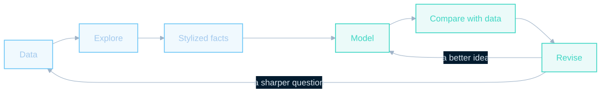

¿Por qué ha mejorado tanto el nivel de vida y por qué algunos países siguen siendo mucho más ricos que otros? ¿Qué ocurre con la producción, el desempleo y la inflación durante una recesión? **Ciencia de datos y modelos macroeconómicos** aborda estas preguntas poniendo datos reales y modelos operativos al alcance del lector.

Este libro abierto en línea de **Carlos Mendez**, cuyo título original es *Data Science and Macroeconomic Models: An AI-powered Python companion to intermediate macroeconomics*, acompaña con Python a *Macroeconomics* (2024), de Charles I. Jones. Sus **21 capítulos** siguen los títulos y el orden del texto de Jones, mientras que **ocho apéndices** avanzan desde las herramientas prácticas hasta el crecimiento económico y la estimación avanzada de modelos. Puede leer el razonamiento económico en Jones y después utilizar el cuaderno correspondiente para investigar la evidencia y explorar el modelo. Es un complemento independiente, con código y gráficos propios, sin afiliación ni respaldo del autor o de la editorial del texto.

## El ciclo del libro

El prefacio parte de una idea sencilla: las explicaciones económicas deben responder a los hechos. Un patrón general que persiste entre países o a lo largo del tiempo se convierte en un **hecho estilizado**, algo que un modelo útil debe ayudar a explicar. Estos patrones pueden revisarse cuando aparecen nuevos datos o cambia la muestra.

Cada capítulo recorre el mismo ciclo de aprendizaje: **datos → exploración → hechos estilizados → modelo → comparación con los datos → revisión**. Los tres primeros pasos desarrollan las habilidades de ciencia de datos necesarias para encontrar un patrón. Los tres siguientes evalúan si un modelo puede explicarlo. Una discrepancia conduce de nuevo a los datos con una pregunta más precisa o al modelo con una explicación mejor.

<figure style="width:min(1130px,calc(100vw - 40px));max-width:none;position:relative;left:50%;transform:translateX(-50%);">
  
  <figcaption>Figura original del ciclo de aprendizaje del prefacio: el azul representa la ciencia de datos y el verde la modelización macroeconómica. <a href="learning-cycle.svg">Abra la figura a tamaño completo</a>. <a href="https://quarcs-lab.github.io/macro102-site/#the-cycle-of-the-book">Fuente: prefacio del libro</a> · CC BY-NC 4.0.</figcaption>
</figure>

El objetivo es aprender tanto de los aciertos de un modelo como de sus límites. El modelo de Solow, por ejemplo, ayuda a explicar las diferencias de prosperidad, mientras que la economía de las ideas aborda el crecimiento sostenido. En el apéndice G, la comparación se convierte en estimación: los datos permiten elegir parámetros y evaluar el ajuste del modelo.

## Qué puede hacer

- **Investigar los datos.** Consulte observaciones, amplíe un período, compare países y cambie variables. Las fuentes públicas incluyen FRED, el Banco Mundial, el FMI, la OCDE y la Penn World Table; el apéndice B explica cómo obtener los datos por su cuenta.
- **Explorar los modelos.** Mueva controles deslizantes para cambiar parámetros, introduzca un choque o edite una ecuación en Python. Explore la producción y el crecimiento, el mercado laboral y la inflación, la política monetaria, las crisis financieras y las relaciones entre las economías nacionales e internacionales.
- **Ver juntos el razonamiento y el código.** Los capítulos construyen un modelo desde sus supuestos hasta sus predicciones y después presentan gráficos con un objetivo, el código que los genera y orientaciones para interpretarlos. Los ejercicios «Su turno» invitan a modificar los datos o el modelo e interpretar el resultado.
- **Usar la IA con criterio.** Un asistente puede explicar o modificar código, pero un programa que funciona puede responder a la pregunta económica equivocada. El prefacio invita a comprobar los resultados y evaluar la evidencia personalmente.

## Cómo estudiar un capítulo

1. Lea el capítulo correspondiente de Jones para conocer el argumento económico y abra después el capítulo del libro que aparece abajo para explorar el modelo y los gráficos interactivos.
2. Siga el enlace al **cuaderno** en Google Colab y seleccione **Runtime → Run all**. Ejecute el código, cambie parámetros y realice los ejercicios. Los capítulos principales no requieren instalación local.
3. Utilice las **diapositivas** del capítulo para una clase o un repaso estructurado del mismo material. Los enlaces siguientes abren las presentaciones reales de cada capítulo.
4. Compare las predicciones del modelo con los datos y explique qué cambió. Si está comenzando con Python, empiece por el apéndice A; consulte el apéndice C cuando necesite repasar matemáticas.

## Capítulos, cuadernos computacionales y diapositivas

Los recursos siguen la misma progresión que el libro. **El título abre el capítulo para lectura en línea; Colab abre el cuaderno computacional ejecutable; Diapositivas abre la presentación de clase.** Los materiales enlazados están en inglés.

### Fundamentos: capítulos 1–2

Comience por las preguntas de la macroeconomía y las herramientas para medir la economía.

| Capítulo | Cuaderno | Diapositivas |
| --- | --- | --- |
| 1. [Introducción a la macroeconomía](https://quarcs-lab.github.io/macro102-site/notebooks/ch01-introduction-to-macroeconomics.html) | [Colab](https://colab.research.google.com/github/quarcs-lab/macro102-site/blob/main/notebooks/ch01-introduction-to-macroeconomics.ipynb) | [Diapositivas](https://quarcs-lab.github.io/macro102-site/slides/ch01/) |
| 2. [Medición de la macroeconomía](https://quarcs-lab.github.io/macro102-site/notebooks/ch02-measuring-the-macroeconomy.html) | [Colab](https://colab.research.google.com/github/quarcs-lab/macro102-site/blob/main/notebooks/ch02-measuring-the-macroeconomy.ipynb) | [Diapositivas](https://quarcs-lab.github.io/macro102-site/slides/ch02/) |

### El largo plazo: capítulos 3–8

Estudie la producción, la acumulación de capital, las ideas, el mercado laboral y la inflación para comprender la prosperidad a largo plazo.

| Capítulo | Cuaderno | Diapositivas |
| --- | --- | --- |
| 3. [Panorama del crecimiento económico a largo plazo](https://quarcs-lab.github.io/macro102-site/notebooks/ch03-an-overview-of-long-run-economic-growth.html) | [Colab](https://colab.research.google.com/github/quarcs-lab/macro102-site/blob/main/notebooks/ch03-an-overview-of-long-run-economic-growth.ipynb) | [Diapositivas](https://quarcs-lab.github.io/macro102-site/slides/ch03/) |
| 4. [Un modelo de producción](https://quarcs-lab.github.io/macro102-site/notebooks/ch04-a-model-of-production.html) | [Colab](https://colab.research.google.com/github/quarcs-lab/macro102-site/blob/main/notebooks/ch04-a-model-of-production.ipynb) | [Diapositivas](https://quarcs-lab.github.io/macro102-site/slides/ch04/) |
| 5. [El modelo de crecimiento de Solow](https://quarcs-lab.github.io/macro102-site/notebooks/ch05-the-solow-growth-model.html) | [Colab](https://colab.research.google.com/github/quarcs-lab/macro102-site/blob/main/notebooks/ch05-the-solow-growth-model.ipynb) | [Diapositivas](https://quarcs-lab.github.io/macro102-site/slides/ch05/) |
| 6. [Crecimiento e ideas](https://quarcs-lab.github.io/macro102-site/notebooks/ch06-growth-and-ideas.html) | [Colab](https://colab.research.google.com/github/quarcs-lab/macro102-site/blob/main/notebooks/ch06-growth-and-ideas.ipynb) | [Diapositivas](https://quarcs-lab.github.io/macro102-site/slides/ch06/) |
| 7. [El mercado laboral, los salarios y el desempleo](https://quarcs-lab.github.io/macro102-site/notebooks/ch07-the-labor-market-wages-and-unemployment.html) | [Colab](https://colab.research.google.com/github/quarcs-lab/macro102-site/blob/main/notebooks/ch07-the-labor-market-wages-and-unemployment.ipynb) | [Diapositivas](https://quarcs-lab.github.io/macro102-site/slides/ch07/) |
| 8. [Inflación](https://quarcs-lab.github.io/macro102-site/notebooks/ch08-inflation.html) | [Colab](https://colab.research.google.com/github/quarcs-lab/macro102-site/blob/main/notebooks/ch08-inflation.ipynb) | [Diapositivas](https://quarcs-lab.github.io/macro102-site/slides/ch08/) |

### El corto plazo: capítulos 9–15

Explore las fluctuaciones, las crisis y la política de estabilización, desde la curva IS hasta los modelos de equilibrio general dinámico estocástico.

| Capítulo | Cuaderno | Diapositivas |
| --- | --- | --- |
| 9. [Introducción al corto plazo](https://quarcs-lab.github.io/macro102-site/notebooks/ch09-an-introduction-to-the-short-run.html) | [Colab](https://colab.research.google.com/github/quarcs-lab/macro102-site/blob/main/notebooks/ch09-an-introduction-to-the-short-run.ipynb) | [Diapositivas](https://quarcs-lab.github.io/macro102-site/slides/ch09/) |
| 10. [La Gran Recesión y la pandemia de COVID-19: una primera mirada](https://quarcs-lab.github.io/macro102-site/notebooks/ch10-the-great-recession-and-the-covid-19-pandemic-a-first-look.html) | [Colab](https://colab.research.google.com/github/quarcs-lab/macro102-site/blob/main/notebooks/ch10-the-great-recession-and-the-covid-19-pandemic-a-first-look.ipynb) | [Diapositivas](https://quarcs-lab.github.io/macro102-site/slides/ch10/) |
| 11. [La curva IS](https://quarcs-lab.github.io/macro102-site/notebooks/ch11-the-is-curve.html) | [Colab](https://colab.research.google.com/github/quarcs-lab/macro102-site/blob/main/notebooks/ch11-the-is-curve.ipynb) | [Diapositivas](https://quarcs-lab.github.io/macro102-site/slides/ch11/) |
| 12. [Política monetaria y curva de Phillips](https://quarcs-lab.github.io/macro102-site/notebooks/ch12-monetary-policy-and-the-phillips-curve.html) | [Colab](https://colab.research.google.com/github/quarcs-lab/macro102-site/blob/main/notebooks/ch12-monetary-policy-and-the-phillips-curve.ipynb) | [Diapositivas](https://quarcs-lab.github.io/macro102-site/slides/ch12/) |
| 13. [Política de estabilización y marco de oferta y demanda agregadas](https://quarcs-lab.github.io/macro102-site/notebooks/ch13-stabilization-policy-and-the-as-ad-framework.html) | [Colab](https://colab.research.google.com/github/quarcs-lab/macro102-site/blob/main/notebooks/ch13-stabilization-policy-and-the-as-ad-framework.ipynb) | [Diapositivas](https://quarcs-lab.github.io/macro102-site/slides/ch13/) |
| 14. [Crisis financieras y modelo de corto plazo](https://quarcs-lab.github.io/macro102-site/notebooks/ch14-financial-crises-and-the-short-run-model.html) | [Colab](https://colab.research.google.com/github/quarcs-lab/macro102-site/blob/main/notebooks/ch14-financial-crises-and-the-short-run-model.ipynb) | [Diapositivas](https://quarcs-lab.github.io/macro102-site/slides/ch14/) |
| 15. [Modelos DSGE: la frontera de la investigación sobre ciclos económicos](https://quarcs-lab.github.io/macro102-site/notebooks/ch15-dsge-models-the-frontier-of-business-cycle-research.html) | [Colab](https://colab.research.google.com/github/quarcs-lab/macro102-site/blob/main/notebooks/ch15-dsge-models-the-frontier-of-business-cycle-research.ipynb) | [Diapositivas](https://quarcs-lab.github.io/macro102-site/slides/ch15/) |

### Aplicaciones y fundamentos microeconómicos: capítulos 16–20

Conecte los modelos con las decisiones de los hogares y las empresas, la política pública, el comercio y las finanzas internacionales.

| Capítulo | Cuaderno | Diapositivas |
| --- | --- | --- |
| 16. [Consumo](https://quarcs-lab.github.io/macro102-site/notebooks/ch16-consumption.html) | [Colab](https://colab.research.google.com/github/quarcs-lab/macro102-site/blob/main/notebooks/ch16-consumption.ipynb) | [Diapositivas](https://quarcs-lab.github.io/macro102-site/slides/ch16/) |
| 17. [Inversión](https://quarcs-lab.github.io/macro102-site/notebooks/ch17-investment.html) | [Colab](https://colab.research.google.com/github/quarcs-lab/macro102-site/blob/main/notebooks/ch17-investment.ipynb) | [Diapositivas](https://quarcs-lab.github.io/macro102-site/slides/ch17/) |
| 18. [El gobierno y la macroeconomía](https://quarcs-lab.github.io/macro102-site/notebooks/ch18-the-government-and-the-macroeconomy.html) | [Colab](https://colab.research.google.com/github/quarcs-lab/macro102-site/blob/main/notebooks/ch18-the-government-and-the-macroeconomy.ipynb) | [Diapositivas](https://quarcs-lab.github.io/macro102-site/slides/ch18/) |
| 19. [Comercio internacional](https://quarcs-lab.github.io/macro102-site/notebooks/ch19-international-trade.html) | [Colab](https://colab.research.google.com/github/quarcs-lab/macro102-site/blob/main/notebooks/ch19-international-trade.ipynb) | [Diapositivas](https://quarcs-lab.github.io/macro102-site/slides/ch19/) |
| 20. [Tipos de cambio y finanzas internacionales](https://quarcs-lab.github.io/macro102-site/notebooks/ch20-exchange-rates-and-international-finance.html) | [Colab](https://colab.research.google.com/github/quarcs-lab/macro102-site/blob/main/notebooks/ch20-exchange-rates-and-international-finance.ipynb) | [Diapositivas](https://quarcs-lab.github.io/macro102-site/slides/ch20/) |

### Mirando hacia adelante: capítulo 21

Considere lo que ha aprendido la macroeconomía y las preguntas que siguen abiertas.

| Capítulo | Cuaderno | Diapositivas |
| --- | --- | --- |
| 21. [Reflexiones finales](https://quarcs-lab.github.io/macro102-site/notebooks/ch21-parting-thoughts.html) | [Colab](https://colab.research.google.com/github/quarcs-lab/macro102-site/blob/main/notebooks/ch21-parting-thoughts.ipynb) | [Diapositivas](https://quarcs-lab.github.io/macro102-site/slides/ch21/) |

## Ocho apéndices: herramientas, crecimiento económico y modelos DSGE

Los apéndices siguen ahora tres rutas de aprendizaje complementarias:

- **Herramientas (A–C).** Comience con Colab, Python y sus bibliotecas de ciencia de datos; aprenda a obtener datos macroeconómicos; y repase las matemáticas mediante cálculos en Python.
- **Crecimiento económico (D–F).** Utilice la Penn World Table para descomponer el crecimiento del PIB y las brechas de ingreso en contribuciones del capital, el trabajo y la productividad. Explore si los países más pobres alcanzan a los más ricos mediante medidas de convergencia; después incorpore capital humano al modelo de Solow y replique el análisis entre países de Mankiw, Romer y Weil (1992).
- **Modelos DSGE (G–H).** Escriba, resuelva y estime modelos macroeconómicos con Snowdrop. El apéndice G incluye la estimación por máxima verosimilitud y métodos bayesianos del modelo neokeynesiano de Ireland (2004) con datos de Estados Unidos. El apéndice H resuelve el modelo estimado de Smets–Wouters y vuelve a calcular las funciones de impulso-respuesta del capítulo 15.

El apéndice B instala sus bibliotecas de datos adicionales en la primera celda de código; G y H instalan Snowdrop en esa celda. **Los ocho apéndices cuentan ahora con cuadernos computacionales y diapositivas de clase.**

| Capítulo | Cuaderno | Diapositivas |
| --- | --- | --- |
| A. [Google Colab, programación en Python y bibliotecas de ciencia de datos](https://quarcs-lab.github.io/macro102-site/notebooks/appA-google-colab-python-and-data-science-libraries.html) | [Colab](https://colab.research.google.com/github/quarcs-lab/macro102-site/blob/main/notebooks/appA-google-colab-python-and-data-science-libraries.ipynb) | [Diapositivas](https://quarcs-lab.github.io/macro102-site/slides/appA/) |
| B. [Acceso a datos macroeconómicos con Python](https://quarcs-lab.github.io/macro102-site/notebooks/appB-accessing-macroeconomic-data-with-python.html) | [Colab](https://colab.research.google.com/github/quarcs-lab/macro102-site/blob/main/notebooks/appB-accessing-macroeconomic-data-with-python.ipynb) | [Diapositivas](https://quarcs-lab.github.io/macro102-site/slides/appB/) |
| C. [Repaso de matemáticas para macroeconomía](https://quarcs-lab.github.io/macro102-site/notebooks/appC-math-review-for-macroeconomics.html) | [Colab](https://colab.research.google.com/github/quarcs-lab/macro102-site/blob/main/notebooks/appC-math-review-for-macroeconomics.ipynb) | [Diapositivas](https://quarcs-lab.github.io/macro102-site/slides/appC/) |
| D. [Contabilidad del crecimiento y del desarrollo](https://quarcs-lab.github.io/macro102-site/notebooks/appD-growth-and-development-accounting.html) | [Colab](https://colab.research.google.com/github/quarcs-lab/macro102-site/blob/main/notebooks/appD-growth-and-development-accounting.ipynb) | [Diapositivas](https://quarcs-lab.github.io/macro102-site/slides/appD/) |
| E. [Crecimiento y convergencia entre países](https://quarcs-lab.github.io/macro102-site/notebooks/appE-growth-and-convergence-across-countries.html) | [Colab](https://colab.research.google.com/github/quarcs-lab/macro102-site/blob/main/notebooks/appE-growth-and-convergence-across-countries.ipynb) | [Diapositivas](https://quarcs-lab.github.io/macro102-site/slides/appE/) |
| F. [Modelo de crecimiento de Solow ampliado](https://quarcs-lab.github.io/macro102-site/notebooks/appF-augmented-solow-growth-model.html) | [Colab](https://colab.research.google.com/github/quarcs-lab/macro102-site/blob/main/notebooks/appF-augmented-solow-growth-model.ipynb) | [Diapositivas](https://quarcs-lab.github.io/macro102-site/slides/appF/) |
| G. [Modelización DSGE con Python](https://quarcs-lab.github.io/macro102-site/notebooks/appG-dsge-modeling-with-python.html) | [Colab](https://colab.research.google.com/github/quarcs-lab/macro102-site/blob/main/notebooks/appG-dsge-modeling-with-python.ipynb) | [Diapositivas](https://quarcs-lab.github.io/macro102-site/slides/appG/) |
| H. [El modelo DSGE de Smets y Wouters](https://quarcs-lab.github.io/macro102-site/notebooks/appH-the-dsge-model-of-smets-and-wouters.html) | [Colab](https://colab.research.google.com/github/quarcs-lab/macro102-site/blob/main/notebooks/appH-the-dsge-model-of-smets-and-wouters.ipynb) | [Diapositivas](https://quarcs-lab.github.io/macro102-site/slides/appH/) |

## A quién se dirige

El libro está dirigido a estudiantes de grado y maestría, autodidactas, personas que aprenden ciencia de datos y buscan aplicaciones económicas, y economistas que desean experiencia práctica con Python. **No se requieren conocimientos previos de programación.** Quienes se interesen por el crecimiento económico pueden explorar los apéndices D–F, mientras que G–H conectan los modelos macroeconómicos con su solución y estimación.

Comience por el [prefacio](https://quarcs-lab.github.io/macro102-site/), elija uno de los capítulos anteriores o empiece por el apéndice A si los cuadernos computacionales son nuevos para usted.
