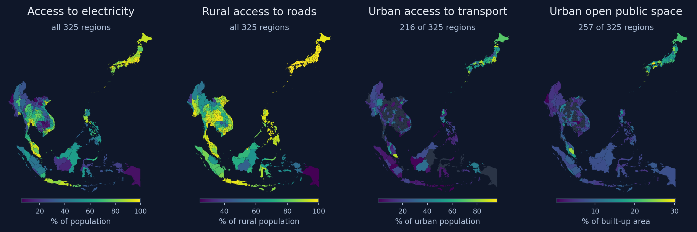
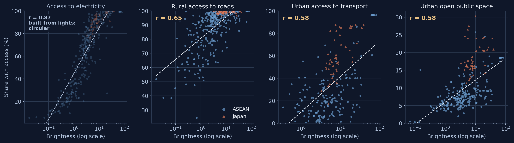
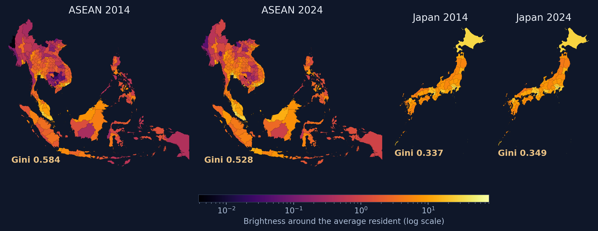
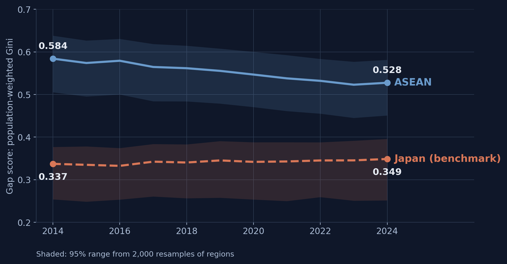
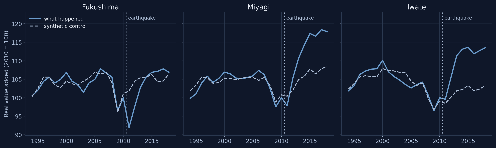
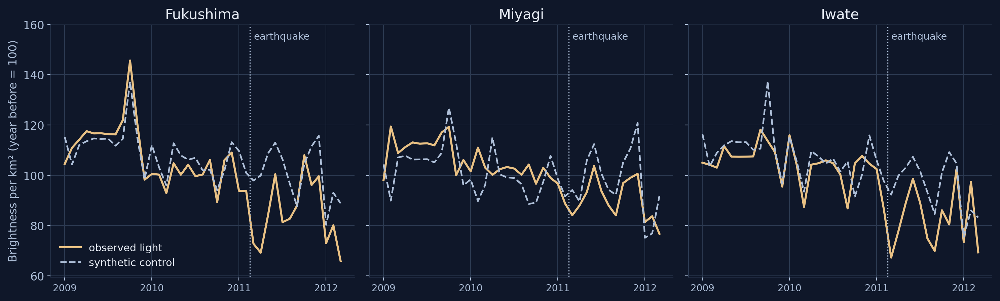
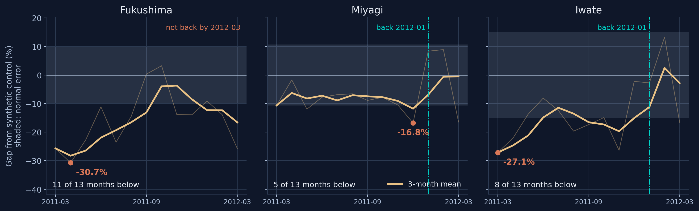
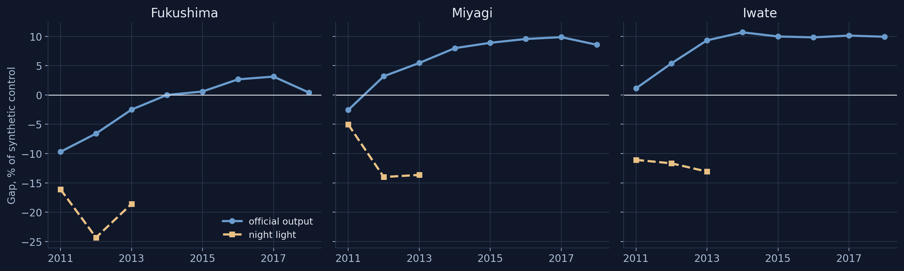
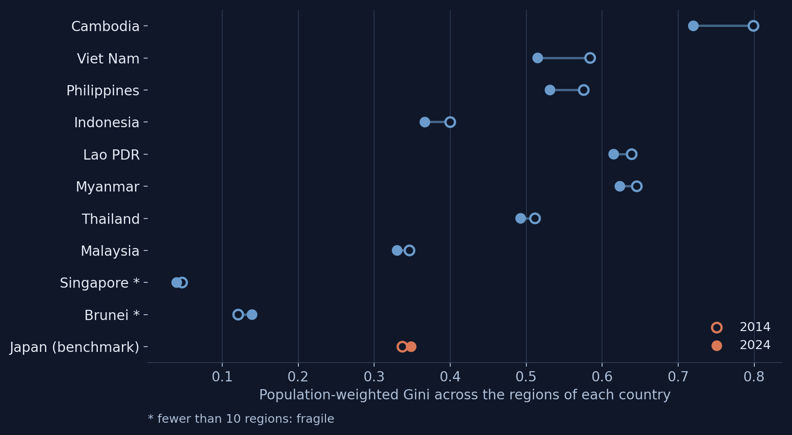
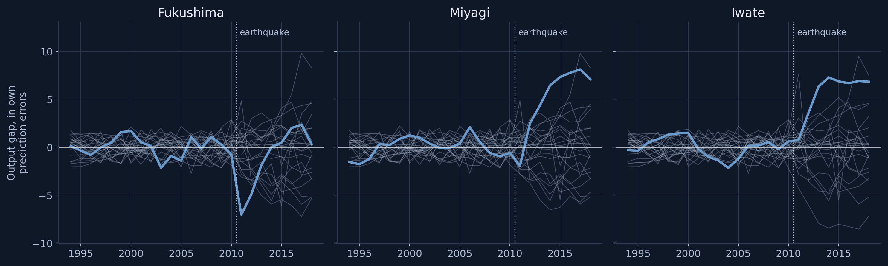

## Infrastructure is measured once a decade, and stops at the border

[Why monitoring, not measuring]{.kicker}

:::: {.columns}
::: {.column width="50%"}
[\$210 bn]{.bignum}
[per year of climate-adjusted infrastructure investment needed in Southeast Asia, 2016–2030 (5.7% of GDP)]{.bignum-label}
:::
::: {.column width="50%"}
[\$102 bn]{.bignum}
[annual investment gap; the last full assessment is from 2017, with no successor]{.bignum-label}
:::
::::

[Needs assessments are costly, infrequent and national. A satellite monitor can be updated every year, one tier below the nation.]{.takeaway .fragment}

[Source: ADB (2017), *Meeting Asia's Infrastructure Needs*.]{.src}

::: {.notes}
≈0:30 → 1:20. The problem is less measuring infrastructure than monitoring it. ADB's last full needs assessment is nearly a decade old. Comparable subnational statistics stop at the border in ASEAN; Japan is the exception, which is why it is our benchmark. The policy focus has shifted from recovery to resilience: we need to know where infrastructure is thin, how badly it fails, how fast it returns.
:::

## At 01:30, the light that remains is installed infrastructure {background-image="img/orbit-night.webp" background-opacity="0.45"}

[The idea]{.kicker}

The VIIRS satellites cross the equator at about **01:30 local time**. Homes and shops are dark; streets, highways, ports, industrial estates and public buildings are still lit.

::: {.duo}

97.3%brightness lost overnight by a sports field (activity lighting)

4.6%lost by an administrative building (infrastructure lighting)

:::

[We read night light as a measure of **infrastructure**, not of income.]{.takeaway .fragment}

[Drone evidence from Wuhan: Li et al. (2020).]{.src}

::: {.notes}
≈1:20 → 2:10. The literature uses lights as a proxy for GDP and runs into trouble: lights predict levels well but changes poorly. We take a different step and treat the infrastructure reading as the object of study. Caveat for Q&A: city streetlights are only part of post-midnight light (about 13% in Tucson); the claim is the broader one, persistent installed outdoor lighting.
:::

## 325 regions, eleven years, three questions

[Data and roadmap]{.kicker}

278 first-level regions in the ten ASEAN member states + 47 Japanese prefectures · VIIRS 2014–2024 · brightness around the average resident (population-weighted)

::: {.cards}

<b>1. Access</b>Can access to infrastructure be seen from orbit?Section 2 · Jiang Qian

<b>2. Inequality</b>Is the gap between regions closing?Section 3 · Li Xiaomeng

<b>3. Disaster</b>Can we see infrastructure fail and recover?Section 4 · Carlos Mendez

:::

::: {.notes}
≈2:10 → 2:40. One instrument, three uses. Japan is measured with the same sensor, the same variable, the same years and the same method, so it is a fair benchmark: a country that has finished the build-out ASEAN is still doing.
:::

## NASA already maps access from orbit, but only once

[1 · Access]{.kicker}

[Each indicator is a single snapshot: none can tell us whether access is improving.]{.takeaway .fragment}

::: {.notes}
≈2:40 → 3:40. Electricity (SDG 7.1.1), rural roads (9.1.1), urban transit (11.2.1), urban open space (11.7.1). Japan is at the top on every measure; the dark interiors of Borneo, Papua and upland Southeast Asia are at the bottom. Nothing here came from a national statistical office. Warning: the electricity measure is itself built from lit pixels; it puts Brunei at 38.9% and Cambodia at 34.2%, where surveys say near-universal access.
:::

## Brighter regions have better access to infrastructure

[1 · Access]{.kicker}

[Lights agree with three indicators that use no lights at all: roads 0.65, transit 0.58, open space 0.58. And lights are annual since 1992.]{.takeaway .fragment}

::: {.notes}
≈3:40 → 4:55. Electricity, at 0.87, is close to a variable agreeing with itself, so we keep it out of the argument. Qualifications: within countries the agreement is weaker (0.47 roads, 0.37 transit); holding population and area fixed leaves 0.39 and 0.35 (backup B1). This is agreement, not causation. The indicators are photographs; lights are the only measure that moves.
:::

## ASEAN brightened, and its darkest regions brightened most

[2 · Inequality]{.kicker}

[Japan is near-uniformly bright; its 2014 and 2024 maps are hard to tell apart.]{.takeaway .fragment}

::: {.notes}
≈4:55 → 5:45. The average ASEAN resident moves from 6.54 to 9.74 over the decade, Japan from 18.24 to 20.08. In 2024 the brightest ASEAN region is about 20,558 times the dimmest, against about 11.7 times in Japan.
:::

## Regional inequality fell while Japan stayed flat

[2 · Inequality]{.kicker}

[ASEAN: −0.057 (95% range −0.072 to −0.042), while average brightness rose. Levelling up, not levelling down.]{.takeaway .fragment}

::: {.notes}
≈5:45 → 6:45. The change is modest, about one point every two years from a high level. Japan: 0.337 to 0.349, indistinguishable from no change; this flatness is what a built-out distribution looks like. Qualifications: the decline stalls after 2023; only 3 of 10 member states (Viet Nam, Philippines, Thailand) have a decline whose range excludes zero (backup B2); most inequality is within member states. Robust to equal weights and to dropping Singapore or Myanmar (backup B3).
:::

## Half of ASEAN lived below Japan's dimmest prefecture. Now a third does. {background-color="#1a3a8a"}

[2 · Inequality]{.kicker}

[50.7% → 31.5%]{.bignum}

[share of the ASEAN population living in regions dimmer than Shimane, 2014 → 2024 (191 → 135 of 278 regions)]{.bignum-label}

[This is the single number we would put in front of a finance ministry.]{.takeaway .fragment}

::: {.notes}
≈6:45 → 7:30. A threshold that needs no index. Like-for-like caveat: the ASEAN Gini includes inequality between member states; against the population-weighted average of within-country Ginis (0.493 to 0.455), the gap to Japan narrows from 0.156 to 0.107.
:::

## One shock, three exposures: a synthetic control for each prefecture {background-image="img/tohoku-coast.webp" background-opacity="0.3"}

[3 · Disaster]{.kicker}

11 March 2011: the Great East Japan Earthquake hit **Fukushima, Miyagi and Iwate**. Only Fukushima also had a nuclear accident and a long evacuation.

::: {.flow}

<b>22 untouched prefectures</b>the donor pool

→

<b>Weighted blend</b>matched to the prefecture over 1994–2010

→

<b>Synthetic control</b>what would have happened without the quake

→

<b>Effect</b>the gap that opens after March 2011

:::

[Run three times, unchanged: official output, annual light, then monthly light.]{.takeaway .fragment}

::: {.notes}
≈7:30 → 8:20. Japan is where official statistics already measured the answer, so the satellite estimate can be checked rather than asserted. Outcome: total real value added (R-JIP 2021), not per person: per person Fukushima ends 9.3% above its synthetic control, against 0.4% as a total, because its population fell. Choosing the denominator would have chosen the finding.
:::

## Official output: Fukushima fell deepest; Miyagi and Iwate ended above

[3 · Disaster]{.kicker}

[2011: Fukushima −9.7%, Miyagi −2.6%, Iwate +1.1%. By 2018 all three are above their synthetic controls: reconstruction money, not a benefit from disaster.]{.takeaway .fragment}

::: {.notes}
≈8:20 → 9:20. Fukushima's gap closed only in 2014, Miyagi's in 2012. By 2018: Fukushima +0.4%, Miyagi +8.6%, Iwate +9.9%. Placebo p-values: Miyagi 0.043, Iwate 0.087, Fukushima 0.348; the test rewards large, sustained departures, so what is statistically visible is the response, not the damage (backup B4). Agrees with Zheng and Wang (2024) and Smith et al. (2025).
:::

## Monthly light drops in the month of the quake, in all three

[3 · Disaster]{.kicker}

[March 2011: Fukushima −25.7%, Miyagi −10.6%, Iwate −27.1% below the synthetic control.]{.takeaway .fragment}

::: {.notes}
≈9:20 → 10:10. Annual light already shows all three going dark and staying dark through 2013 (Fukushima −16.1%, Miyagi −5.0%, Iwate −11.1% in 2011). Monthly data give 206 pre-quake observations instead of 17, so we can date the damage and measure depth and duration. Robust to every specification tried. Caveat: usable modern monthly images begin in 2012-04, so earlier months are a reconstruction; the window stops at 2012-03.
:::

## Depth is not duration: Fukushima stays down longest

[3 · Disaster]{.kicker}

[Fukushima bottoms at −30.7% and is below its normal error 11 of 13 months; Iwate 8, Miyagi 5. Annual data cannot make this distinction.]{.takeaway .fragment}

::: {.notes}
≈10:10 → 11:10. Iwate's drop is as deep as Fukushima's in March but it returns by 2012-01, like Miyagi. Fukushima is never the first of the three to return, under any setting tried. The evacuation zone stays dark: this is denied access, not just damage.
:::

## Output recovers with reconstruction; light returns only with infrastructure

[3 · Disaster]{.kicker}

[The two measures agree about the first year, then diverge. Rebuildable damage and denied access are different problems.]{.takeaway .fragment}

::: {.notes}
≈11:10 → 12:20. Output in Miyagi and Iwate rises with reconstruction spending; their brightness stays below. The accounts measure activity, including rebuilding; the 01:30 light measures installed, energised infrastructure. Annual light stops in 2013 because the old sensor ends there: three post-years of light against eight of output is not a fair fight. If asked about significance: with 22 comparison prefectures no luminosity estimate is statistically decisive, and a monthly permutation test over-rejects about five-fold, so it is not reported (backup B5). Population-weighted light sees a smaller Fukushima fall (12.0%) than the area average (16.1%): match the measure to the geography of the shock (backup B6).
:::

## Three policy outputs from one instrument

[Implications]{.kicker}

::: {.cards}

<b>Target lagging clusters</b>Persistent dark regions straddle borders (Myanmar–Lao PDR–Cambodia–Thailand uplands, Borneo). Target clusters, not countries, in line with ASEAN connectivity corridors.

<b>Deficit or vulnerability?</b>Are the places hit deepest and longest the ones already behind? If yes, one budget line; if not, two.

<b>An annual monitor</b>Updated every year at negligible cost, one tier below the nation. We propose a public dashboard that ADBI could host.

:::

[Next step: daily light. Blackouts last about four days; monthly composites average them away.]{.takeaway .fragment}

::: {.notes}
≈12:20 → 13:40. The monitor complements a decadal needs assessment, it does not replace it. A monthly panel for all 325 regions, 2014–2024, is already assembled, so the same design applies to any event the modern sensor has seen. Close: an annual, subnational, near-zero-cost monitor of infrastructure inequality, and soon of resilience.
:::

## Thank you {.thanks background-image="img/orbit-night.webp" background-opacity="0.55"}

[Access, inequality and disaster recovery can all be seen in night light.]{.thanks-lead}

::: {.authors}

Carlos MendezNagoya UniversityPresenter · Section 4

Li XiaomengNagoya UniversitySection 3

Jiang QianIndependent researcherSection 2

:::

[Chapter for the ADBI volume *Building Sustainable Infrastructure in Asia and the Pacific*]{.thanks-meta}

[[carlos-mendez.org](https://carlos-mendez.org) · Questions and comments are very welcome]{.thanks-contact}

::: {.notes}
≈13:40 → 14:00. Hand over to Q&A. Backup slides follow (press O for the overview or M for the menu to jump).
:::

# Backup slides {.divider background-color="#1a3a8a"}

[For questions]{.act}

## B1 · How strongly lights agree with each access indicator

::: {.small-table}
| Indicator | Built from | N | Raw r | Within r | Net r | Spearman ρ |
|---|---|---:|---:|---:|---:|---:|
| SDG 7.1.1 Electricity (circular) | VIIRS + population | 324 | 0.87 | 0.81 | 0.76 | 0.90 |
| SDG 9.1.1 Rural road access | OSM + GHSL + population | 324 | [0.65]{.key} | 0.47 | 0.39 | 0.68 |
| SDG 11.2.1 Urban transit access | OSM + GHSL + population | 216 | 0.58 | 0.37 | 0.35 | 0.51 |
| SDG 11.7.1 Urban open public space | OSM + GHSL | 257 | 0.58 | 0.27 | 0.54 | 0.64 |
:::

[Within: each country's mean removed from both sides. Net: log population and log area held fixed. Luminosity in logs, 2020. Transit exists only where a mapped urban centre exists (216 regions).]{.comment}

## B2 · Within-country inequality, 2014 versus 2024

[9 of 10 member states fall, but only 3 have a 95% range excluding zero: Viet Nam, the Philippines, Thailand.]{.comment}

## B3 · The inequality decline is robust

::: {.small-table}
| Specification (ASEAN) | Regions | Gini 2014 | Gini 2024 | Change | 95% range |
|---|---:|---:|---:|---:|---|
| Headline (population-weighted) | 278 | 0.584 | 0.528 | [−0.057]{.key} | [−0.072, −0.042] |
| Unweighted (one weight per region) | 278 | 0.714 | 0.635 | −0.079 | [−0.089, −0.067] |
| Excluding ever-dark units | 276 | 0.584 | 0.528 | −0.057 | [−0.072, −0.041] |
| Excluding Singapore | 269 | 0.565 | 0.516 | −0.050 | [−0.063, −0.036] |
| Excluding Myanmar | 261 | 0.572 | 0.512 | −0.060 | [−0.076, −0.044] |
:::

[Paired region bootstrap, 2,000 draws, each region resampled with its full 11-year path.]{.comment}

## B4 · Official output against every untouched prefecture

[Placebo p-values: Miyagi 0.043, Iwate 0.087, Fukushima 0.348. The test rewards large, sustained departures, so it sees the reconstruction response more clearly than the damage.]{.comment}

## B5 · Is the monthly light record usable? A pre-registered gate

::: {.small-table}
| Check | Measured | Bound | Result | Consequence |
|---|---:|---:|---|---|
| Year-on-year same-month difference | 0.945 | 0.600 | pass | — |
| Lag-12 over lag-1 autocorrelation | 0.964 | 0.600 | pass | — |
| Month-to-month volatility | 0.948 | 0.600 | pass | — |
| Monthly composites average to the annual panel | 0.000 | 0.005 | pass | — |
| Hokkaido 2018-09 blackout is visible | 0.050 | −1.000 | [fail]{.key} | bounds the claim |
| Permutation rejection rate at nominal 5% | 0.273 | 0.120 | [fail]{.key} | inference dropped |
:::

[Bounds fixed before the gate was first run. Monthly light measures how long infrastructure stays down, not whether it went down for a few days.]{.comment}

## B6 · Which light measure sees the disaster?

::: {.small-table}
| 2011 gap from the synthetic control (%) | Fukushima | Miyagi | Iwate |
|---|---:|---:|---:|
| Mean brightness per km² (headline) | [−16.1]{.key} | −5.0 | −11.1 |
| Total light emitted | −16.7 | −1.4 | −15.9 |
| Population-weighted mean (inequality variable) | −12.0 | +4.4 | −11.3 |
:::

[Population weighting plays down the rural coast and evacuation zone that went dark. Match the measure to the geography of the shock.]{.comment}
