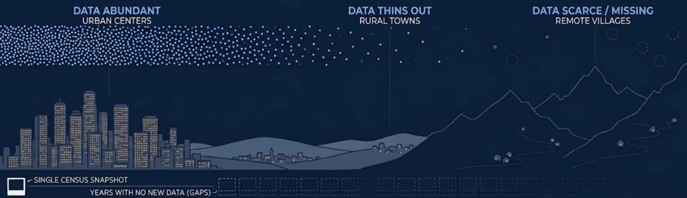
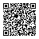
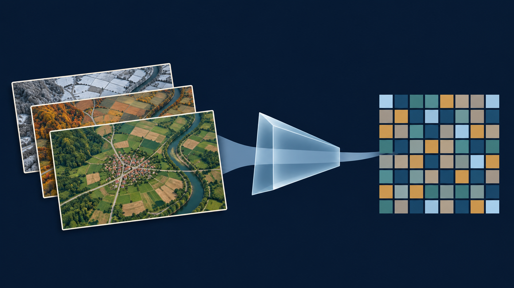
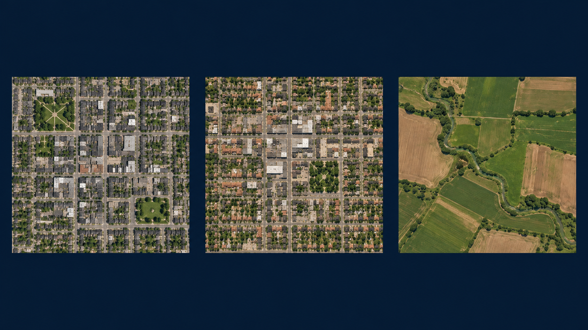
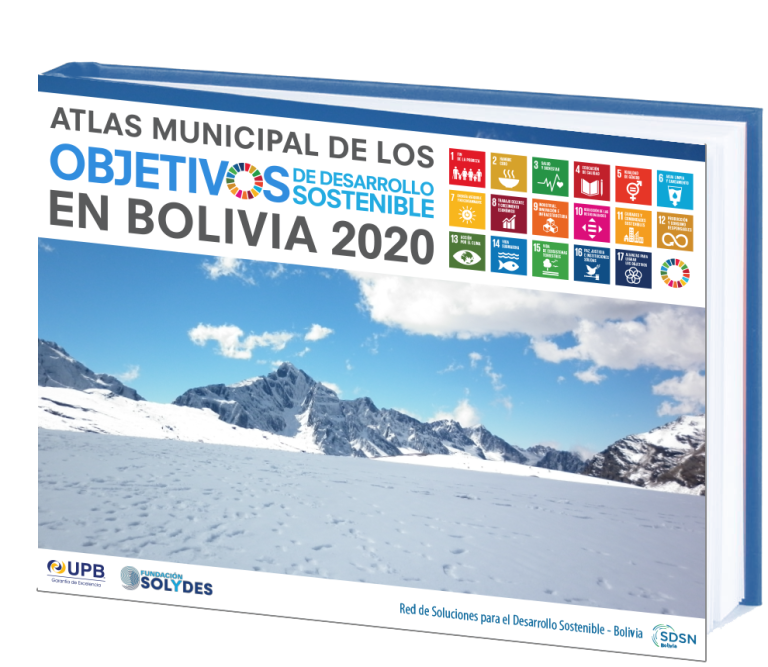
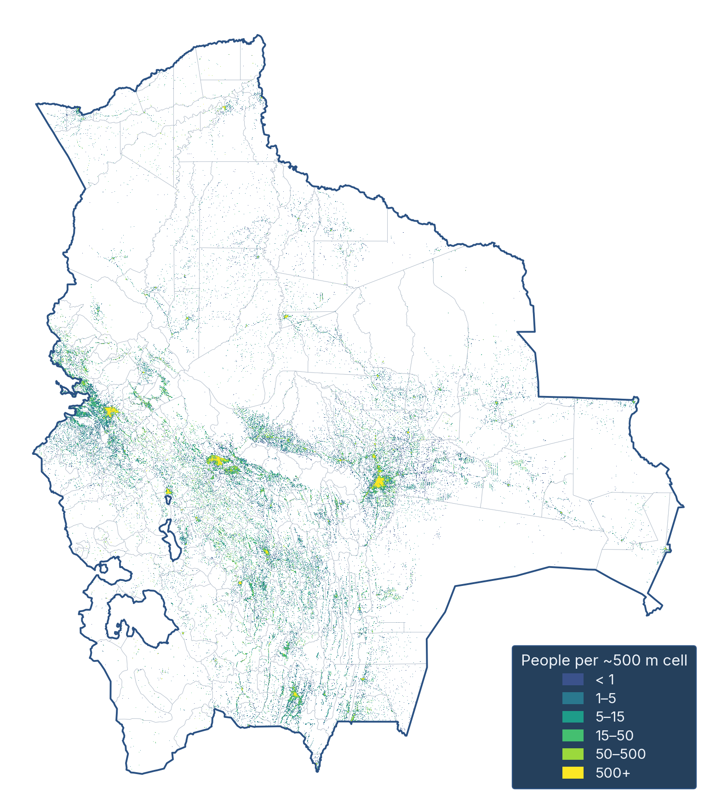

## Local decisions need information between surveys {.picture-slide}

[The information gap]{.kicker}

{.gap-illustration fig-alt="Conceptual illustration of a lit city, rural towns and remote villages, with fewer data observations over more remote places."}

:::: {.plain-pair}
::: {}
Where are needs concentrated?
:::
::: {}
Which places need a closer look?
:::
::::

[Repeated satellite observations could help fill the gaps between surveys.]{.takeaway}

```{=html}
<a class="jasid-slides-qr" href="https://carlos-mendez.org/presentations/mapping-local-development-ai-satellite-imagery/slides/" target="_blank" rel="noopener" aria-label="Open the online JASID slides in a new tab"><span>Scan for slides</span></a>
```

::: {.notes}
Begin with the practical problem, not the technology. Local decisions require information about small places. Surveys and censuses remain essential, but collecting them frequently everywhere is difficult. Satellite observations offer repeated coverage. The question is whether we can turn that coverage into useful, tested information about development.

Image: illustrative AI-generated artwork reused from the Bolivia deck, figures/README.md. This image is not evidence about the coverage of any particular survey. Source study: Mendez, Predicting and monitoring local development from outer space: Evidence from the Bolivian municipalities, frozen snapshot in quarcs-lab/project2026e-slides.
:::


# What an AI embedding actually is {background-color="#06101F" .center}

[Act I · The idea]{.kicker}


## AI compresses a year of images into 64 numbers {.picture-slide}

[From many observations to one compact description]{.kicker}

{.wide-illustration fig-alt="Illustrative repeated observations of one place pass through a compression metaphor into a grid representing one numerical summary."}

:::: {.stage-labels .stage-labels-embedding}
::: {}
Many images of one place, across a year
:::
::: {}
AI model
:::
::: {}
64 numbers: an *embedding*
:::
::::

[The 64 numbers become the input to a separate prediction model.]{.takeaway}

[Google DeepMind AlphaEarth Foundations: one set of 64 numbers for every 10 × 10 metre square, each year.]{.source}

::: {.notes}
This is the entire idea of the talk. We start with repeated observations of a place. A general-purpose AI model compresses the observations into a useful numerical description called an embedding. We can then ask whether those numerical descriptions help predict an outcome for which we have measured examples.

Define the unfamiliar word only after the audience has seen its purpose. A vector is an ordered list of numbers. AlphaEarth's released annual dataset has 64 dimensions on a 10-metre grid. The grid spacing does not establish 10-metre accuracy for any downstream poverty estimate.

Each position in the vector has a consistent place in the representation, but an individual dimension has no fixed standalone semantic label such as income, roads or vegetation. The pattern across dimensions is what matters. A useful analogy is a recipe of coordinates: the combined position carries information even when a single coordinate is hard to interpret. Avoid describing this as principal components, because AlphaEarth is a learned nonlinear representation, not PCA.

The picture is an analogy, not AlphaEarth's literal architecture. It is a new AI-generated scientific illustration. The colored cells represent numerical features, not a geographic grid or a poverty classification.

Naming: the source study calls these "daytime embeddings", to contrast them with nighttime lights. The slides say "AI embeddings" for a general audience; both names refer to the same AlphaEarth data. Technical qualification: generation uses optical and thermal observations from Landsat, optical Sentinel-2 and radar Sentinel-1. Broader sources such as elevation and geolocated text participate in training as targets. Thus the dataset is not daytime-optical-only. Sources: https://deepmind.google/blog/alphaearth-foundations-helps-map-our-planet-in-unprecedented-detail/ , https://developers.google.com/earth-engine/datasets/catalog/GOOGLE_SATELLITE_EMBEDDING_V1_ANNUAL , and the AlphaEarth paper Table S1 and supplement S16.2.2, https://arxiv.org/html/2507.22291v1 .
:::


## Similar landscapes get similar numbers, not a poverty label {.picture-slide}

[Similarity, not a verdict]{.kicker}

{.wide-illustration fig-alt="Three illustrative overhead landscapes: two towns with similar street patterns and a contrasting agricultural landscape."}

:::: {.stage-labels .stage-labels-tiles}
::: {}
**Town A**
:::
::: {}
**Town B**<br>numbers close to Town A
:::
::: {}
**Farmland**<br>very different numbers
:::
::::

[Resemblance helps prediction, but places that look alike can still differ in poverty.]{.takeaway}

::: {.notes}
Invite the audience to compare the first two places with the agricultural landscape. A model can encode a kind of resemblance without a person naming every roof, road or field. In the embedding space, similar observed characteristics can give similar vectors. This is intuition, not a measured nearest-neighbor result for these pictures. We have not extracted embeddings from these invented scenes.

Similarity is not identity and does not guarantee similar poverty. The model still needs local measured outcomes and validation. Image: new AI-generated illustration. Source for embedding similarity: Earth Engine dataset catalog and DeepMind AlphaEarth overview.
:::


## Prediction still needs measured poverty data {.pipeline-slide}

[Two separate learning steps]{.kicker}

:::: {.pipeline .pipeline-emb}
::: {.pipe-step-label}
[Step 1]{.pipe-num}
Describe the landscape
:::
::: {.pipe-box}
Satellite images of a place, across a year
:::
::: {.pipe-arrow}
→
:::
::: {.pipe-box}
General AI model
:::
::: {.pipe-arrow}
→
:::
::: {.pipe-box .pipe-out}
64 numbers per place
:::
::::

[The AI model never sees any poverty data.]{.pipe-note .pipe-note-emb}

:::: {.pipeline .pipeline-pov}
::: {.pipe-step-label}
[Step 2]{.pipe-num}
Learn the poverty relationship
:::
::: {.pipe-box}
64 numbers, averaged for each municipality
:::
::: {.pipe-plus}
\+
:::
::: {.pipe-box}
Measured poverty in 339 municipalities
:::
::: {.pipe-arrow}
→
:::
::: {.pipe-box .pipe-out}
Prediction model, tested on places it has not seen
:::
::::

[The measured poverty data is what gives the prediction its meaning.]{.takeaway}

::: {.notes}
Keep these steps separate. AlphaEarth was not trained in this study to predict poverty. The study takes its general-purpose representation and trains a separate supervised prediction model using measured municipal outcomes. A useful representation alone does not tell us which places have more or less poverty.

The Bolivia study uses random forests, tuned within nested cross-validation. A random forest combines many decision trees. Technical details are not needed on the slide, but the independent outcome and the held-out evaluation are essential to explain. Sources: source Bolivia deck, Data and methods; source tables in the local sources/tables directory; AlphaEarth paper https://arxiv.org/html/2507.22291v1 .
:::


# Does it work for poverty in Bolivia? {background-color="#06101F" .center}

[Act II · The evidence]{.kicker}


## 339 Bolivian municipalities give a concrete test {.study-slide}

:::: {.two-columns}
::: {.image-column}
{fig-alt="Cover of the Municipal Atlas of the Sustainable Development Goals in Bolivia 2020."}
:::
::: {.text-column}
[Bolivia · municipal outcomes for 2017]{.kicker}

[SDG 1 "No Poverty" index]{.hero-small}

Scored from 0 to 100. Higher means **less** poverty.

[An achievement index: not the poverty rate, and not a count of poor households.]{.quiet}

[One country, one clearly defined outcome.]{.takeaway}
:::
::::

[Outcome data: Andersen et al. (2020), Municipal Atlas of the Sustainable Development Goals in Bolivia.]{.source}

::: {.notes}
Introduce the case only after the audience understands embeddings. The Municipal Atlas supplies 2017 outcomes for 339 municipalities. This talk uses only SDG 1, the No Poverty index. It ranges from 0 to 100 with higher values indicating better achievement, hence less poverty. Do not describe it as the percentage of people in poverty or the number of poor households.

The broader research considers other development goals. They stay in the background here, but they are visible in the next charts, where poverty is the highlighted top row. Cover image: existing Atlas cover from the Bolivia deck. Study counts and outcome interpretation: original source deck and frozen sources/claims.toml. Underlying Atlas: Andersen et al. (2020).
:::


## Can nighttime lights tell us about poverty? {.evidence-slide}

[Each dot is one municipality]{.kicker}

```{=html}

```

[Brighter places tend to score higher, but the relationship is far from exact.]{.takeaway}

::: {.notes}
Each dot is a municipality. The horizontal axis is a single measure of nighttime lights: population-weighted mean VIIRS radiance. The axis is logarithmic, so equal distances represent equal ratios of brightness. The vertical axis is the No Poverty achievement index, not a poverty rate. Higher means less poverty. Hover a dot to name the municipality and its department.

Places with brighter lights tend to score higher, but municipalities with similar light levels can have quite different outcomes. This is an association, not evidence that lighting causes poverty reduction. All 339 observations come directly from the pinned study's original interactive scatter, decoded at full precision; the extract and the script that draws this chart are in slides/figures-src (ntl_sdg1_2017.csv, make_ntl_figures.py). Source: https://github.com/quarcs-lab/project2026e-slides/blob/bb860234b4c4f4f279509ae26cc4c1483fe10256/figures/fig-ntl-sdg1-scatter.html and scripts/fig-ntl-sdg1-scatter.py. VIIRS DNB Annual V2.1, population-weighted average band, 2017, nW/sr/cm².
:::


## R² compares a model with a simple guess {.evidence-slide .r2-slide}

[Reading the score we are about to use]{.kicker}

```{=html}

```

:::: {.r2-callout}
::: {.r2-number}
R² = 0.54
:::
::: {.r2-text}
The lights remove 54% of the squared error of the simple guess. R² of 0 is no better than the guess; 1 would be perfect.
:::
::::

[This fit uses the same places it describes. From here on, every score is tested on places the model has not seen.]{.source}

::: {.notes}
Start with the simplest prediction: give every municipality the same average score, 37.46. The gaps from each dot to that horizontal line are errors. Square these gaps and add them up. This is our 100% baseline.

Now use one nighttime-light measure to fit a line. Its total squared error is 45.6% of that baseline. R² measures the reduction: one minus 0.456 equals 0.544. In this descriptive fit, the line captures about 54.4% of the variation in the index. This is not the percentage of households classified correctly, a causal effect, or an accuracy rate.

The line is ordinary least squares fitted to all 339 observations, with SDG 1 achievement as the outcome and the natural logarithm of population-weighted mean radiance as the single predictor. R² = 0.5440562265527182. Both panels and the score use the same municipalities; the blue gaps show a representative subset of 14 (evenly spaced brightness ranks) only for legibility. The score uses all observations. This in-sample illustration cannot establish performance in new places. That requires held-out evaluation, which every chart from here on uses.

A held-out R² can be negative if the model does worse than its mean-only benchmark. You will see that at the bottom of the next two charts.

Do not confuse this one-predictor descriptive result with the study's 0.553 held-out nighttime-light result, which uses eight features in a random-forest model. Provenance: slides/figures-src/make_ntl_figures.py recomputes 37.46, 45.6% and 0.544 from the data and refuses to write the chart if any of them moves.
:::


## Averaged over empty land, the lights still read poverty better {.chart-slide}

:::: {.figure-split}
::: {.figure-main}
```{=html}

```
:::
::: {.figure-side}
[Poverty (SDG 1)]{.side-head}

:::: {.side-stat}
[■]{.mark-lights} Nighttime lights [0.52]{.side-num .num-lights}
::::

:::: {.side-stat}
[●]{.mark-emb} AI embeddings [0.38]{.side-num .num-emb}
::::

[The richer AI data loses. The embeddings lead on only 8 of the 15 goals.]{.side-take}

[Every pixel counts the same. Out-of-sample R², 339 municipalities.]{.source}
:::
::::

::: {.notes}
This is the puzzle the next two slides resolve. Every goal is tested out of sample, so these are held-out scores, not descriptive fits. Hover any row to read both values.

Read the highlighted top row: poverty. Nighttime lights 0.515, satellite embeddings 0.375. The richer predictor is losing. Across all 15 goals the embeddings lead on only 8, and on poverty and energy they clearly trail.

Note the bottom of the chart too: institutions sits near zero and goes slightly negative for the embeddings. A negative held-out R² means the model does worse than simply guessing the average. Keep that in mind for the limits slide.

Labels: the chart says "AI embeddings" where the source study says "daytime embeddings". Source: tbl-popweighting-master.csv and tbl-mon-featureset-comparison.csv, simple-aggregation columns.
:::


## Most land is empty, so weight each pixel by the people on it {.population-slide}

[The methodological turn]{.kicker}

:::: {.pop-split}
::: {.pop-map}
{fig-alt="Population distribution across Bolivia from the source study, with brighter cells indicating more people."}
:::
::: {.pop-explain}
:::: {.weight-row}
[Simple average]{.weight-head}

::: {.pixels}
[]{.px .px-empty} []{.px .px-empty} []{.px .px-empty} []{.px .px-town} []{.px .px-empty} []{.px .px-empty} []{.px .px-town} []{.px .px-empty}
:::

[Every pixel gets one vote, so empty land outvotes the towns.]{.weight-text}
::::

:::: {.weight-row}
[Weighted by population]{.weight-head .weight-head-pop}

::: {.pixels .pixels-weighted}
[]{.px .px-empty} []{.px .px-empty} []{.px .px-empty} []{.px .px-town} []{.px .px-empty} []{.px .px-empty} []{.px .px-town} []{.px .px-empty}
:::

[Pixels count in proportion to the people living there.]{.weight-text}
::::

[A simple average lets empty terrain outvote the places where people actually live.]{.takeaway}
:::
::::

[Population map from the source study (cells of roughly 500 metres). Brighter cells hold more people.]{.source}

::: {.notes}
Here is the explanation for the previous slide. The embedding starts at a small grid cell, but our outcome is municipal, so the pixel values have to be aggregated. A simple average treats every pixel equally, including vast uninhabited areas, and a Bolivian municipality can be enormous and almost empty. Population weighting emphasizes the landscapes where people actually live. It does not assign poverty to individual pixels or households.

The little squares on the right are a schematic, not data: eight pixels of one imaginary municipality, two of them settled. Under the simple average all eight count the same; under population weighting the settled ones dominate.

Nighttime lights are much less affected by this choice, because empty land is dark either way. That is why the simple average flattered the lights.

The population raster shown is an existing analytical figure from the Bolivia deck (fig-pop-raster.png), not generated imagery. Its roughly 500-metre cells refer to the population layer, not the 10-metre embedding grid. Source figure and provenance: quarcs-lab/project2026e-slides, scripts/fig-pop-raster.py and figures/README.md.
:::


## Weight by people, and the embeddings read poverty best {.chart-slide}

:::: {.figure-split}
::: {.figure-main}
```{=html}

```
:::
::: {.figure-side}
[Poverty (SDG 1)]{.side-head}

:::: {.side-stat}
[■]{.mark-lights} Nighttime lights [0.55]{.side-num .num-lights}
::::

:::: {.side-stat}
[●]{.mark-emb} AI embeddings [0.69]{.side-num .num-emb}
::::

[Same models, same tests. The embeddings jump from 0.38 to 0.69 and now lead on 14 of the 15 goals.]{.side-take}

[Pixels weighted by population. Out-of-sample R², 339 municipalities.]{.source}
:::
::::

::: {.notes}
Same chart, one change: pixels are now weighted by population before being averaged to the municipality. The model and the test design are identical.

Poverty, the highlighted top row: nighttime lights 0.553, satellite embeddings 0.691. Compare with the slide before last, where the embeddings were at 0.375. Where we summarize the images matters as much as which images we use.

Across all 15 goals the embeddings now lead on 14, up from 8. The lead clears fold noise on only 5 of the 15, so do not oversell the goal-by-goal ordering. These are mean test-fold R² values, not the R² from pooling every out-of-fold prediction, not percent accuracy, and not the share of households correctly classified.

This is a large change in this study, not a guarantee that weighting always helps everywhere. Source: tbl-popweighting-master.csv, row Poverty (SDG 1); tbl-mon-featureset-comparison.csv, SDG 1 row, population-weighted columns.
:::


## How we test changes the score: 0.54 to 0.72 {.chart-slide}

:::: {.figure-split}
::: {.figure-main}
```{=html}

```
:::
::: {.figure-side}
[Poverty (SDG 1)]{.side-head}

:::: {.side-stat}
[○]{.mark-emb} Tested in a new region [0.54]{.side-num .num-ink}
::::

:::: {.side-stat}
[●]{.mark-emb} Tested in a familiar region [0.72]{.side-num .num-ink}
::::

[The honest answer is a range. The lower number is the fair guide for a region the model has never seen.]{.side-take}

[Lights and embeddings combined. New region: a whole department left out of training.]{.source}
:::
::::

::: {.notes}
This is the honesty slide. Each goal spans the two ways of testing, and the gap between them is the real uncertainty.

The hollow marker is the lower bound: an entire department is excluded from training, so the model must travel to a region it has never seen. The filled marker is the upper bound: a random municipal split, where test municipalities are scattered among places the model already knows.

For poverty: 0.537 under whole-department transfer, 0.721 under the random split. In the transfer test the embeddings alone no longer outperform nightlights (0.442 against 0.451), and it is the combination that holds up at 0.537. Spatial neighbours resemble one another, so a random split can be optimistic about performance in entirely new regions.

These two numbers are not a confidence interval and not bounds guaranteed for every deployment. They are two distinct evaluation designs. Neither establishes future-year performance or performance in another country. The dashed line marks 0.60. Sources: tbl-views-lodo.csv, SDG 1 row; tbl-mon-comprehensive.csv, SDG 1 row; tbl-mon-featureset-comparison.csv.
:::


## The satellite view recovers the geography of poverty {.map-slide}

```{=html}

```

:::: {.map-callout}
::: {.map-number}
80%
:::
::: {.map-text}
of municipalities fall in the same class on the predicted map (d) as on the measured map (a). Red: groups of places with low poverty. Blue: groups with high poverty.
:::
::::

::: {.notes}
Panel (a) classifies the measured No Poverty index. Panels (b), (c) and (d) apply the same spatial analysis to predictions from nightlights, embeddings and the two combined. Red indicates a cluster of high index values, hence lower poverty. Blue indicates a cluster of low index values, hence higher poverty, labelled "poverty trap" in the legend. Outliers differ from their neighbours. Grey denotes no significant local cluster at the study threshold.

Point at panel (d). The combined predictor agrees with the full measured classification for 79.646% of municipalities, displayed as 80%. This denominator includes the no-significant-cluster class; it is not 80% recovery of poverty clusters alone. Among the 104 measured high-high or low-low municipalities, agreement is 75%. For lights alone the figures are 77% and 53%; for embeddings alone 78% and 80%. Moran's I is 0.50 for the measured map and 0.50 for the combined prediction (0.33 lights, 0.60 embeddings).

Hover a municipality and all four panels highlight it together, so a question about any single place can be answered live. Do not interpret a cross-sectional cluster as evidence of a persistent causal poverty trap. The spatial weights and randomization specification follow the source study. Source: tbl-views-comparison-sdg1.csv and the original _fourview.py.
:::


## Three findings to take home {.recap-slide}

[Summary]{.kicker}

:::: {.recap}
::: {.recap-card}
[64]{.recap-num}

[numbers per place]{.recap-unit}

AI turns a year of satellite images into a compact description of each landscape.
:::
::: {.recap-card}
[0.38 → 0.69]{.recap-num}

[R² for poverty]{.recap-unit}

Averaging where people live, not over empty land, moves the embeddings from behind the lights to ahead of them.
:::
::: {.recap-card}
[0.54 to 0.72]{.recap-num}

[R² for poverty]{.recap-unit}

How we test matters. A region the model has never seen gives the honest, lower number.
:::
::::

[Satellite data can help map poverty, but only when measured data anchors and tests it.]{.takeaway}

::: {.notes}
Pause here and let the audience read. Three ideas carry the talk. First, an AI model can compress a year of satellite observations of a place into 64 numbers that describe the landscape. Second, how we summarize those numbers for a municipality matters: population weighting moved the embeddings from 0.375 to 0.691 on poverty. Third, how we test matters: the combined predictor scores 0.537 when a whole department is held out and 0.721 under a random split.

All three numbers are out-of-sample R² values from the earlier slides; nothing new is introduced here. The next slide says what these results cannot do.
:::


## The map says where to look, not what any household needs {.limits-slide}

[What the evidence supports]{.kicker}

:::: {.limits}
::: {.limit-card .limit-can}
[What the map can do]{.limit-head}

- Pick up patterns in settlements and the surrounding landscape
- Flag municipalities worth a closer look, with tested accuracy

[Then verify: check the uncertainty, run new surveys, ask local people.]{.limit-foot}
:::
::: {.limit-card .limit-cannot}
[What the map cannot tell us]{.limit-head}

- Income, needs and experiences inside individual households
- The causes of poverty, or which intervention would help

[A new year of images is not a poverty update until the model is checked again.]{.limit-foot}
:::
::::

[Local surveys and the knowledge of local people remain essential.]{.takeaway}

::: {.notes}
Return to people. These images do not directly observe income, household needs or the reasons people face deprivation. Municipal relationships cannot be assigned automatically to individual households. Prediction is not a causal explanation and cannot by itself tell us which intervention would help.

Recall the bottom of the dumbbell charts: institutions scored near zero, slightly negative. Goals built from things satellites can see (housing, roads, land cover) are readable. Goals built from things they cannot see are not.

The practical role is to help prioritize where to investigate, complement data collection, and inform discussion. The results shown test a single-year municipal relationship. They do not validate future-year poverty estimates. Annual embeddings make updated analysis possible, but an embedding change can reflect many landscape changes and cannot automatically be called a poverty change.

Additional risks include displaced or poorly measured outcome locations, unrepresentative training data, changed relationships in a new region or year, and error near a decision threshold. A high-resolution input does not remove these problems. Before operational targeting, evaluate error for the intended decision and population, test temporal transfer, consider fairness and local context, and keep measured social data central.
:::


## AI is most useful when local data anchors the map {background-color="#06101F" background-image="figures/fig-title-ai-satellite.webp" background-size="cover" background-position="center center" .closing-statement}

::: {.closing-line}
Many observations.<br>
A compact description.<br>
A prediction we still need to test.
:::

::: {.closing-author}
Carlos Mendez<br>
carlos-mendez.org
:::

```{=html}
<a class="jasid-slides-qr" href="https://carlos-mendez.org/presentations/mapping-local-development-ai-satellite-imagery/slides/" target="_blank" rel="noopener" aria-label="Open the online JASID slides in a new tab"><span>Scan for slides</span></a>
```

::: {.notes}
Close with the three ideas, pausing between them. Repeated Earth observations become manageable through a numerical representation. The representation can be useful for poverty prediction when measured outcomes anchor the model. Validation determines where that prediction deserves confidence.

Background: the same illustrative artwork as the cover. For discussion, the source study and all cited tables are documented in SOURCES.md accompanying the editable slide source. A PDF of these slides is linked on the presentation page.
:::
