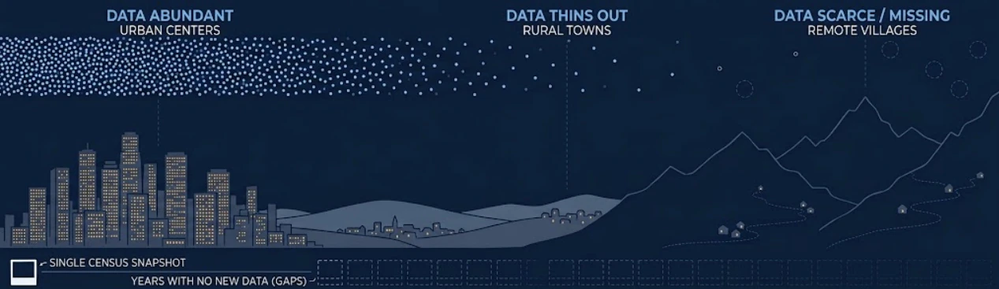
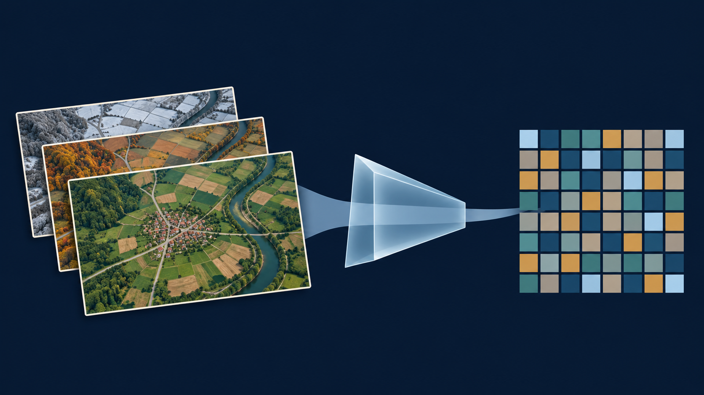
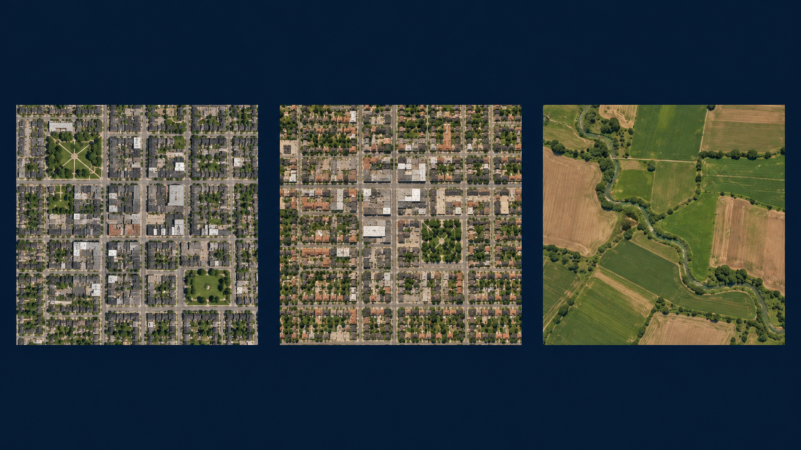
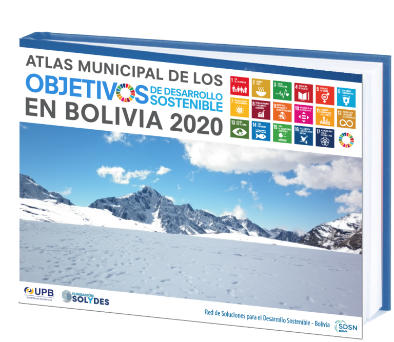
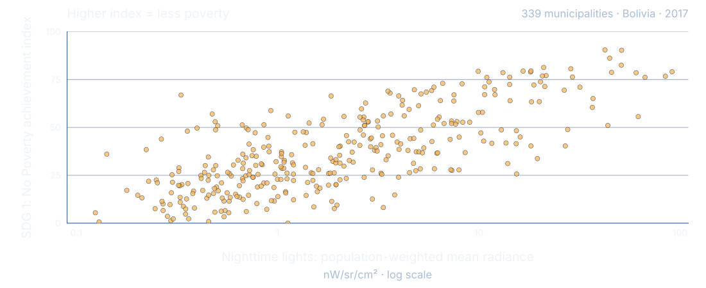
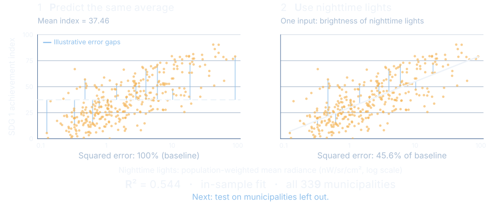
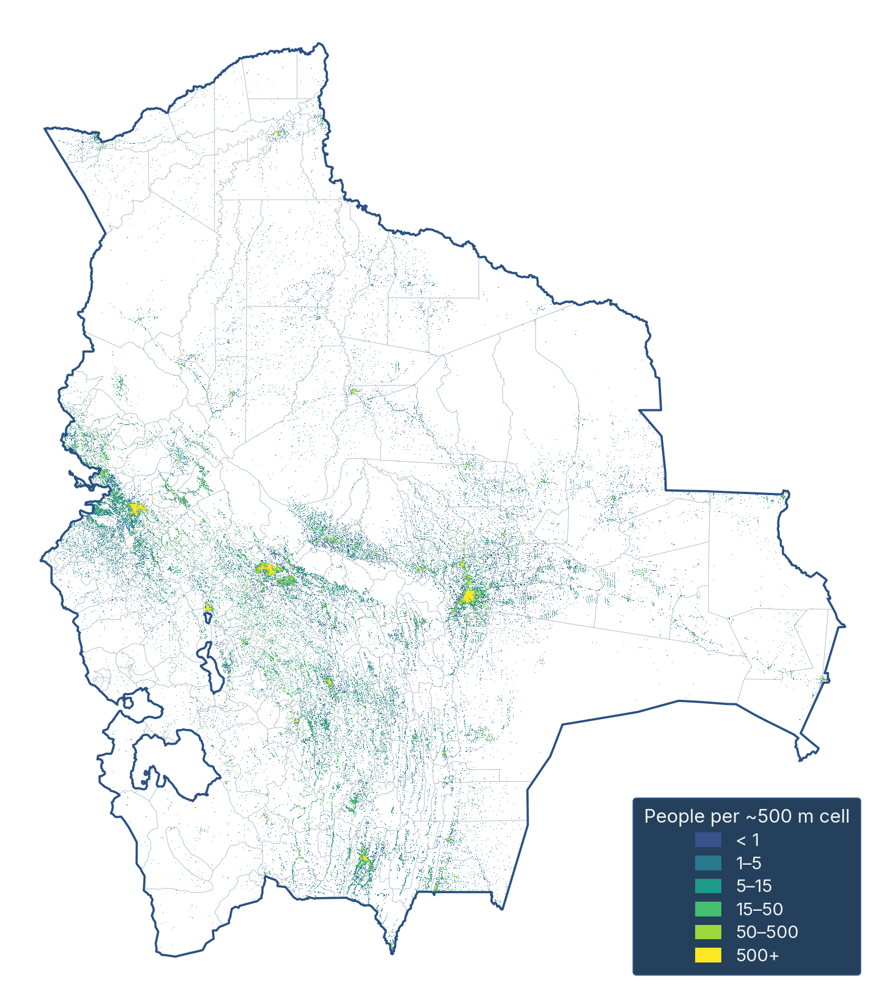

## Local decisions need information between surveys {.picture-slide}

[The information gap]{.kicker}

{.wide-illustration fig-alt="Conceptual illustration of a lit city, rural towns and remote villages, with fewer data observations over more remote places."}

::: {.plain-pair}
<div>Where are needs concentrated?</div>
<div>Which places need a closer look?</div>
:::

[Repeated satellite observations could help fill the gaps between surveys.]{.takeaway}

::: {.notes}
Begin with the practical problem, not the technology. Local decisions require information about small places. Surveys and censuses remain essential, but collecting them frequently everywhere is difficult. Satellite observations offer repeated coverage. The question is whether we can turn that coverage into useful, tested information about development.

Image: illustrative AI-generated artwork reused from the Bolivia deck, figures/README.md. This image is not evidence about the coverage of any particular survey. Source study: Mendez, Predicting and monitoring local development from outer space: Evidence from the Bolivian municipalities, frozen snapshot in quarcs-lab/project2026e-slides.
:::


# What an AI embedding actually is {background-color="#06101F" .center}

[Act I · The idea]{.kicker}


## AI compresses a year of images into 64 numbers {.picture-slide}

[From many observations to one compact description]{.kicker}

{.wide-illustration fig-alt="Illustrative repeated observations of one place pass through a compression metaphor into a grid representing one numerical summary."}

::: {.three-labels}
<div>Many observations</div>
<div>AI model</div>
<div>64 numbers — an embedding</div>
:::

[The summary becomes an input to a separate prediction model.]{.takeaway}

[AlphaEarth Foundations releases one vector per 10 × 10 metre location, summarizing observations across a year. It combines optical imagery with radar; "daytime embeddings" is shorthand here.]{.source}

::: {.notes}
This is the entire idea of the talk. We start with repeated observations of a place. A general-purpose AI model compresses the observations into a useful numerical description called an embedding. We can then ask whether those numerical descriptions help predict an outcome for which we have measured examples.

Define the unfamiliar word only after the audience has seen its purpose. A vector is an ordered list of numbers. AlphaEarth's released annual dataset has 64 dimensions on a 10-metre grid. The grid spacing does not establish 10-metre accuracy for any downstream poverty estimate.

Each position in the vector has a consistent place in the representation, but an individual dimension has no fixed standalone semantic label such as income, roads or vegetation. The pattern across dimensions is what matters. A useful analogy is a recipe of coordinates: the combined position carries information even when a single coordinate is hard to interpret. Avoid describing this as principal components, because AlphaEarth is a learned nonlinear representation, not PCA.

The picture is an analogy, not AlphaEarth's literal architecture. It is a new AI-generated scientific illustration. The colored cells represent numerical features, not a geographic grid or a poverty classification.

Technical qualification: generation uses optical and thermal observations from Landsat, optical Sentinel-2 and radar Sentinel-1. Broader sources such as elevation and geolocated text participate in training as targets. Thus the dataset is not daytime-optical-only. We retain the source study's daytime-embeddings comparison label, while using satellite embeddings for the technical explanation. Sources: https://deepmind.google/blog/alphaearth-foundations-helps-map-our-planet-in-unprecedented-detail/ , https://developers.google.com/earth-engine/datasets/catalog/GOOGLE_SATELLITE_EMBEDDING_V1_ANNUAL , and the AlphaEarth paper Table S1 and supplement S16.2.2, https://arxiv.org/html/2507.22291v1 .
:::


## Similar landscapes get similar numbers, not a poverty label {.picture-slide}

[Similarity, not a verdict]{.kicker}

{.wide-illustration fig-alt="Three illustrative overhead landscapes: two towns with similar street patterns and a contrasting agricultural landscape."}

[Resemblance can help prediction, but similar-looking places can have different poverty outcomes.]{.takeaway}

::: {.notes}
Invite the audience to compare the first two places with the agricultural landscape. A model can encode a kind of resemblance without a person naming every roof, road or field. In the embedding space, similar observed characteristics can give similar vectors. This is intuition, not a measured nearest-neighbor result for these pictures. We have not extracted embeddings from these invented scenes.

Similarity is not identity and does not guarantee similar poverty. The model still needs local measured outcomes and validation. Image: new AI-generated illustration. Source for embedding similarity: Earth Engine dataset catalog and DeepMind AlphaEarth overview.
:::


## Prediction still needs measured poverty data {.learning-slide}

[Two separate learning tasks]{.kicker}

::: {.learning-row}
[1]{.step-number}
<div>
### Describe the landscape
A general-purpose model produces embeddings. It was never shown a poverty outcome.
</div>
:::

::: {.learning-row}
[2]{.step-number}
<div>
### Learn the poverty relationship
Municipal summaries of those embeddings, trained against measured poverty outcomes.
</div>
:::

[The measured outcome data is what gives the prediction its meaning.]{.takeaway}

::: {.notes}
Keep these steps separate. AlphaEarth was not trained in this study to predict poverty. The study takes its general-purpose representation and trains a separate supervised prediction model using measured municipal outcomes. A useful representation alone does not tell us which places have more or less poverty.

The Bolivia study uses random forests, tuned within nested cross-validation. A random forest combines many decision trees. Technical details are not needed on the slide, but the independent outcome and the held-out evaluation are essential to explain. Sources: source Bolivia deck, Data and methods; source tables in the local sources/tables directory; AlphaEarth paper https://arxiv.org/html/2507.22291v1 .
:::


# Does it work for poverty in Bolivia? {background-color="#06101F" .center}

[Act II · The evidence]{.kicker}


## Bolivia's 339 municipalities give a concrete test {.study-slide}

::: {.two-columns}
::: {.image-column}
{fig-alt="Cover of the Municipal Atlas of the Sustainable Development Goals in Bolivia 2020."}
:::
::: {.text-column}
[Bolivia · municipal outcomes for 2017]{.kicker}

[SDG 1 "No Poverty" index]{.hero-small}

Scored 0–100. Higher means **less** poverty.

[This is an achievement index, not the poverty rate and not a count of poor households.]{.quiet}

[One application, one clearly defined outcome.]{.takeaway}
:::
:::

[Outcome: Andersen et al. (2020), Municipal Atlas of the Sustainable Development Goals in Bolivia.]{.source}

::: {.notes}
Introduce the case only after the audience understands embeddings. The Municipal Atlas supplies 2017 outcomes for 339 municipalities. This talk uses only SDG 1, the No Poverty index. It ranges from 0 to 100 with higher values indicating better achievement, hence less poverty. Do not describe it as the percentage of people in poverty or the number of poor households.

The broader research considers other development goals. They stay in the background here, but they are visible in the next charts, where poverty is the top row. Cover image: existing Atlas cover from the Bolivia deck. Study counts and outcome interpretation: original source deck and frozen sources/claims.toml. Underlying Atlas: Andersen et al. (2020).
:::


## Can nighttime lights tell us about poverty? {.evidence-slide}

[Each dot is one municipality]{.kicker}

{.evidence-figure fig-alt="Scatter of all 339 Bolivian municipalities in 2017. The x axis is population-weighted mean nighttime-light radiance on a log scale. The y axis is the SDG 1 achievement index, from 0 to 100; higher means less poverty."}

[Brighter places tend to score higher, but the relationship is far from exact.]{.takeaway}

[SDG 1 is an achievement index: higher means less poverty. Source: Bolivia study, 2017 municipal data.]{.source}

::: {.notes}
Each dot is a municipality. The horizontal axis is a single measure of nighttime lights: population-weighted mean VIIRS radiance. The axis is logarithmic, so equal distances represent equal ratios of brightness. The vertical axis is the No Poverty achievement index, not a poverty rate. Higher means less poverty.

Places with brighter lights tend to score higher, but municipalities with similar light levels can have quite different outcomes. This is an association, not evidence that lighting causes poverty reduction. All 339 observations come directly from the pinned study's original interactive scatter, decoded at full precision. The SDG 1 outcomes match the source CSV exactly. Source: https://github.com/quarcs-lab/project2026e-slides/blob/bb860234b4c4f4f279509ae26cc4c1483fe10256/figures/fig-ntl-sdg1-scatter.html and scripts/fig-ntl-sdg1-scatter.py. VIIRS DNB Annual V2.1, population-weighted average band, 2017, nW/sr/cm².
:::


## R² compares a model with predicting the average {.evidence-slide}

[Reading the score we are about to use]{.kicker}

{.evidence-figure fig-alt="The same 339 municipalities appear in two panels. On the left, everyone is assigned the mean SDG 1 index, 37.46. On the right, a fitted line uses the log of mean nighttime-light radiance. Squared error falls from 100 percent of the baseline to 45.6 percent. In-sample R squared equals 0.544."}

[R² of 0 is no better than guessing the average; 1 would be perfect. Here the lights cut squared error by 54.4% — in the same places used to fit the line.]{.takeaway}

[Blue gaps illustrate errors. This is a descriptive fit, not a test of prediction in new places.]{.source}

::: {.notes}
Start with the simplest prediction: give every municipality the same average score, 37.46. The gaps from each dot to that horizontal line are errors. Square these gaps and add them up. This is our 100% baseline.

Now use one nighttime-light measure to fit a line. Its total squared error is 45.6% of that baseline. R² measures the reduction: one minus 0.456 equals 0.544. In this descriptive fit, the line captures about 54.4% of the variation in the index. This is not the percentage of households classified correctly, a causal effect, or an accuracy rate.

The line is ordinary least squares fitted to all 339 observations, with SDG 1 achievement as the outcome and the natural logarithm of population-weighted mean radiance as the single predictor. R² = 0.5440562265527182. Both panels and the score use the same municipalities; the blue gaps show a representative subset only for legibility. The score uses all observations. This in-sample illustration cannot establish performance in new places. That requires held-out evaluation, which every chart from here on uses.

A held-out R² can be negative if the model does worse than its mean-only benchmark — you will see that at the top of the next two charts.

Do not confuse this one-predictor descriptive result with the study's 0.553 held-out nighttime-light result, which uses eight features in a random-forest model. Provenance and exact calculations are in the editable source bundle, NIGHTLIGHTS-PROVENANCE.md.
:::


## Averaged over empty land, the lights still read poverty better

```{=html}

```

[Simple average over every pixel · out of sample · 339 municipalities. On poverty, the top row, nighttime lights reach 0.52 and the embeddings only 0.38 — and the embeddings lead on just 8 of the 15 goals.]{.source}

::: {.notes}
This is the puzzle the next two slides resolve. Every goal is tested out of sample, so these are held-out scores, not descriptive fits. Hover any row to read both values.

Read the top row: poverty. Nighttime lights 0.515, satellite embeddings 0.375. The richer predictor is losing. Across all 15 goals the embeddings lead on only 8, and on poverty and energy they clearly trail.

Note the bottom of the chart too: institutions sits near zero and goes slightly negative for the embeddings. A negative held-out R² means the model does worse than simply guessing the average. Keep that in mind for the limits slide.

Source: tbl-popweighting-master.csv and tbl-mon-featureset-comparison.csv, simple-aggregation columns.
:::


## Most land is empty, so weight each pixel by the people on it {.population-slide}

[The methodological turn]{.kicker}

{.evidence-figure fig-alt="Population distribution across Bolivia from the source study, with brighter cells indicating more people."}

[A simple average lets empty terrain outvote the places where people actually live.]{.takeaway}

[Population raster from the source study. Its roughly 500-metre cells refer to the population layer, not the 10-metre embedding grid. Source: quarcs-lab/project2026e-slides, scripts/fig-pop-raster.py.]{.source}

::: {.notes}
Here is the explanation for the previous slide. The embedding starts at a small grid cell, but our outcome is municipal, so the pixel values have to be aggregated. A simple average treats every pixel equally, including vast uninhabited areas — and a Bolivian municipality can be enormous and almost empty. Population weighting emphasizes the landscapes where people actually live. It does not assign poverty to individual pixels or households.

Nighttime lights are much less affected by this choice, because empty land is dark either way. That is why the simple average flattered the lights.

The population raster shown is an existing analytical figure from the Bolivia deck (fig-pop-raster.png), not generated imagery. Source figure and provenance: quarcs-lab/project2026e-slides, scripts/fig-pop-raster.py and figures/README.md.
:::


## Weight by where people live and the embeddings read poverty best

```{=html}

```

[Weighted by population · out of sample · same models, same splits. On poverty the embeddings move from 0.38 to 0.69 and now beat the lights at 0.55 — and they lead on 14 of the 15 goals, up from 8.]{.source}

::: {.notes}
Same chart, one change: pixels are now weighted by population before being averaged to the municipality. The model and the test design are identical.

Poverty, the top row: nighttime lights 0.553, satellite embeddings 0.691. Compare with the previous slide, where the embeddings were at 0.375. Where we summarize the images matters as much as which images we use.

Across all 15 goals the embeddings now lead on 14, up from 8. The lead clears fold noise on only 5 of the 15, so do not oversell the goal-by-goal ordering. These are mean test-fold R² values, not the R² from pooling every out-of-fold prediction, not percent accuracy, and not the share of households correctly classified.

This is a large change in this study, not a guarantee that weighting always helps everywhere. Source: tbl-popweighting-master.csv, row Poverty (SDG 1); tbl-mon-featureset-comparison.csv, SDG 1 row, population-weighted columns.
:::


## How you test decides what you get: 0.54 to 0.72

```{=html}

```

[Combined predictor, lights and embeddings together. For poverty the score runs from 0.54 when a whole department is held out of training to 0.72 when the test municipalities sit among regions the model already knows.]{.source}

::: {.notes}
This is the honesty slide. Each goal spans the two ways of testing, and the gap between them is the real uncertainty.

The hollow marker is the lower bound: an entire department is excluded from training, so the model must travel to a region it has never seen. The filled marker is the upper bound: a random municipal split, where test municipalities are scattered among places the model already knows.

For poverty: 0.537 under whole-department transfer, 0.721 under the random split. In the transfer test the embeddings alone no longer outperform nightlights — 0.442 against 0.451 — and it is the combination that holds up at 0.537. Spatial neighbours resemble one another, so a random split can be optimistic about performance in entirely new regions.

These two numbers are not a confidence interval and not bounds guaranteed for every deployment. They are two distinct evaluation designs. Neither establishes future-year performance or performance in another country. The dashed line marks 0.60. Sources: tbl-views-lodo.csv, SDG 1 row; tbl-mon-comprehensive.csv, SDG 1 row; tbl-mon-featureset-comparison.csv.
:::


## The satellite view recovers the geography of poverty {.map-slide}

```{=html}

```

[Red: clusters of low poverty · Blue: poverty traps · Compare panel (a), the measured map, with panel (d), the combined prediction: 80% agreement across all classes, 75% among the measured clusters.]{.source}

::: {.notes}
Panel (a) classifies the measured No Poverty index. Panels (b), (c) and (d) apply the same spatial analysis to predictions from nightlights, embeddings and the two combined. Red indicates a cluster of high index values, hence lower poverty. Blue indicates a cluster of low index values, hence higher poverty. Outliers differ from their neighbours. Grey denotes no significant local cluster at the study threshold.

Point at panel (d). The combined predictor agrees with the full measured classification for 79.646% of municipalities, displayed as 80%. This denominator includes the no-significant-cluster class; it is not 80% recovery of poverty clusters alone. Among the 104 measured high-high or low-low municipalities, agreement is 75%. Moran's I is 0.50 for the measured map and 0.50 for the combined prediction.

Hover a municipality and all four panels highlight it together, so a question about any single place can be answered live. Do not interpret a cross-sectional cluster as evidence of a persistent causal poverty trap. The spatial weights and randomization specification follow the source study. Source: tbl-views-comparison-sdg1.csv and the original _fourview.py.
:::


## The map says where to look, not what any household needs {.limits-slide}

[What the evidence supports]{.kicker}

::: {.comparison}
<div>
### Useful clues
Patterns in settlements and the surrounding landscape.

Tested municipal predictions that can flag places worth checking.

[Then verify: uncertainty, new surveys, community knowledge.]{.question}
</div>
<div>
### Important unknowns
Income, needs and experiences inside individual households.

The causes of poverty, and which intervention would help.

[An annual image update is not a poverty update until it is revalidated.]{.question}
</div>
:::

[Local surveys and people's knowledge remain essential.]{.takeaway}

::: {.notes}
Return to people. These images do not directly observe income, household needs or the reasons people face deprivation. Municipal relationships cannot be assigned automatically to individual households. Prediction is not a causal explanation and cannot by itself tell us which intervention would help.

Recall the bottom of the dumbbell charts: institutions scored near zero, slightly negative. Goals built from things satellites can see — housing, roads, land cover — are readable. Goals built from things they cannot see are not.

The practical role is to help prioritize where to investigate, complement data collection, and inform discussion. The results shown test a single-year municipal relationship. They do not validate future-year poverty estimates. Annual embeddings make updated analysis possible, but an embedding change can reflect many landscape changes and cannot automatically be called a poverty change.

Additional risks include displaced or poorly measured outcome locations, unrepresentative training data, changed relationships in a new region or year, and error near a decision threshold. A high-resolution input does not remove these problems. Before operational targeting, evaluate error for the intended decision and population, test temporal transfer, consider fairness and local context, and keep measured social data central.
:::


## AI is most useful when local data anchors the map {background-color="#06101F" background-image="figures/fig-title-ai-satellite.webp" background-size="cover" background-position="center center" .closing-statement}

::: {.closing-line}
Many observations.<br>
A compact description.<br>
A prediction we still need to test.
:::

::: {.closing-author}
Carlos Mendez<br>
carlos-mendez.org
:::

::: {.notes}
Close with the three ideas, pausing between them. Repeated Earth observations become manageable through a numerical representation. The representation can be useful for poverty prediction when measured outcomes anchor the model. Validation determines where that prediction deserves confidence.

Background: the same illustrative artwork as the cover. For discussion, the source study and all cited tables are documented in SOURCES.md accompanying the editable slide source.
:::
