---
authors:
  - admin
categories:
  - Python
  - Causal Inference
  - Synthetic Control
  - Spatial Regression
date: "2026-08-03T00:00:00Z"
draft: false
featured: false
image:
  caption: ""
  focal_point: Smart
  placement: 3
links:
  - icon: chalkboard-teacher
    icon_pack: fas
    name: "Slides (HTML)"
    url: slides/index.html
  - icon: poll
    icon_pack: fas
    name: "Interactive slides (AhaSlides)"
    url: https://presenter.ahaslides.com/share/1789021577046-xkh2lwuly9
  - icon: laptop-code
    icon_pack: fas
    name: "Web app"
    url: web_app/index.html
  - icon: open-data
    icon_pack: ai
    name: "[Python] Google Colab"
    url: https://colab.research.google.com/github/cmg777/starter-academic-v501/blob/master/content/tutorials/python_sc_bayes_spatial/notebook.ipynb
  - icon: file-code
    icon_pack: fas
    name: "Quarto project (.zip)"
    url: python_sc_bayes_spatial.zip
  - icon: code
    icon_pack: fas
    name: "Python script"
    url: analysis.py
  - icon: bolt
    icon_pack: fas
    name: "Python cheat sheet"
    url: cheatsheet_python.py
  - icon: book
    icon_pack: fas
    name: "Jupyter notebook"
    url: https://github.com/cmg777/starter-academic-v501/blob/master/content/tutorials/python_sc_bayes_spatial/notebook.ipynb
  - icon: book
    icon_pack: fas
    name: "Data dictionary"
    url: data/index.html
  - icon: r-project
    icon_pack: fab
    name: "R edition of this post"
    url: /tutorials/r_sc_bayes_spatial/
  - icon: spotify
    icon_pack: fab
    name: "Podcast"
    url: https://open.spotify.com/episode/6p8VVb6fArSGPNrtHbauDG?si=nAb8esftRvqlCq-d91UwOA
  - icon: markdown
    icon_pack: fab
    name: "MD version"
    url: https://raw.githubusercontent.com/cmg777/starter-academic-v501/master/content/tutorials/python_sc_bayes_spatial/index.md
summary: "Did the 1988 California tobacco law cut cigarette sales, and did it also affect neighboring states such as Nevada? This Python tutorial builds a look-alike California from other states in three steps, the last one letting nearby states be affected too, and finds that the drop in California holds up. It comes with an interactive app that runs in your web browser."
tags:
  - python
  - causal inference
  - synthetic control
  - bayesian
  - spatial
  - spillovers
  - scspill
  - mlsynth
  - policy evaluation
title: "Bayesian Spatial Synthetic Control in Python: California's Proposition 99 with scspill and mlsynth"
toc: true
diagram: true
---

<div style="background:#0e1545; border-radius:12px; padding:8px;">
<iframe style="border-radius:8px" src="https://open.spotify.com/embed/episode/6p8VVb6fArSGPNrtHbauDG?utm_source=generator&theme=0" width="100%" height="152" frameBorder="0" allowfullscreen="" allow="autoplay; clipboard-write; encrypted-media; fullscreen; picture-in-picture" loading="lazy"></iframe>
</div>

## Abstract

Cigarette taxes leak across state lines, so one of the most replicated results in applied causal inference, the effect of Proposition 99 (California, 1988) on per-capita cigarette sales, rests on an assumption that the data can examine. Classical synthetic control requires donor weights to lie on the simplex, and it requires that no donor absorb any part of the treatment; if the policy reached Nevada, the counterfactual is built partly out of a contaminated donor. This tutorial estimates the effect three ways on one panel and asks how much of the answer each assumption was carrying. The data are the bundled Proposition 99 panel: 39 US states from 1970 to 2000, 1,209 observations, per-capita cigarette sales and the retail price of cigarettes, with rook-contiguity spatial weights in which Nevada is the only neighbour of California inside the donor pool. Estimation uses `mlsynth.VanillaSC` for the simplex baseline, `mlsynth.BSCM` and `scspill.SCSPILL` at zero spillover intensity for the Bayesian stage, and `scspill.SCSPILL` with `method="sar"` for the Bayesian spatial stage. The average treatment effect on the treated (ATT) is −18.43 packs per capita per year under the simplex, −15.68 under a no-intercept horseshoe prior on unconstrained weights (−18.85 when the same prior is fitted with an intercept), and −16.87 once spillovers are modelled, with an estimated spillover intensity of 0.316 (95% credible interval 0.231 to 0.403) and a Nevada spillover of −5.50 packs per capita, 11 times the next-largest donor. Within the same donor weights, ignoring the leak pulls the estimate toward zero by about 1.2 packs, which is roughly 7% of the effect. The effect on California survives every relaxation, while the assumption that the donor pool was clean does not.

<a href="https://colab.research.google.com/github/cmg777/starter-academic-v501/blob/master/content/tutorials/python_sc_bayes_spatial/notebook.ipynb" target="_blank" rel="noopener"></a>

## 1. Overview

In November 1988, California voters passed Proposition 99, a 25-cent-per-pack cigarette excise tax with the revenue earmarked for anti-smoking programmes, and the tax took effect on 1 January 1989. The evaluation of that policy by [Abadie, Diamond and Hainmueller (2010)](https://doi.org/10.1198/jasa.2009.ap08746) building on [Abadie and Gardeazabal (2003)](https://doi.org/10.1257/000282803321455188), introduced the synthetic control method to a generation of applied economists, and it remains one of the most replicated case studies in causal inference. It appears in the leading textbooks and in the documentation of most synthetic control packages, and in this post it appears in three of them.

That ubiquity makes the case the right place to ask an uncomfortable question. The headline number rests on two assumptions that are rarely stated as assumptions at all. Both are listed below, and the rest of the post relaxes them one at a time.

1. **The simplex.** The synthetic California is a weighted average of other states, and the weights are required to be non-negative and to sum to one. This is a modelling choice, not a fact about the world, and it has a price that can be measured.
2. **SUTVA on the donor pool.** Every donor state is assumed to be untouched by the policy of California. Its observed cigarette sales are taken to be its no-treatment outcome.

The second assumption is the interesting one here, because Proposition 99 raised the price of a pack in California by 25 cents and left the price in Nevada unchanged. Cross-border purchasing is the obvious behavioural response, and if it happened at any scale, then observed sales in Nevada *rose* because of a policy that Nevada never passed. Nevada would then be a second, oppositely treated unit that we had mistakenly enrolled as a donor, and in the classical fit it carries a weight of about 0.24.

That is the hypothesis, but **the estimates say that the leak runs the other way.** The estimated spillover on Nevada is −5.50 packs per capita per year, which means that its sales came in *below* the path the model reconstructs for a world without the policy. The model cannot tell us why, so any mechanism remains a hypothesis: the anti-smoking campaign may have travelled across the border, or the large number of Californian visitors who buy cigarettes in Nevada may themselves have smoked less. Section 12 checks that the sign is consistent with the bias identity, and section 9.5 explains why the evidence for the leak is only as good as the spatial model behind it.

The direction of the leak matters for the headline number, and not in the way most readers expect. A donor whose observed series sits *below* its no-treatment path drags the synthetic California down with it. For a given set of donor weights, the contaminated comparison therefore gives the policy less credit than it deserves, so the contaminated estimate is closer to zero than the purged one. Section 9.1 derives that statement as an identity, and section 12 confirms it numerically.

The spatial weights shipped with the data make the channel unusually concrete. Under rook contiguity, the chess convention in which two states count as neighbours only if they share a stretch of border and not merely a corner, **Nevada is the only state in the Abadie–Diamond–Hainmueller donor pool that shares a border with California.** Oregon and Arizona also border California, but neither is in the pool, because both ran large tobacco-control programmes of their own. There is therefore exactly one direct channel for the leak, and we can name it.

This post estimates the same effect three ways, relaxing one assumption at a time, with two Python libraries. Both are young and actively developed, so section 5 pins exact versions. The list below introduces them.

- **[mlsynth](https://mlsynth.readthedocs.io/)** (Jared Greathouse) puts 69 synthetic control and related estimator classes behind a single configuration-dictionary interface.
- **[scspill](https://quarcs-lab.github.io/scspill/)** implements the Bayesian spatial spillover model of [Sakaguchi and Tagawa (2026)](https://doi.org/10.1093/ectj/utag006) and returns *two* estimands: the effect on the treated unit, purged of contamination, and the spillover effect received by each donor.

We state the argument of the post up front, so that it can be checked along the way. **The effect on California survives every relaxation, and the claim that the donor pool was clean does not.** Every estimate in this post is observational, so each one is only as credible as the identifying assumption of its stage, and we state those assumptions as we go.

There is an [R edition of this post](/tutorials/r_sc_bayes_spatial/) that runs the same three stages with the R and C++ replication code of the authors. It reports different numbers, and the difference is larger than a change of language would explain. Section 10 explains why, and it turns out to be the most instructive section of the post.

### 1.1 Learning objectives

This tutorial has five learning objectives, and each one names a skill that later sections practise. The verbs matter, because each one asks for something you can check yourself. By the end of this tutorial you will be able to:

- **Distinguish** the two estimands that a spillover-aware synthetic control reports (the effect on the treated unit, and the spillover received by each donor) and explain why classical synthetic control cannot express the second one at all.
- **Implement** three nested estimators on one panel: the simplex baseline with `mlsynth.VanillaSC`, the Bayesian horseshoe with `mlsynth.BSCM` and with `scspill` at zero spillover intensity, and the Bayesian spatial model with `scspill.SCSPILL(method="sar")`.
- **Derive** the spillover-bias decomposition by hand on a three-donor example, and predict from it the direction in which a SUTVA failure moves a classical estimate.
- **Diagnose** a Bayesian spatial sampler with a prior predictive check, a Geweke joint distribution test and a prior-sensitivity grid, and read an effective sample size as the reason to distrust one credible interval while trusting another.
- **Reconcile** two implementations of the same paper by walking through the six differences between them, and decide which of those differences changes an answer.

### 1.2 The road ahead

The three stages are nested. Each one keeps everything the previous stage assumed except a single restriction, which it replaces with something weaker. That structure makes the final comparison meaningful, because when the number moves, we know exactly which assumption moved it.


The arrows are successive relaxations. Difference-in-differences fixes the donor weights at $1/N$ and asks parallel trends to do all the work. Classical synthetic control lets the data choose the weights but confines them to the simplex. The Bayesian stage replaces that hard constraint with a prior that *prefers* zero without forbidding anything else. The spatial stage keeps the Bayesian weights and drops the last assumption, namely that the donors were bystanders.

Only the final stage can answer the question "who else was treated?", because only the final stage has a parameter that represents the leak. The earlier stages are still useful, because they show how much of the answer the leak can move. Sections 13 and 16 return to the full comparison.

## 2. Key concepts

The rest of this tutorial leans on a small vocabulary. The **definition** of each concept below is always visible, while the **example** and **analogy** cards open on demand and can stay collapsed during a quick scan. Two terms are slipperier than the rest and worth re-reading later: *spillover bias*, which is what the third stage removes, and *effective sample size*, which decides whether a credible interval means anything.

**1. Potential outcomes under interference** $Y\_{it}(d\_1, d\_2, \\ldots, d\_N)$. This is the outcome that unit $i$ would take at time $t$ under a whole *vector* of treatment assignments. Standard causal inference writes $Y\_{it}(d\_i)$ and drops the assignments of every other unit from the notation. Here we keep them, because dropping them is exactly SUTVA, and SUTVA is what this post examines.

<div class="concept-pair">
<details class="concept-card concept-example"><summary>Example</summary>

Nevada in 1990 has two potential outcomes that matter. $Y\_{\\mathrm{NV},1990}(\\mathbf{0})$ is its cigarette sales in a world where California never passed Proposition 99, and $Y\_{\\mathrm{NV},1990}(\\mathbf{e}\_1)$ is its sales in the world we observe, where only California is treated. We see the second, the spatial stage reconstructs the first, and the gap between them is `result.spillover_panel["Nevada"]`.

</details>

<details class="concept-card concept-analogy"><summary>Analogy</summary>

A pharmacy runs a flu-shot campaign in one town and measures it against the neighbouring town. If people drove across to get the free shot, the flu rate in the neighbouring town also fell. Its observed rate is then no longer its untreated rate, and using it as a control understates the campaign.

</details>
</div>

**2. Average treatment effect on the treated (ATT)** $\\mathrm{ATT} = \\frac{1}{T\_1}\\sum\_{t > T\_0} \\big(Y\_{1t} - Y\_{1t}(\\mathbf{0})\\big)$. This is the causal effect averaged over the periods after treatment, for the unit that actually received it. With a single treated unit there is no population to average over, so the ATT is the average gap between what California did and what a reconstructed untreated California would have done.

<div class="concept-pair">
<details class="concept-card concept-example"><summary>Example</summary>

In this post the ATT is per-capita cigarette sales in California from 1988 to 2000 minus those of a synthetic California, averaged over those 13 years. Every stage targets this same ATT. The stages differ only in how the synthetic California is built and in which assumptions make that construction credible.

</details>

<details class="concept-card concept-analogy"><summary>Analogy</summary>

A patient takes a new drug, and we never see that same patient untreated. We therefore build an imagined twin from similar untreated patients and take the difference. The ATT is the actual outcome of the patient minus the outcome of the twin.

</details>
</div>

**3. Donor pool.** This is the set of untreated units from which the counterfactual is built. Here it is the 38 US states that neither ran a large tobacco-control programme nor raised their cigarette tax by 50 cents or more during the sample period. Which states are *excluded* is a modelling decision made before any estimation happens, and it matters a great deal for this particular question.

<div class="concept-pair">
<details class="concept-card concept-example"><summary>Example</summary>

Eleven states are absent from the panel: Alaska, Arizona, Florida, Hawaii, Maryland, Massachusetts, Michigan, New Jersey, New York, Oregon and Washington. Two of those, Oregon and Arizona, border California. Their exclusion is why Nevada ends up as the *only* contiguous donor of California, and why the leak in this application has exactly one direct channel.

</details>

<details class="concept-card concept-analogy"><summary>Analogy</summary>

Choosing a control group is like choosing which neighbours to ask about a normal electricity bill. We exclude the neighbour who installed solar panels, which is sensible. If the only remaining neighbour shares a wall with us, however, the comparison inherits whatever passes through that wall.

</details>
</div>

**4. Simplex constraint** $\\alpha\_j \\geq 0$ and $\\sum\_j \\alpha\_j = 1$. This is the requirement that donor weights be non-negative and sum to one. It guarantees that the synthetic unit is an *interpolation* of the donors rather than an extrapolation, which is what makes classical synthetic control feel safe. It also tends to produce sparsity, because a constrained least-squares problem in 38 variables typically puts all its weight on a handful of them.

<div class="concept-pair">
<details class="concept-card concept-example"><summary>Example</summary>

In Stage 1 the simplex puts 98.6% of the weight on four states (Utah 0.343, Montana 0.254, Nevada 0.242, Connecticut 0.146), a small weight of 0.014 on New Hampshire, and exactly zero on the other 33. Section 4.2 constructs a case where that constraint has a measurable cost. Section 8 then shows what the same data say when it is lifted.

</details>

<details class="concept-card concept-analogy"><summary>Analogy</summary>

Mixing paint is a good picture of the simplex. We can combine tins in any proportions that add to one, but we cannot add a *negative* amount of blue to make something more orange. Sometimes that restriction is exactly what we want, and sometimes the colour we are matching lies outside anything we can mix.

</details>
</div>

**5. Horseshoe prior** $\\alpha\_j \\mid \\lambda\_j \\sim \\mathcal{N}(0, \\lambda\_j^2)$ with $\\lambda\_j \\mid \\tau \\sim \\mathcal{C}^{+}(0, \\tau)$. This is a continuous shrinkage prior with an infinite spike at zero and heavy Cauchy tails. It makes "this donor gets no weight" very likely a priori, while leaving any individual donor free to escape to a large value if the data insist. It is the Bayesian answer to the sparsity that the simplex imposes by decree.

<div class="concept-pair">
<details class="concept-card concept-example"><summary>Example</summary>

Under the horseshoe, 25 of 38 donors carry a posterior weight above 0.01 in absolute value, against five under the simplex. Only the 95% credible interval for the Nevada weight excludes zero, however. The pool looks much broader, yet it is no more informative about which individual states resemble California.

</details>

<details class="concept-card concept-analogy"><summary>Analogy</summary>

Compare a hiring policy that says "assume nobody is qualified" with one that says "only four people may ever be hired". The first can still hire twenty people if twenty candidates are outstanding. The second cannot, no matter what the evidence says.

</details>
</div>

**6. SUTVA (stable unit treatment value assumption).** This is the assumption that the treatment of one unit does not affect the outcome of another unit. Under SUTVA, $Y\_{jt}(d\_1, \\ldots, d\_N) = Y\_{jt}(d\_j)$, and the observed outcome of every donor is its no-treatment outcome. Classical synthetic control does not merely assume this; it has no way to express its failure.

<div class="concept-pair">
<details class="concept-card concept-example"><summary>Example</summary>

Nevada carries a weight of 0.24 in the simplex fit and 0.20 in the Bayesian fit, and its estimated spillover is −5.50 packs per capita, so its observed series sits below its no-treatment path. The counterfactual is therefore built partly from a contaminated donor. Section 9.1 shows that the resulting bias has a closed form, and section 12 evaluates that formula with the Bayesian weights, recovering 1.13 of the 1.19 packs that separate the contaminated and purged estimates, of which Nevada alone supplies 1.10.

</details>

<details class="concept-card concept-analogy"><summary>Analogy</summary>

Suppose we measure whether a new streetlight reduces crime by comparing with the next street over, while the criminals simply move to the next street. The comparison street is then not a control, because it absorbed part of the effect of the policy. The sign can run either way: displacement raises crime on the comparison street and flatters the light, whereas in the Nevada case the contamination makes Proposition 99 look weaker than it was.

</details>
</div>

**7. Spatial autoregressive (SAR) model** $\\mathbf{y} = \\rho W \\mathbf{y} + X\\beta + \\varepsilon$. This is a regression in which the outcome of each unit depends on a weighted average of the outcomes of its neighbours. The scalar $\\rho$ measures how strongly, and the matrix $W$ encodes who is a neighbour. Setting $\\rho = 0$ removes the spatial channel entirely and returns an ordinary regression.

<div class="concept-pair">
<details class="concept-card concept-example"><summary>Example</summary>

Here the SAR layer sits on the *donor* outcomes, and $\\rho$ is estimated at 0.316 with a 95% credible interval from 0.231 to 0.403. Because that interval excludes zero, the model does not support the restriction that would collapse Stage 3 back to Stage 2. Section 9.5 explains why this is evidence of spatial dependence in general, and only through the model is it evidence of a leak from California.

</details>

<details class="concept-card concept-analogy"><summary>Analogy</summary>

House prices are a familiar example. A home is worth more when the houses around it are worth more, and those houses are worth more partly because of it. Everything is determined at once rather than in sequence, which is why the model has to be solved rather than simply evaluated.

</details>
</div>

**8. Spillover effect** $\\xi^{c}\_{t} = \\mathbf{Y}^{c}\_{t} - \\mathbf{Y}^{c}\_{t}(\\mathbf{0})$. This is the difference between the observed outcome of a donor and the outcome it would have had if the treated unit had never been treated. It is the second estimand, and it exists only in the spatial stage. It is reported per donor and per year.

<div class="concept-pair">
<details class="concept-card concept-example"><summary>Example</summary>

The mean post-1988 spillover on Nevada is −5.50 packs per capita per year, against −0.49 for Idaho and −0.49 for Utah. Every other donor has a posterior mean below 0.06 packs in absolute value. The geographic footprint of the policy, as this model measures it, is essentially one state wide.

</details>

<details class="concept-card concept-analogy"><summary>Analogy</summary>

Think of the splash from a stone dropped in a pond. The stone is the policy, the treated unit is where it lands, and the spillover is how far the ripple reaches before it is lost in the noise. Section 9.7 lets us vary the strength of the ripple and watch it spread.

</details>
</div>

**9. Effective sample size (ESS).** This is the number of *independent* draws that an autocorrelated MCMC chain is worth. A chain of 250,000 highly correlated draws can carry the information of a few dozen independent ones. A credible interval computed from a chain with a small ESS is not a reliable posterior summary, because it mostly reflects where the chain happened to wander.

<div class="concept-pair">
<details class="concept-card concept-example"><summary>Example</summary>

The R edition of this post reported a 95% interval for the ATT that was 0.38 packs wide, from a chain whose ESS for $\\rho$ this post recomputes as 2.93. The corrected run here reports an interval 12.71 packs wide from an ESS of 137. The policy did not change, so the difference lies entirely in how the interval was computed.

</details>

<details class="concept-card concept-analogy"><summary>Analogy</summary>

Imagine asking a thousand people their opinion while they all sit in the same room and hear each other answer. We collect a thousand responses but perhaps only five independent opinions. Reporting a margin of error based on a thousand would overstate what we know.

</details>
</div>

## 3. The estimand, and two ways it goes wrong

Everything below serves a single number: how many packs per capita did Proposition 99 remove from annual sales in California? Getting that number requires two things, and each can fail independently. We need **a counterfactual**, some construction of what California would have done untreated, and we need **uncontaminated donors** to build it from.

Stages 1 and 2 are two answers to the first requirement. Stage 3 is the only one of the three that also addresses the second. The rest of this section states both requirements formally, so that later sections can say precisely which one each method relaxes.

### 3.1 Potential outcomes when the treatment leaks

Write $D\_i \\in \\{0, 1\\}$ for whether unit $i$ is treated, and let $\\mathbf{D} = (D\_1, \\ldots, D\_N)$ be the whole assignment vector. Indexing potential outcomes by the full vector rather than by $D\_i$ alone is the notational commitment that lets us even *state* the problem. The observed outcome is the potential outcome under the realised assignment:

$$Y\_{it} = Y\_{it}(\\mathbf{D}), \\qquad i = 1, \\ldots, N, \\qquad t = 1, \\ldots, T$$

In words, what unit $i$ does at time $t$ may depend on who *else* got treated, not only on whether $i$ did. SUTVA is the restriction $Y\_{it}(\\mathbf{D}) = Y\_{it}(D\_i)$, which throws away every argument but one. Classical synthetic control imposes it silently.

Let unit 1 be California, treated from period $T\_0 + 1$ onward, and let $\\mathbf{e}\_1$ be the assignment vector in which only California is treated. The vector $\\mathbf{0}$ is the world in which nobody is treated. Comparing the two worlds defines two estimands, and the second is invisible to classical synthetic control:

$$\\xi\_{0t} = Y\_{1t}(\\mathbf{e}\_1) - Y\_{1t}(\\mathbf{0}), \\qquad \\xi^{c}\_{jt} = Y\_{jt}(\\mathbf{e}\_1) - Y\_{jt}(\\mathbf{0})$$

In words, $\\xi\_{0t}$ is the effect on California, the quantity everybody reports, and its average over the post-treatment years is the ATT. The second term, $\\xi^{c}\_{jt}$, is the effect on donor $j$ of a policy that donor $j$ never passed. Under SUTVA the second is *defined* to be zero, which is why a classical synthetic control cannot report it, cannot test it, and cannot be visibly wrong about it.

| Symbol | Meaning | In the code |
|---|---|---|
| $Y\_{1t}$ | observed sales in California | `panel.df.query("state == 'California'").cigsale` |
| $Y\_{1t}(\\mathbf{0})$ | no-treatment sales in California | `result.counterfactual` |
| $\\xi\_{0t}$ | effect on California in year $t$ | `result.gap` |
| $\\xi^{c}\_{jt}$ | spillover onto donor $j$ in year $t$ | `result.spillover_panel[j][t]` |
| $T\_0$ | number of pre-treatment years (18, 1970–1987) | `result.inputs.T0` |

### 3.2 Why difference-in-differences will not do

The simplest counterfactual is the average of the donors, shifted to match the pre-treatment level of California. That is difference-in-differences, which gives every donor the same weight. Its estimate is the following double difference:

$$\\widehat{\\mathrm{ATT}}\_{\\mathrm{DiD}} = \\Big(\\bar{Y}\_{1,\\mathrm{post}} - \\bar{Y}\_{1,\\mathrm{pre}}\\Big) - \\frac{1}{N-1}\\sum\_{j \\neq 1} \\Big(\\bar{Y}\_{j,\\mathrm{post}} - \\bar{Y}\_{j,\\mathrm{pre}}\\Big)$$

In words, this is the before-and-after change in California minus the before-and-after change of the average donor. It is unbiased only under **parallel trends**, the assumption that without the policy, sales in California would have moved by exactly the amount of the average donor. That assumption is a statement about an unobserved path, so the best we can do is look at the years before the policy.

The data make that assumption hard to defend. California starts slightly above the donor average in 1970 (123.0 against 120.1 packs), falls below it by the mid-1970s, and keeps falling faster throughout the 1970s and 1980s, long before Proposition 99 exists. By 1987 the gap is about 20 packs (97.5 against 117.6).

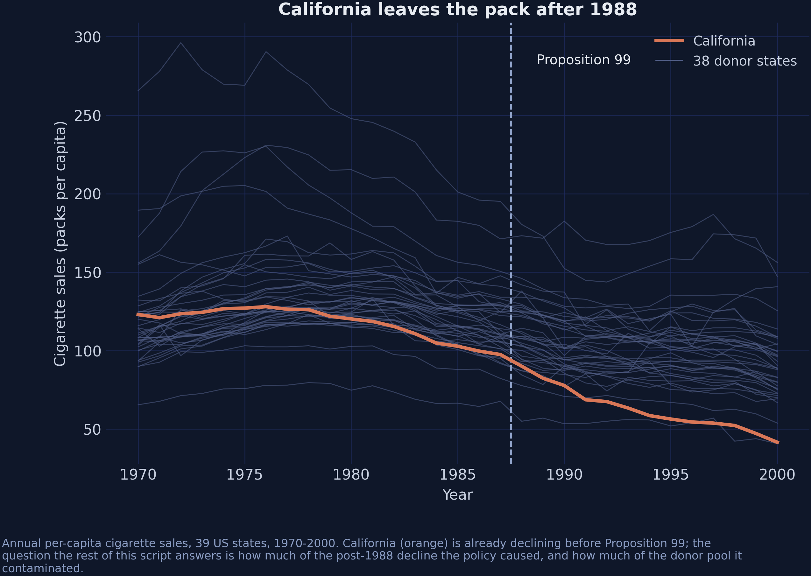

*Figure 1. Annual per-capita cigarette sales, 39 US states, 1970–2000. California in orange, the 38 donor states in grey.*

California is already declining relative to the other states well before the dashed line. Any method that assumes California would otherwise have tracked the average donor will attribute a pre-existing trend to the policy. Synthetic control exists precisely because of this picture: rather than assuming that California resembles the average donor, it searches for the *combination* of donors that California actually does resemble.

### 3.3 The donor pool as a weighted average

The fix is to replace the equal weights $1/(N-1)$ with weights chosen so that the blend tracks California before the treatment. Write $\\mathbf{Y}^{c}\_{t}$ for the vector of donor outcomes in year $t$ and $\\alpha$ for a vector of weights. The counterfactual becomes a weighted sum of the donors:

$$\\widehat{Y}\_{1t}(\\mathbf{0}) = \\sum\_{j=2}^{N} \\alpha\_j Y\_{jt} = \\alpha^{\\top} \\mathbf{Y}^{c}\_{t}$$

The weights are chosen to make that blend match California over the pre-treatment window. The match is measured by the sum of squared gaps in the 18 pre-treatment years. The weights therefore solve a constrained least-squares problem:

$$\\widehat{\\alpha} = \\arg\\min\_{\\alpha \\in \\Delta} \\sum\_{t=1}^{T\_0} \\Big(Y\_{1t} - \\alpha^{\\top}\\mathbf{Y}^{c}\_{t}\\Big)^2, \\qquad \\Delta = \\Big\\{\\alpha : \\alpha\_j \\geq 0, \\, \\sum\_j \\alpha\_j = 1\\Big\\}$$

In words, we look for the mix of donor states whose weighted average tracks California most closely over 1970–1987, subject to the mix being a genuine average, with no negative weights and weights that add to one. The set $\\Delta$ is the simplex. Everything that distinguishes the three stages of this post is a statement about $\\Delta$ or about what $\\mathbf{Y}^{c}\_{t}$ contains.

| Symbol | Meaning | In the code |
|---|---|---|
| $\\alpha$ | vector of 38 donor weights | `result.donor_weights` |
| $\\Delta$ | the simplex | the default constraint of `VanillaSC` |
| $T\_0$ | 18 pre-treatment years (1970–1987) | `result.inputs.T0` |
| $\\mathbf{Y}^{c}\_{t}$ | donor outcomes in year $t$ | `result.inputs.Yc` |

Stage 1 solves this problem as written. Stage 2 replaces $\\alpha \\in \\Delta$ with a prior over all of $\\mathbb{R}^{38}$. Stage 3 keeps the Stage 2 weights and changes what $\\mathbf{Y}^{c}\_{t}$ is assumed to *be*: no longer the untreated outcomes of the donors, but outcomes that may already carry part of the policy.

## 4. Three donors, four years, no computer

Before handing 38 donors to an optimiser, it pays to solve a version small enough to check by hand. Everything that happens in the next ten sections happens here first, in arithmetic that fits on paper. The toy has three donor states and four pre-treatment years:

| Year | Donor A | Donor B | Donor C |
|---:|---:|---:|---:|
| 1 | 10 | 20 | 30 |
| 2 | 12 | 18 | 30 |
| 3 | 14 | 16 | 30 |
| 4 | 16 | 14 | 30 |

One structural fact makes this tractable: **A and B sum to 30 in every year.** A rises, B falls, and the two series cross. C is flat at 30, and that flatness will matter in both of the next two subsections.

### 4.1 An exact blend on the simplex

Suppose our treated unit sits at 15 in all four pre-treatment years, and ask whether a simplex-constrained blend can match it exactly. Take $\\alpha = (0.5,\\, 0.5,\\, 0)$. Year 1 gives $0.5 \\times 10 + 0.5 \\times 20 = 15$, year 2 gives $0.5 \\times 12 + 0.5 \\times 18 = 15$, and years 3 and 4 give 15 as well, because $A\_t + B\_t = 30$ for every $t$. The fit is exact, the weights are non-negative and they sum to one, as the code confirms.

```python
import numpy as np

A = np.array([10.0, 12.0, 14.0, 16.0])
B = np.array([20.0, 18.0, 16.0, 14.0])
C = np.array([30.0, 30.0, 30.0, 30.0])
Z = np.array([15.0, 15.0, 15.0, 15.0])          # the treated unit, pre-treatment

blend = 0.5 * A + 0.5 * B + 0.0 * C
print("blend      :", blend)
print("exact fit  :", np.allclose(blend, Z))
print("weights sum:", 0.5 + 0.5 + 0.0)
```

```text
blend      : [15. 15. 15. 15.]
exact fit  : True
weights sum: 1.0
```

The point worth extracting concerns donor C. It receives a weight of exactly zero, not because a constraint forbade it, but because it is useless: a flat series at 30 cannot help match a flat series at 15 when two other donors already do it perfectly. **Sparsity here came from the data.** In section 7 the simplex will also produce sparsity, and from the outside it will be much harder to tell which source it came from.

### 4.2 The treated unit outside the hull

Now move the treated unit to 35 in all four years, and keep the same three donors. The *convex hull* of the donors is the set of all simplex blends, and every such blend is a weighted average of numbers no larger than 30. The treated unit therefore lies **outside the convex hull of the donors**, and the constraint now costs something we can measure. The best a simplex can do is put all the weight on C, which gives 30 every year and a gap of 5.

```python
best_simplex = 0.0 * A + 0.0 * B + 1.0 * C      # all weight on the highest donor
gap = np.array([35.0, 35.0, 35.0, 35.0]) - best_simplex
print("best simplex blend :", best_simplex)
print("pre-treatment RMSE :", np.sqrt((gap ** 2).mean()))

# Drop the sum-to-one requirement and the fit becomes exact.
alpha_unconstrained = np.array([0.0, 0.0, 7 / 6])
print("unconstrained blend:", alpha_unconstrained[2] * C)
print("weights sum        :", alpha_unconstrained.sum().round(4))
```

```text
best simplex blend : [30. 30. 30. 30.]
pre-treatment RMSE : 5.0
unconstrained blend: [35. 35. 35. 35.]
weights sum        : 1.1667
```

A weight of $7/6 \\approx 1.167$ fits perfectly, but it is not a convex combination. It is an *extrapolation* that scales C up by 17%. Whether that is acceptable is a genuine modelling judgement, and it is exactly the judgement that Stage 2 hands to a prior rather than a constraint.

What is not a judgement is the accounting. **The simplex bought interpretability at a cost of 5 units of pre-treatment error.** This is why pre-treatment RMSE is the first diagnostic to read in any synthetic control table, because it is the visible part of the price.

### 4.3 What one leaky donor does

Now comes the third assumption, the one this post is really about. We give the toy a post-treatment period by extending the table one year, so that A reaches 18 and B falls to 12; $A\_t + B\_t$ is still 30, so the same 50-50 blend still lands on 15. We also assume that we know the truth, which the list below spells out.

- The treatment lowers the treated unit by **20 units**.
- Donor B is not a bystander. It absorbs a spillover of **−8**, so its observed post-treatment value is 8 below what it would have been.
- Our weights are the exact-fit ones from section 4.1: $\\alpha = (0.5, 0.5, 0)$.

A classical synthetic control builds the counterfactual from *observed* donor values, which for B are already 8 too low. It has no way to know that B was touched by the treatment. The question is what estimate it reports.

<div class="learn-card predict-card">
<p class="learn-card-kicker">Predict first</p>

The true effect is −20, and donor B carries half the counterfactual while absorbing a spillover of −8. Will the naive estimate be larger than 20 in absolute value, smaller, or exactly right? Commit to a number before running the code.

<details class="learn-card-reveal">
<summary>Reveal the answer</summary>

**Answer.** Smaller. The naive estimate is −16, so it understates the effect by 4 units. Donor B pulls the synthetic counterfactual down by $0.5 \\times 8 = 4$, which makes the treated unit look less different from its counterfactual than it really is.

</details>
</div>

```python
alpha_toy = np.array([0.5, 0.5, 0.0])

Y_no_treatment = np.array([18.0, 12.0, 30.0])   # A, B, C in year 5, absent any treatment
xi = np.array([0.0, -8.0, 0.0])                 # the spillover each donor absorbs
Y_observed = Y_no_treatment + xi                # what we actually see

Y_treated_true = alpha_toy @ Y_no_treatment - 20.0  # the true post-treatment outcome

att_true = Y_treated_true - alpha_toy @ Y_no_treatment
att_naive = Y_treated_true - alpha_toy @ Y_observed

print(f"true ATT              : {att_true:+.1f}")
print(f"naive (SUTVA) ATT     : {att_naive:+.1f}")
print(f"bias                  : {att_naive - att_true:+.1f}")
print(f"-sum(alpha_j * xi_j)  : {-(alpha_toy * xi).sum():+.1f}")
```

```text
true ATT              : -20.0
naive (SUTVA) ATT     : -16.0
bias                  : +4.0
-sum(alpha_j * xi_j)  : +4.0
```

The naive estimate is **−16 when the truth is −20**. It understates the effect by 4, and that 4 is exactly $-\\sum\_j \\alpha\_j \\xi\_j = -(0.5 \\times -8) = +4$. Three consequences follow, and all three recur in the real data:

1. **The bias has a closed form.** It is the weighted sum of the spillovers, with the *same* weights used to build the counterfactual. Section 9.1 states it in general.
2. **The sign of the bias is set by the sign of the spillover.** Negative spillovers on positively weighted donors push the estimate *upward*, which, when the true effect is negative as it is here, means toward zero. That is the case for Nevada, and it is why purging the contamination in section 12 makes the estimated effect larger, not smaller.
3. **The damage done by a donor is the product of two things**, its weight and its spillover. A heavily contaminated donor with zero weight is harmless, while a lightly contaminated donor carrying half the counterfactual is not.

The quantity $-\\sum\_j \\alpha\_j \\xi\_j$ is worth holding onto. In section 12 we compute it on the real panel and find that it accounts for 1.13 of the 1.19 packs separating the contaminated and purged estimates. The toy has already told us both the sign and the mechanism.

## 5. Setup: two libraries, two pins

Both packages are young and under active development, so both are pinned. `scspill` was at version 0.2.1 when this post was written. `mlsynth` is pinned to a commit rather than a release, because its PyPI release lagged its `main` branch by weeks at the same version string, a trap documented in the [companion post on the synthetic control ladder](/tutorials/python_sc_dsc_sdid/).

The numbers in this post are reproducible only under these two pins. The `[numba]` extra is optional: it makes the samplers about five times faster and returns results identical to the pure-numpy backend on this panel. The fallback after `||` is there for readers whose Python has no `llvmlite` wheel.

```bash
pip install "scspill[numba]==0.2.1" || pip install "scspill==0.2.1"
pip install "mlsynth[bayes] @ git+https://github.com/jgreathouse9/mlsynth.git@15f168bb90487098a7324be00b6663fcab0139ef"
```

The `[bayes]` extra on `mlsynth` matters, because four of the estimators in section 13 import `numpyro`, which is an optional dependency. Without it they fail with a `ModuleNotFoundError` on an otherwise clean install. The setup block below also pins the BLAS threads and the seed, which makes every later number reproducible to the last digit.

```python
import os

# BLAS reduction order changes the last digits of every matrix product, and at
# N = 38 single-threaded BLAS is also faster than multi-threaded. Both are
# reasons to pin it, and it has to happen before numpy is imported.
for v in ("OMP_NUM_THREADS", "OPENBLAS_NUM_THREADS", "MKL_NUM_THREADS"):
    os.environ.setdefault(v, "1")
os.environ.setdefault("JAX_ENABLE_X64", "1")   # numpyro is float32 by default

import numpy as np
import pandas as pd
import scipy.sparse.csgraph

import mlsynth
import scspill
from scspill import SCSPILL
from scspill.data import load_california

SEED = 20251022        # the R edition's seed, so the two are comparable
TREAT_YEAR = 1988
M_ITER, BURN = 500_000, 250_000

print(f"scspill {scspill.__version__}   mlsynth {mlsynth.__version__}")
```

```text
scspill 0.2.1   mlsynth 1.0.0
```

Half a million iterations for a 13-year effect looks excessive. Section 14 shows that it is not: the ATT is stable from about 100,000 draws onward, but the spatial parameter needs roughly five times that before its effective sample size reaches a reportable level. On a laptop with the numba backend, the headline fit takes about two minutes.

## 6. The data

`scspill` ships the Proposition 99 panel together with both of the spatial objects that the third stage needs. The panel is the one distributed with [Cunningham (2021)](https://mixtape.scunning.com/), so there is nothing to download and nothing to merge. This section loads the panel, explains the two spatial objects, and fixes the treatment year.

### 6.1 The panel

`load_california()` returns a panel object that already knows which columns hold the unit, the time index and the outcome. It also carries the two spatial objects alongside the data frame. The block below prints its description and the first rows.

```python
import textwrap

panel = load_california()
df = panel.df.copy()
donors = list(panel.spatial_W.index)

print(textwrap.fill(panel.description, 80))
print()
print(df.head().round(2).to_string())
print(f"\nshape {df.shape}   states {df['state'].nunique()}   "
      f"years {df['year'].min()}-{df['year'].max()}")
```

```text
California Proposition 99 tobacco panel (Abadie, Diamond & Hainmueller 2010): 39
states, 1970-2000, per-capita cigarette sales, treatment in 1988. Spatial
weights are rook contiguity from the 2024 TIGER/Line state shapefile, stored
unnormalized. Source: scspill replication package, nonproprietary export.

     state  state_id  year  cigsale  retprice  treated
0  Alabama         1  1970     89.8      39.6        0
1  Alabama         1  1971     95.4      42.7        0
2  Alabama         1  1972    101.1      42.3        0
3  Alabama         1  1973    102.9      42.1        0
4  Alabama         1  1974    108.2      43.1        0

shape (1209, 6)   states 39   years 1970-2000
```

The result is a balanced panel of 39 states over 31 years, which gives 1,209 rows with no missing values. The outcome `cigsale` is annual per-capita cigarette sales in packs, and the single covariate `retprice` is the average retail price of a pack in cents, recorded in current (nominal) prices. There are 18 pre-treatment years (1970–1987) and 13 post-treatment years (1988–2000).

This predictor set is leaner than the original Abadie–Diamond–Hainmueller specification, which also matched on beer consumption, income, the share of the population aged 15–24, and three individual lags of the outcome. Stages 1 and 2 match on the pre-treatment path of the outcome alone, while Stage 3 adds `retprice` as a covariate inside its spatial layer. Section 9.3 shows that the covariate coefficients drop out of the effects, so the three stages remain comparable.

### 6.2 The spatial weights

The panel carries two spatial objects, and the distinction between them is the one thing to get right in this section. The vector $\\mathbf{w}$ records how exposed each donor is to the treated unit, and the matrix $W$ records which donors border each other. The block below prints both.

```python
# Pin the donor ordering once; every later section indexes off it.
W = panel.spatial_W.loc[donors, donors]      # donor-to-donor contiguity
w = panel.spatial_w.reindex(donors)          # each donor's exposure to California

# spatial_w: how exposed is each DONOR to the TREATED unit?
print(w[w > 0].rename_axis(None).to_string())

# spatial_W: donor-to-donor contiguity. Row-normalised inside the estimator.
print()
print(W.iloc[:4, :4].rename_axis(index=None, columns=None).to_string())
print(f"\nW is symmetric: {np.allclose(W.values, W.values.T)}")
deg = W.sum(axis=1)
print(f"degree: min {deg.min():.0f}  max {deg.max():.0f}  mean {deg.mean():.2f}")
```

```text
Nevada    1.0

             Alabama  Arkansas  Colorado  Connecticut
Alabama          0.0       0.0       0.0          0.0
Arkansas         0.0       0.0       0.0          0.0
Colorado         0.0       0.0       0.0          0.0
Connecticut      0.0       0.0       0.0          0.0

W is symmetric: True
degree: min 1  max 8  mean 3.95
```

**`spatial_w` has exactly one non-zero entry, because Nevada is the only donor that borders California.** Oregon and Arizona also border California, but neither is in the donor pool, because Abadie, Diamond and Hainmueller excluded the four states with large tobacco-control programmes (Arizona, Florida, Massachusetts and Oregon). They also excluded seven states that raised their cigarette taxes by 50 cents or more during the sample period (Alaska, Hawaii, Maryland, Michigan, New Jersey, New York and Washington), together with the District of Columbia.

That exclusion does quiet work. It means that the spatial model has a single direct channel to estimate, which is both a gift and a limitation. The parameter is easy to interpret, but a single channel is thin evidence for a scalar.

The matrix $W$ is symmetric, with between one and eight neighbours per donor. Inside the estimator it is *row-normalised*, which means that each row is divided by its sum, so that $W\\mathbf{y}$ becomes the average outcome of the neighbours of each donor. Figure 2 shows the structure.

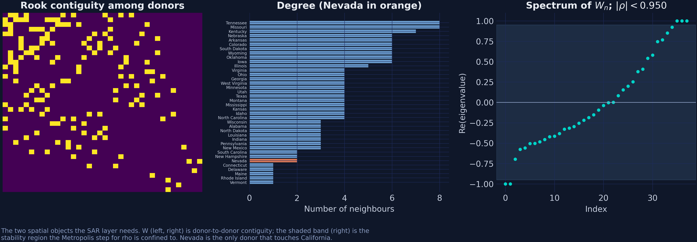

*Figure 2. Left: the 38 × 38 donor contiguity matrix, states ordered by degree. Centre: how many neighbours each donor has, with Nevada in orange. Right: the eigenvalues of the row-normalised W, and the shaded stability region the sampler confines ρ to.*

The right-hand panel matters for section 9.4. A spatial autoregressive model is only well defined when $I - \\rho W$ is invertible, and for a row-normalised contiguity matrix the largest eigenvalue is exactly 1, so $|\\rho| < 1$ is sufficient. `scspill` shrinks the support to $|\\rho| < 0.95$ as a numerical safety margin, and the sampler never proposes outside it. Section 11.3 shows that this margin is itself a prior choice worth reporting.

### 6.3 Treatment in 1988, not 1989

One detail will trip up anyone comparing this post with other sources. Proposition 99 passed in November 1988 and the tax took effect on 1 January 1989. Abadie, Diamond and Hainmueller treat 1989 as the first treated year, and so does the Proposition 99 example of `mlsynth`, whereas `load_california()` in `scspill` uses **1988**, following the paper and the R replication package of Sakaguchi and Tagawa.

Neither convention is wrong, but they cannot be mixed. This post pins **1988 everywhere**, so that all three stages and the whole benchmark in section 13 condition on the same 18 pre-treatment years. The block below rebuilds the treatment dummy from that rule and asserts that it matches the shipped column.

```python
# Rebuild the treatment dummy from the stated rule and assert it matches, so a
# future change in the shipped column cannot silently move the post-period.
rebuilt = ((df["state"] == "California") & (df["year"] >= TREAT_YEAR)).astype(int)
assert (rebuilt.to_numpy() == df["treated"].to_numpy()).all()
years = np.sort(df["year"].unique())
wide = df.pivot(index="year", columns="state", values="cigsale")
y_treated = wide["California"].to_numpy()
post = years >= TREAT_YEAR
print(f"T0 = {(~post).sum()}   T1 = {post.sum()}   donors = {len(donors)}")
```

```text
T0 = 18   T1 = 13   donors = 38
```

The 1989 convention can be used instead by overwriting `df["treated"]` before passing the frame to any estimator. The choice is not innocuous, because 1988 was essentially an untreated year: the vote came in November and the tax started in January. Counting 1988 as treated adds one year with little or no policy effect to the post-period average, which is likely to pull the ATT toward zero, and exercise 1 measures how much. Above all, a comparison across libraries stops being like with like the moment two of them disagree about $T\_0$.

## 7. Stage 1: classical simplex synthetic control

The first stage solves exactly the problem written down in section 3.3. Its identifying assumption is that, without the policy, California would have followed a convex combination of the donors, and that no donor was touched by the policy. In `mlsynth` every estimator takes the same configuration dictionary, a long data frame plus four column names, and the class chosen decides the estimator.

```python
common = dict(df=df, outcome="cigsale", treat="treated",
              unitid="state", time="year", display_graphs=False)

sc = mlsynth.VanillaSC(dict(common)).fit()

w_sc = pd.Series(sc.donor_weights).reindex(donors).fillna(0.0)
print(f"ATT                : {sc.att:.4f} packs per capita per year")
print(f"pre-treatment RMSE : {sc.pre_rmse:.4f}")
print(f"weights sum        : {w_sc.sum():.6f}")
print(f"active donors      : {(w_sc > 1e-4).sum()} of {len(donors)}")
print(w_sc[w_sc > 1e-4].sort_values(ascending=False).round(4).to_string())
```

```text
ATT                : -18.4277 packs per capita per year
pre-treatment RMSE : 1.5998
weights sum        : 1.000000
active donors      : 5 of 38
Utah             0.3430
Montana          0.2545
Nevada           0.2423
Connecticut      0.1457
New Hampshire    0.0144
```

Five of 38 donors carry the entire counterfactual, and four of them carry 98.6% of it. The pre-treatment RMSE of 1.60 is small against an outcome averaging 117.7 packs over the pre-period, which is a relative error of 1.4% and a pre-treatment $R^2$ of about 0.97. By that standard, which [Abadie (2021)](https://doi.org/10.1257/jel.20191450) treats as a precondition for credible synthetic control, the simplex is not visibly straining to reach California.

Two things deserve a pause. First, this reproduces the R edition to within 0.03 packs: that post reports −18.46 with the `tidysynth` package and a different optimiser, with weights of Utah 0.327, Nevada 0.255, Montana 0.245 and Connecticut 0.148. Two independent implementations landing this close is strong evidence that both code the estimator correctly.

Second, and less comfortably, **Nevada is in the synthetic California, with a weight of 0.24.** The one state that we have a specific reason to suspect of contamination carries nearly a quarter of the counterfactual. Stage 3 exists to ask what that costs.

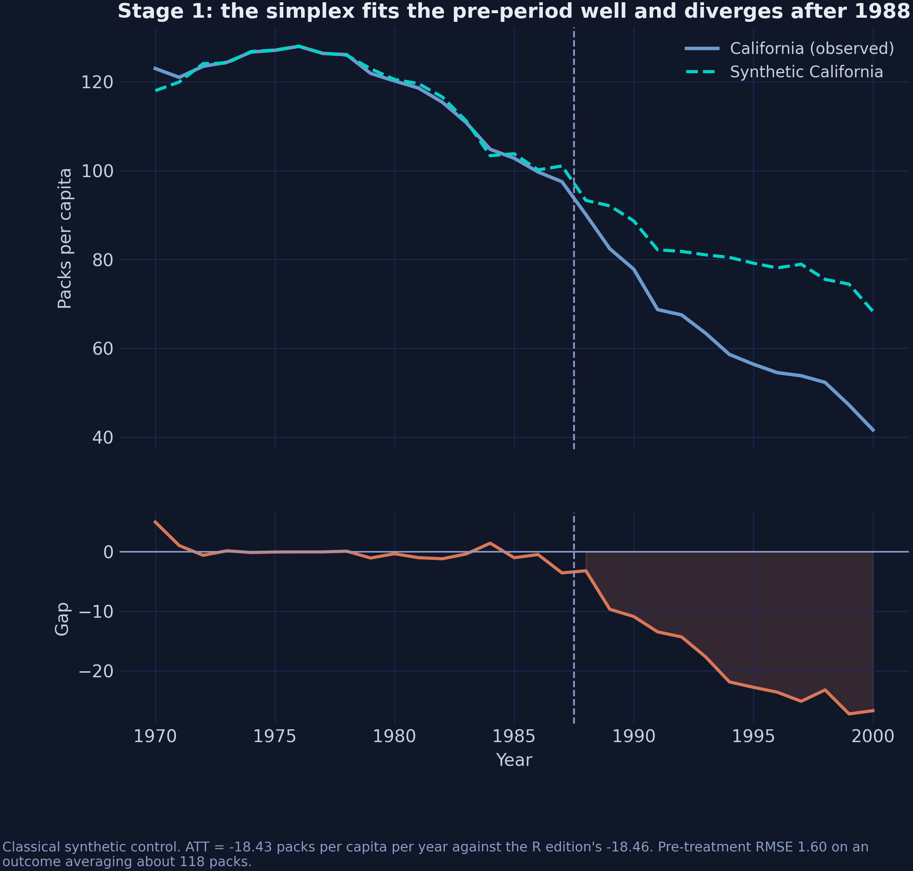

*Figure 3. Top: California and its simplex-weighted synthetic. Bottom: the gap between them, shaded after 1988.*

The two series track closely until 1988 and separate steadily thereafter, reaching a gap of −26.7 packs in 2000. The pre-treatment gap is not exactly zero, because it wanders between −3.5 and +5.0 packs, which is the visible form of the misfit that section 4.2 priced. An RMSE of 1.60 is an average over that wandering, not a promise that any single year fits well.

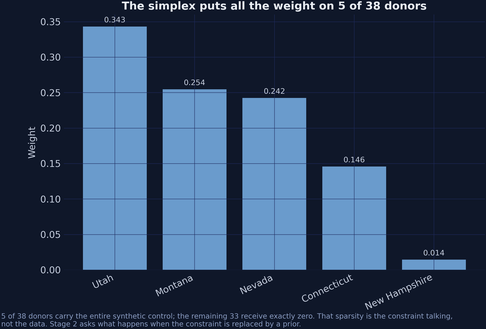

*Figure 4. The simplex assigns weight to five donors and exactly zero to the other 33.*

That wall of zeros is the question that Stage 2 exists to ask. Are 33 states genuinely irrelevant to reconstructing California, or is that simply what a constrained least-squares problem in 38 variables does? Section 4.1 showed that sparsity can come from the data, but it can also come from the constraint, and from the outside the two look identical.

Stage 1 therefore leaves two questions on the table, and each of the remaining stages takes one. Neither question can be answered from the simplex fit alone. The list below names them.

- **Is the sparsity real?** Stage 2 replaces the constraint with a prior and looks again.
- **Is Nevada a donor or a victim?** Stage 3 gives the model a way to answer.

## 8. Stage 2: Bayesian synthetic control

The simplex is a hard constraint, because it declares certain weight vectors impossible. A prior is softer: it declares them *unlikely* and lets the data overrule it if the evidence is strong enough. Stage 2 makes that substitution and changes nothing else, so its identifying assumption is that some unconstrained combination of donors reproduces the untreated path of California, while SUTVA is still assumed.

### 8.1 The horseshoe hierarchy

The prior we want has two properties that pull in opposite directions. It should put enormous mass near zero, so that a donor with nothing to contribute gets nothing, and it should have tails heavy enough that a donor with a great deal to contribute is not shrunk into irrelevance. The horseshoe prior of [Carvalho, Polson and Scott (2010)](https://doi.org/10.1093/biomet/asq017) does both:

$$\\alpha\_j \\mid \\lambda\_j \\sim \\mathcal{N}\\big(0, \\, \\lambda\_j^2\\big), \\qquad \\lambda\_j \\mid \\tau \\sim \\mathcal{C}^{+}(0, \\tau), \\qquad \\tau \\sim \\mathcal{C}^{+}(0, \\sigma), \\qquad \\sigma \\sim \\mathcal{C}^{+}(0, 10)$$

In words, each donor weight is normal around zero but with its *own* scale, and that scale is drawn from a half-Cauchy. The half-Cauchy puts a lot of mass near zero and has a tail that decays only polynomially, so most $\\lambda\_j$ come out tiny, shrinking that donor to nothing, while any individual $\\lambda\_j$ can be enormous if the likelihood demands it. The global scale $\\tau$ decides how sparse the whole vector is, and the local scales $\\lambda\_j$ decide which donors get to escape.

The name comes from the shrinkage factor $\\kappa\_j = 1/(1 + \\lambda\_j^2)$, whose implied prior (with unit global scale) is a $\\mathrm{Beta}(1/2, 1/2)$ distribution. Its density is U-shaped, with peaks at 0 and 1, like a horseshoe. Weights are therefore pushed either toward "shrunk to nothing" or toward "left alone", and rarely in between.

Sampling from this prior directly is awkward, because the half-Cauchy is not conjugate to the normal likelihood and so has no closed-form conditional distribution to draw from. [Makalic and Schmidt (2016)](https://doi.org/10.1109/LSP.2015.2503725) supply the trick that turns the problem into a Gibbs sampler: every half-Cauchy is a scale mixture of inverse-gamma distributions, so introducing one auxiliary variable per scale gives closed-form conditionals throughout. The identity below states that mixture for a unit scale:

$$\\lambda\_j^2 \\mid \\nu\_j \\sim \\mathcal{IG}\\Big(\\tfrac{1}{2}, \\, \\tfrac{1}{\\nu\_j}\\Big), \\qquad \\nu\_j \\sim \\mathcal{IG}\\Big(\\tfrac{1}{2}, \\, 1\\Big) \\, \\Longrightarrow \\, \\lambda\_j \\sim \\mathcal{C}^{+}(0, 1)$$

In words, an inverse-gamma variable whose own scale is inverse-gamma distributed *is* a squared half-Cauchy variable. Nothing is approximated, because this is an exact reparameterisation. It is why both libraries can run tens of thousands of iterations of the weight sampler in seconds.

| Symbol | Meaning | In the code |
|---|---|---|
| $\\alpha\_j$ | weight on donor $j$ | `result.alpha_hat` |
| $\\lambda\_j$ | local shrinkage scale for donor $j$ | internal to the sampler |
| $\\tau$ | global shrinkage scale | internal to the sampler |
| $\\nu\_j$ | Makalic–Schmidt auxiliary variable | internal to the sampler |
| $\\kappa\_j$ | shrinkage factor, $1/(1+\\lambda\_j^2)$ | not exposed |

### 8.2 Fitting it with mlsynth.BSCM

`mlsynth.BSCM` takes the same configuration dictionary as `VanillaSC`, plus the prior family and the MCMC settings. We run four chains of 20,000 iterations each and discard the first 10,000 of every chain as burn-in. That is generous for a 38-donor regression, and the funnel-shaped geometry of the horseshoe is the reason not to be stingy.

<div class="learn-card predict-card">
<p class="learn-card-kicker">Predict first</p>

The simplex used five donors. Once the constraint is replaced by a horseshoe prior that merely *prefers* zero, how many of the 38 donors will carry a posterior weight above 0.01 in absolute value: fewer than five, about five, or many more? Commit to an answer before running the code.

<details class="learn-card-reveal">
<summary>Reveal the answer</summary>

**Answer.** Many more: 26 of 38 under `mlsynth.BSCM` (and 25 under `scspill` at zero spillover). The weights also no longer sum to one (0.758), because the intercept of 16.86 packs absorbs part of the level. The sparsity of Stage 1 came largely from the constraint, not from the data.

</details>
</div>

```python
bscm = mlsynth.BSCM({**common, "prior": "horseshoe", "n_iter": 20_000,
                     "burn_in": 10_000, "chains": 4, "seed": SEED}).fit()

w_bscm = pd.Series(bscm.donor_weights).reindex(donors).fillna(0.0)
beta0 = float(np.mean(np.asarray(bscm.posterior.beta0)))

print(f"ATT           : {bscm.att:.4f}")
print(f"95% CrI       : [{bscm.att_ci[0]:.4f}, {bscm.att_ci[1]:.4f}]")
print(f"intercept     : {beta0:.4f}")
print(f"weights sum   : {w_bscm.sum():.4f}")
print(f"active donors : {(w_bscm.abs() > 0.01).sum()} of {len(donors)}")
```

```text
ATT           : -18.8469
95% CrI       : [-26.4568, -9.9884]
intercept     : 16.8619
weights sum   : 0.7576
active donors : 26 of 38
```

The donor pool has gone from 5 active states to 26, and the weights no longer sum to one. Both are consequences of dropping the simplex, and neither is a defect. This is also the first output carrying a 95% *credible* interval, which is the range that holds 95% of the posterior mass: given the model, the prior and the data, the ATT lies in it with probability 0.95. That is a statement about the parameter conditional on the model, not a statement about repeated sampling, and it is only as good as the model behind it.

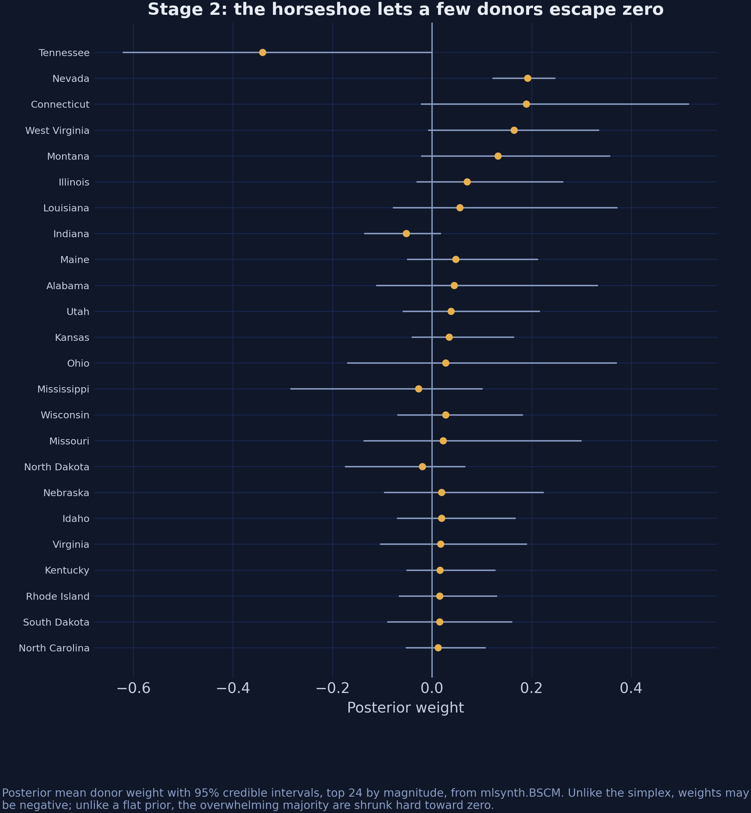

*Figure 5. Posterior mean weight with 95% credible intervals for the 24 donors with the largest magnitude, from `mlsynth.BSCM`.*

The credible intervals in Figure 5 do something instructive. Most of them straddle zero comfortably, so the model is willing to entertain a role for these donors, but the data do not insist on one. The horseshoe has done what it promised, because it made zero the default without making it compulsory.

One number in that output deserves more attention than it usually gets: **the intercept of 16.86**. It explains a discrepancy that the next subsection would otherwise leave hanging. The two Bayesian synthetic controls in this post differ precisely in whether they include it.

### 8.3 The same model in scspill, at zero spillover intensity

`scspill` has no `rho` argument, because the spatial intensity is a parameter to be estimated, not a setting. The model collapses *exactly* to a Bayesian horseshoe synthetic control when $\\rho = 0$, however, and that special case is computed and exposed as part of every Stage 3 fit. Stage 2 therefore costs no extra MCMC at all, and the code that reads it off the fit appears in section 9.5, right after the fit is created.

The numbers are worth seeing here, because they belong to the Stage 2 story. The table below compares the two Bayesian synthetic controls with the R edition. The only design difference between the first two rows is the intercept.

| Estimator | Intercept | ATT |
|---|---|---:|
| `scspill` at $\\rho = 0$ (section 9.5) | no | −15.682 |
| `mlsynth.BSCM` (section 8.2) | yes, 16.86 | −18.847 |
| R edition, Stage 2 | no | −15.840 |

The two Bayesian synthetic controls share a prior family and a data set, yet they are **3.17 packs apart**. That gap is not noise, and it is not a bug in either library. It is an intercept.

`mlsynth.BSCM` implements [Kim, Lee and Gupta (2020)](https://doi.org/10.1177/0022243720936230), which fits an explicit intercept $\\beta\_0$ and leaves the donor series on their original scale. Step 1 of `scspill` has no intercept and standardises the donors first. The consequences are visible in the output of section 8.2: the BSCM weights sum to 0.758 rather than 1, because the intercept of 16.86 packs absorbs the level difference that the weights would otherwise have to carry.

$$\\text{BSCM:} \\quad Y\_{1t} = \\beta\_0 + \\sum\_j \\alpha\_j Y\_{jt} + \\varepsilon\_t \\qquad\\text{versus}\\qquad \\text{scspill:} \\quad Y\_{1t} = \\sum\_j \\alpha\_j Y\_{jt} + \\varepsilon\_t$$

In words, one model may say "California is like this blend of states, shifted up by 17 packs", while the other must say "California *is* this blend of states". Because the BSCM weights sum to only 0.758, its raw blend sits well below California, roughly $0.758 \\times 131.5 \\approx 100$ packs against a pre-period mean of 117.7 for California, and the positive intercept lifts it back onto the treated series. Neither model is more correct in the abstract, but they answer different questions, and averaging them would be meaningless.

The tiebreaker available here is external. The $\\rho = 0$ case of `scspill` lands within **0.16 packs** of the Stage 2 estimate of −15.84 in the R edition, which was produced by entirely separate C++ code. Two independent implementations of the no-intercept horseshoe agree, while the intercept model deliberately does something else.

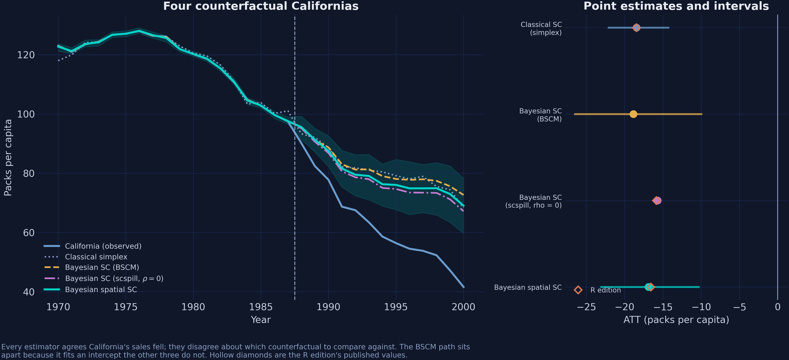

*Figure 6. Left: the counterfactual path implied by each estimator. Right: point estimates with intervals; hollow diamonds are the published values of the R edition.*

The lesson generalises well beyond this post. When two packages disagree about a model they both claim to implement, the first thing to check is not the sampler. It is whether they fit the same equation.

## 9. Stage 3: Bayesian spatial synthetic control

Everything so far has assumed that the donors were bystanders, and Stage 3 drops that assumption. In its place it puts two others: that some unconstrained combination of donors reproduces the untreated path of California exactly, and that any spillover travels only along a researcher-supplied graph, with a single intensity parameter. The estimand is still the ATT on California, now purged of contamination, and the model adds a second estimand, the spillover on each donor.

### 9.1 Where the contamination enters

We start from the estimator itself and ask what it actually computes when SUTVA fails. The synthetic control is built from *observed* donor outcomes, so if those observations already contain a spillover, the counterfactual inherits it. Adding and subtracting the untreated outcomes gives an exact decomposition of the reported gap:

$$Y\_{1t} - \\sum\_j \\alpha\_j Y\_{jt} \\, = \\, \\xi\_{0t} \\, - \\, \\sum\_j \\alpha\_j \\, \\xi^{c}\_{jt}$$

The two terms on the right do very different jobs, and the table below separates them. The first is what we want, and the second is what we get for free. Only a model of the spillovers can tell them apart.

| Term | What it is | Do we want it? |
|---|---|---|
| $\\xi\_{0t}$ | the causal effect on California | **yes**, this is the estimand |
| $-\\sum\_j \\alpha\_j \\, \\xi^{c}\_{jt}$ | a weighted sum of the spillovers that landed on the donors | **no**, this is bias |

In words, the number that a classical synthetic control reports is the true effect on California *minus* a weighted sum of the spillovers that landed on the donors, with the same weights used to build the counterfactual. The derivation is one line of adding and subtracting $\\sum\_j \\alpha\_j Y\_{jt}(\\mathbf{0})$, using $Y\_{jt} = Y\_{jt}(\\mathbf{e}\_1)$, $\\xi^{c}\_{jt} = Y\_{jt}(\\mathbf{e}\_1) - Y\_{jt}(\\mathbf{0})$, and the perfect-fit assumption $Y\_{1t}(\\mathbf{0}) = \\sum\_j \\alpha\_j Y\_{jt}(\\mathbf{0})$. The bias term is therefore the following weighted sum:

$$\\mathrm{bias}\_t = -\\sum\_j \\alpha\_j \\, \\xi^{c}\_{jt}$$

This is exactly the identity that the toy example in section 4.3 verified with $-\\left(0.5 \\times -8\\right) = +4$. It holds in every post-treatment year, so averaging it over the post-period gives the bias of the ATT. Three consequences are worth stating plainly, and the list below gives them.

- If every $\\xi^{c}\_{jt} = 0$, the bias vanishes and classical synthetic control is right. SUTVA is therefore not a technicality, because it is the whole justification.
- The bias is a *product* of weight and spillover, so contamination in a zero-weight donor is harmless.
- The sign of the bias is the opposite of the sign of the weighted spillover. Negative spillovers on positively weighted donors push the estimate toward zero.

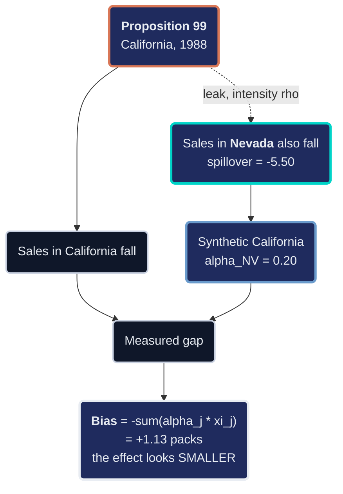

The dashed arrow is the one that classical synthetic control cannot draw. To estimate its strength we need a model of how outcomes travel between neighbouring states. That is what a spatial autoregression provides.

### 9.2 A spatial process on the donor outcomes

The proposal of Sakaguchi and Tagawa is to put a spatial autoregressive structure ([LeSage and Pace, 2009](https://doi.org/10.1201/9781420064254)) on the donor block. In this section and the next, $N$ denotes the number of donors (38), and $W$ and $\\mathbf{w}$ are the normalised weights. The outcome of each donor depends on the outcomes of its neighbours *and* on the outcome of the treated unit, with a single intensity parameter $\\rho$ governing both:

$$\\mathbf{Y}^{c}\_{t} = \\rho \\big( \\mathbf{w} \\, Y\_{1t} + W \\mathbf{Y}^{c}\_{t} \\big) + X\_t \\beta + \\mathbf{u}\_t, \\qquad \\mathbf{u}\_t = \\eta \\gamma\_t + \\mathbf{e}\_t$$

In words, the cigarette sales of a donor are a weighted average of the sales of its neighbours, plus a term for how exposed it is to California, plus covariates, plus a common latent factor and idiosyncratic noise. The vector $\\mathbf{w}$ is exposure to the treated unit, with one non-zero entry for Nevada, and $W$ is donor-to-donor contiguity. Because one $\\rho$ scales both terms, the model learns about the leak from California partly through the ordinary spatial co-movement among the donors themselves.

The error is not white noise, and the model says so explicitly. Without a common component, the SAR layer could mistake a national trend for spatial dependence. The error therefore carries a latent factor $\\gamma\_t$ that follows an AR(1) process with loadings $\\eta$, and this factor absorbs the common national trends visible in Figure 1, such as the reports of the Surgeon General, federal tax changes, and the general secular decline in smoking:

$$\\gamma\_t = \\phi\_\\gamma \\gamma\_{t-1} + \\epsilon\_t, \\qquad \\epsilon\_t \\sim \\mathcal{N}(0, \\sigma^2\_\\gamma), \\qquad \\eta\_{jk} \\sim \\mathcal{N}(0, \\sigma^2\_\\eta \\omega\_k), \\qquad \\omega\_k \\sim \\mathcal{C}^{+}(0, 10)$$

The critical structural point is *why* $\\mathbf{w}$ multiplies $Y\_{1t}$, the **observed** outcome of California. Residents of Nevada respond to what California actually does, such as the actual prices, the actual advertising and the actual sales, not to some counterfactual California. That is what makes the system solvable, because everything on the right-hand side is observed.

Setting $\\rho = 0$ removes both spatial terms at once and returns Stage 2 exactly. This is the sense in which the three stages are nested. It is also why section 9.5 can read Stage 2 off a Stage 3 fit.

| Symbol | Meaning | In the code |
|---|---|---|
| $\\rho$ | spatial intensity, the leak | `result.rho_hat` |
| $\\mathbf{w}$ | donor exposure to California | `panel.spatial_w` |
| $W$ | donor-to-donor contiguity | `panel.spatial_W` |
| $W\_n$ | the same matrix, row-normalised | `result.inputs.Wn` |
| $\\beta$ | covariate coefficients | `result.sar_posterior.beta` |
| $\\gamma\_t$, $\\eta$ | latent AR(1) factor and loadings | `p_factors=1` |
| $\\sigma^2$ | idiosyncratic variance | `result.sar_posterior.sigma2` |

### 9.3 Identification in closed form

Here the model earns its keep. The simplex is gone, and something has to replace it as the identifying assumption. What replaces it is a **perfect pre-treatment fit with unconstrained weights**:

$$\\exists \\, \\alpha \\in \\mathbb{R}^{N} \\, : \\, Y\_{1t}(\\mathbf{0}) = \\sum\_j \\alpha\_j Y\_{jt}(\\mathbf{0}) \\quad \\text{for all } t$$

In words, some fixed combination of the untreated outcomes of the donors reproduces the untreated outcome of California exactly, in every period. The weights may be negative and need not sum to one. This is a *stronger* assumption than approximate fit and a *weaker* one than convexity, and it is an assumption rather than a result, so it cannot be tested after the treatment starts.

Given that assumption, define $A = W + \\mathbf{w}\\alpha^{\\top}$, which is the contiguity graph *plus* the indirect path from each donor back to itself through the synthetic California. Solving the simultaneous system for the untreated outcomes of the donors gives a closed form. It reconstructs the world without the policy from observed data alone:

$$\\mathbf{Y}^{c}\_{t}(\\mathbf{0}) = \\big(I\_N - \\rho A\\big)^{-1}\\Big[\\big(I\_N - \\rho W\\big)\\mathbf{Y}^{c}\_{t} - \\rho \\, \\mathbf{w} \\, Y\_{1t}\\Big]$$

Both estimands follow immediately from that reconstruction. Each is a difference between an observed outcome and a reconstructed untreated outcome. The first compares California with its synthetic built from untreated donors, and the second compares each donor with its own untreated path:

$$\\xi\_{0t} = Y\_{1t} - \\alpha^{\\top}\\mathbf{Y}^{c}\_{t}(\\mathbf{0}), \\qquad \\boldsymbol{\\xi}^{c}\_{t} = \\mathbf{Y}^{c}\_{t} - \\mathbf{Y}^{c}\_{t}(\\mathbf{0}) = \\big(I\_N - \\rho W\\big)^{-1} \\rho \\, \\mathbf{w} \\, \\xi\_{0t}$$

**What is absent from those expressions matters most.** There is no $\\beta$, no $\\gamma\_t$, no $\\eta$ and no $\\sigma^2$, only $(\\alpha, \\rho, \\mathbf{w}, W)$ and the observed outcomes. The covariate coefficients, the latent factors and the error variances all cancel out of the effects. The second expression also has a simple reading: the spillover on every donor is the effect on California, passed to Nevada with strength $\\rho$ and then rippled outward through the contiguity graph.

<details class="learn-card proof-card">
<summary><span class="learn-card-kicker">Proof</span> Why the nuisance parameters cancel, and why every spillover is a ripple of the effect on California</summary>

Write the model in the observed world and in the untreated world. The covariates and errors are the same in both worlds, because the policy changes outcomes, not the structural shocks. Only the outcomes differ between the two equations:

$$\\mathbf{Y}^{c}\_{t} = \\rho \\big( \\mathbf{w} \\, Y\_{1t} + W \\mathbf{Y}^{c}\_{t} \\big) + X\_t \\beta + \\mathbf{u}\_t, \\qquad \\mathbf{Y}^{c}\_{t}(\\mathbf{0}) = \\rho \\big( \\mathbf{w} \\, Y\_{1t}(\\mathbf{0}) + W \\mathbf{Y}^{c}\_{t}(\\mathbf{0}) \\big) + X\_t \\beta + \\mathbf{u}\_t$$

**Step 1.** Rearranging the first equation expresses the nuisance block through observed quantities: $X\_t\\beta + \\mathbf{u}\_t = (I\_N - \\rho W)\\mathbf{Y}^{c}\_{t} - \\rho \\mathbf{w} Y\_{1t}$. The right-hand side contains only data and $\\rho$. This is the step that will remove $\\beta$, $\\gamma\_t$, $\\eta$ and $\\sigma^2$.

**Step 2.** In the second equation, substitute the perfect-fit assumption $Y\_{1t}(\\mathbf{0}) = \\alpha^{\\top}\\mathbf{Y}^{c}\_{t}(\\mathbf{0})$ and collect terms: $(I\_N - \\rho W - \\rho \\mathbf{w}\\alpha^{\\top})\\mathbf{Y}^{c}\_{t}(\\mathbf{0}) = X\_t\\beta + \\mathbf{u}\_t$. With $A = W + \\mathbf{w}\\alpha^{\\top}$, replacing the right-hand side by Step 1 gives the closed form above, in which $\\beta$, $\\gamma\_t$, $\\eta$ and $\\sigma^2$ no longer appear.

**Step 3.** Subtract the second structural equation from the first. The nuisance block cancels, and $Y\_{1t} - Y\_{1t}(\\mathbf{0}) = \\xi\_{0t}$, so $\\boldsymbol{\\xi}^{c}\_{t} = \\rho \\mathbf{w} \\xi\_{0t} + \\rho W \\boldsymbol{\\xi}^{c}\_{t}$, which solves to $\\boldsymbol{\\xi}^{c}\_{t} = (I\_N - \\rho W)^{-1}\\rho \\mathbf{w} \\xi\_{0t}$. Expanding the inverse as $I + \\rho W + \\rho^2 W^2 + \\cdots$ shows the ripple: Nevada first, then the neighbours of Nevada, and so on.

</details>

This cancellation is what makes the whole approach usable. A model this rich has many parameters that are poorly pinned down by 31 years of data on 39 states, and section 9.5 will show that $\\rho$ itself mixes slowly enough to need half a million draws. If the effects depended on the entire nuisance block, every weakness of that block would contaminate them. Because they depend on four objects only, the difficulty is confined to $\\rho$, where we can see it, measure it, and report it.

### 9.4 The two-step sampler

The product $\\rho \\, \\mathbf{w} \\, \\alpha^{\\top}$ appears inside $\\rho A$, so the exposure channel identifies $\\rho$ and $\\alpha$ only jointly, and sampling them together mixes very badly. The answer of the paper is to factorise the posterior into two steps. It uses a *cut* posterior, meaning a deliberate refusal to let the second step feed information back into the first: $\\alpha$ is estimated first from the pre-treatment fit and then held fixed while $\\rho$ is drawn.

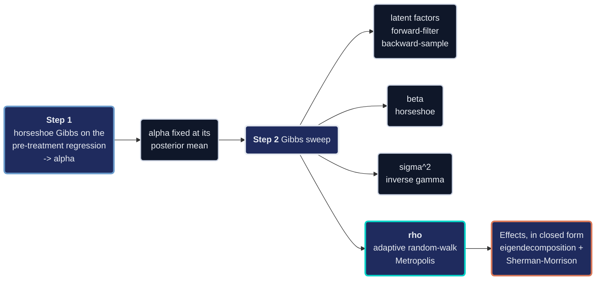

Within Step 2, the latent factors are drawn by forward-filtering backward-sampling (FFBS) as in [Carter and Kohn (1994)](https://doi.org/10.1093/biomet/81.3.541), and the remaining blocks have closed-form conditionals. The split is the price of the identification problem: Step 1 never sees $\\rho$, and Step 2 never revisits $\\alpha$. The $\\rho$ step is a **random-walk Metropolis** move, which proposes a small jump and accepts it with a probability that depends on how much better the new value fits, and otherwise stays put. It is the only part of this sampler that is not a draw from a closed-form conditional, and it is the reason why section 9.5 has an effective-sample-size problem to report.

Three implementation details explain both the speed and the one weakness. The first concerns where $\\rho$ may go, the second makes each step cheap, and the third tunes the step size. Only the third has a counterpart that the R code switches off.

**The support for $\\rho$.** The system is only solvable when $I\_N - \\rho A$ is non-singular. A value of $\\rho$ outside the admissible range would make the reconstruction of the untreated world meaningless. The package therefore bounds $\\rho$ with the spectral radius of the row-normalised weights:

$$|\\rho| < \\frac{0.95}{\\max\\big(1, \\, \\max\_i |\\mu\_i(W\_n)|\\big)}$$

For row-normalised contiguity the largest eigenvalue is exactly 1, so the bound becomes $|\\rho| < 0.95$. The 0.95 in the numerator is a numerical safety margin imposed by the package, not a consequence of invertibility. Section 11.3 shows that the support is the prior setting that moves the posterior of $\\rho$ most.

**The Jacobian.** Each Metropolis proposal needs $\\log|I\_N - \\rho A|$, which is an $O(N^3)$ determinant if computed naively, at every one of 500,000 iterations. Pre-computing the eigenvalues $\\mu\_i$ of $A$ once turns it into a sum, written with $\\mu$ rather than $\\lambda$ because $\\lambda\_j$ is already the local shrinkage scale of the horseshoe in section 8.1:

$$\\log\\big|I\_N - \\rho A\\big| = \\sum\_{i=1}^{N} \\log\\big(1 - \\rho \\mu\_i\\big)$$

The cost per iteration falls from $O(N^3)$ to $O(N)$. This single substitution is what lets a half-million-draw chain finish in about two minutes rather than days. The effects use the same trick, combined with the Sherman–Morrison identity for the rank-one term $\\mathbf{w}\\alpha^{\\top}$.

**Adaptive step size.** The standard deviation of the Metropolis proposal is tuned during burn-in by [Robbins–Monro](https://doi.org/10.1214/aoms/1177729586) stochastic approximation. It targets a 44% acceptance rate, the optimum for a one-dimensional random walk ([Gelman, Roberts and Gilks, 1996](https://doi.org/10.1093/oso/9780198523567.003.0038)), whereas the familiar 0.234 is the asymptotic result for high dimensions ([Roberts, Gelman and Gilks, 1997](https://doi.org/10.1214/aoap/1034625254)):

$$\\log s\_{m+1} = \\log s\_m + (m+1)^{-0.6}\\big(a\_m - 0.44\\big)$$

Here $a\_m$ is the acceptance probability of the proposal made at iteration $m$. When proposals are readily accepted the step grows, and when they keep being rejected it shrinks. The exponent $-0.6$ makes the corrections vanish fast enough for the chain to settle, and adaptation stops entirely at the end of burn-in, so the sampled portion is a genuine Markov chain.

In the run below the adaptation lands at an acceptance rate of 0.444 against the 0.44 target, from a starting step of 0.05. Section 10 shows what happens when this adaptation is switched off. The R replication code does exactly that.

### 9.5 Fitting it

The configuration is the output of `config_kwargs()` on the panel plus five settings: chain length, burn-in, the seed, a switch for the automatic plotting of the package, and a cap on how many posterior draws the effects sweep uses. Everything spatial, namely $\\mathbf{w}$, $W$ and the covariates, comes from the bundled panel, so there is nothing to align by hand. With the numba backend, the fit takes about two minutes.

```python
result = SCSPILL({
    **panel.config_kwargs(),      # df, columns, spatial_w, spatial_W, covariates
    "m_iter": M_ITER,
    "burn": BURN,
    "seed": SEED,
    "display_graphs": False,
    "max_effect_draws": 5_000,    # thin the effects sweep; the ATT is unaffected
}).fit()

print(f"ATT        : {result.att:.4f}  95% CrI "
      f"[{result.att_ci[0]:.4f}, {result.att_ci[1]:.4f}]")
print(f"ATT at rho=0: {result.effects_detail.att_scm:.4f}")
print(f"rho        : {result.rho_hat:.4f}  95% CrI "
      f"[{result.rho_ci[0]:.4f}, {result.rho_ci[1]:.4f}]")
print(f"ESS(rho)   : {result.rho_ess:.1f}   acceptance {result.acc_rho:.3f}")
```

```text
ATT        : -16.8680  95% CrI [-23.0450, -10.3316]
ATT at rho=0: -15.6816
rho        : 0.3161  95% CrI [0.2312, 0.4032]
ESS(rho)   : 136.8   acceptance 0.444
```

**The credible interval for $\\rho$ excludes zero.** Within this model, the data therefore do not support the restriction $\\rho = 0$ that would collapse Stage 3 back to Stage 2. Because one $\\rho$ governs both the exposure to California and the co-movement among neighbouring donors, however, this is first of all evidence that donor outcomes are spatially dependent. The model attributes part of that dependence to a leak from California because it ties the two channels together, and a model with separate intensities could apportion it differently.

The ATT moves from −15.68 to −16.87 once the leak is modelled, so purging the contamination makes the estimated effect **larger**, by 1.19 packs. Section 4.3 predicted that direction from the sign of the spillover. Section 12 checks the magnitude against the identity.

`scspill` ships its own diagnostics table, and it is worth reading in full, because it shows precisely where the sampling difficulty lives. The block below prints it with the six largest donor weights. The wide display setting only keeps pandas from hiding columns.

```python
with pd.option_context("display.width", 200, "display.max_columns", 20):
    print(result.diagnostics(top_n_alpha=6).round(4))
```

```text
                         mean      sd     q025      q50     q975          ess  rhat_split    mcse  geweke_z
parameter                                                                                                  
rho                    0.3161  0.0430   0.2312   0.3162   0.4032     136.7806      1.0154  0.0037   -0.5704
sigma2                61.5905  3.4887  55.1382  61.4554  68.8232  204094.9179      1.0000  0.0077   -0.2965
alpha[Tennessee]      -0.2505  0.1675  -0.5833  -0.2543   0.0121   10194.7170      1.0000  0.0017   -0.4424
alpha[Connecticut]     0.2296  0.1672  -0.0273   0.2319   0.5575   11798.6429      1.0000  0.0015    0.0571
alpha[Nevada]          0.1997  0.0370   0.1191   0.2016   0.2693   25855.2663      1.0000  0.0002    1.2922
alpha[Montana]         0.1289  0.1299  -0.0305   0.1015   0.4114   11047.2550      1.0001  0.0012    1.2323
alpha[West Virginia]   0.1253  0.0954  -0.0189   0.1261   0.3072   12238.6311      1.0000  0.0009   -0.7574
alpha[Illinois]        0.1049  0.1159  -0.0356   0.0755   0.3810   14970.6186      1.0000  0.0009   -0.6747
beta[retprice]         0.3475  0.0256   0.2979   0.3472   0.3988     388.4297      1.0060  0.0013    0.6091
```

The `ess` column is best read from top to bottom. $\\sigma^2$ has an effective sample size of 204,000, and the donor weights are in the 10,000–26,000 range, but **$\\rho$ has 137**, and the price coefficient 388, from the same chain. The pattern is that the two quantities tied to the spatial and covariate block of Step 2 mix slowly, and $\\rho$, the scalar that the whole third stage exists to estimate, is the slower of the two.

This is not a defect in the software, and it does not mean that the data are silent about $\\rho$. The posterior is tight, with a standard deviation of 0.043 on a support 1.9 wide. The difficulty is that $\\rho$ is the only parameter drawn by random-walk Metropolis rather than from a closed-form conditional, so each draw is highly correlated with the one before. Section 14 shows what it costs to pin it down, and section 10 shows what happens without that effort.

Two further observations come from the table. Nevada has the most precisely estimated weight among the donors shown (`sd` 0.037 against 0.10–0.17 for the other five), so the model is confident about the one state to which it also assigns nearly all the spillover. In addition, `rhat_split` for $\\rho$ is 1.0154, which is above the 1.01 threshold that [Vehtari et al. (2021)](https://doi.org/10.1214/20-BA1221) recommend, although well short of the 1.05 that older practice tolerated. The chain has therefore mixed adequately but not comfortably, which is one more reason to report the effective sample size beside the interval.

The Stage 2 numbers of section 8.3 come out of this same fit. The block below reads the $\\rho = 0$ ATT and the whole $\\rho = 0$ counterfactual path from `result`, so no second MCMC run is needed. The function `treated_counterfactual` evaluates the closed form of section 9.3 with $\\rho$ set to zero.

```python
# Fitted once in section 9.5; both quantities come out of that single fit.
from scspill.utils.scspill_helpers.sar.effects import treated_counterfactual

att_rho0 = result.effects_detail.att_scm          # the rho = 0 ATT
cf_rho0 = treated_counterfactual(result.inputs.Y0, result.inputs.Yc,
                                 result.inputs.Wn, result.inputs.wn,
                                 result.alpha_hat, rho=0.0)   # the whole path

print(f"scspill at rho = 0 : {att_rho0:.4f}")
print(f"mlsynth.BSCM       : {bscm.att:.4f}")
print(f"R edition Stage 2  : -15.8400")
print(f"rho=0 counterfactual, last 3 years: {cf_rho0[-3:].round(1)}")
```

```text
scspill at rho = 0 : -15.6816
mlsynth.BSCM       : -18.8469
R edition Stage 2  : -15.8400
rho=0 counterfactual, last 3 years: [73.4 71.2 67.2]
```

The $\\rho = 0$ case lands 3.17 packs away from `mlsynth.BSCM` and 0.16 packs away from the R edition, which is the comparison that section 8.3 discussed. The last three years of its counterfactual path sit near 70 packs, while observed sales in California fell from 52 to 42 packs over the same years. The gap between the two is the effect that every stage agrees on.

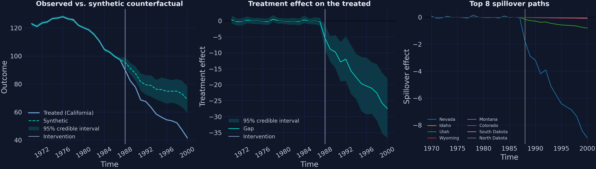

*Figure 7. `result.plot(kind="panel")`: observed against counterfactual, the treatment effect over time, and the eight largest spillover paths, drawn by the library itself.*

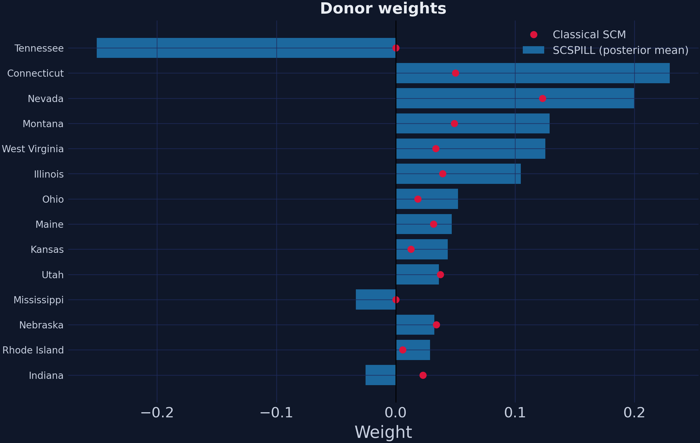

*Figure 8. `result.plot(kind="weights")`: the horseshoe posterior against the simplex weights for the same donors.*

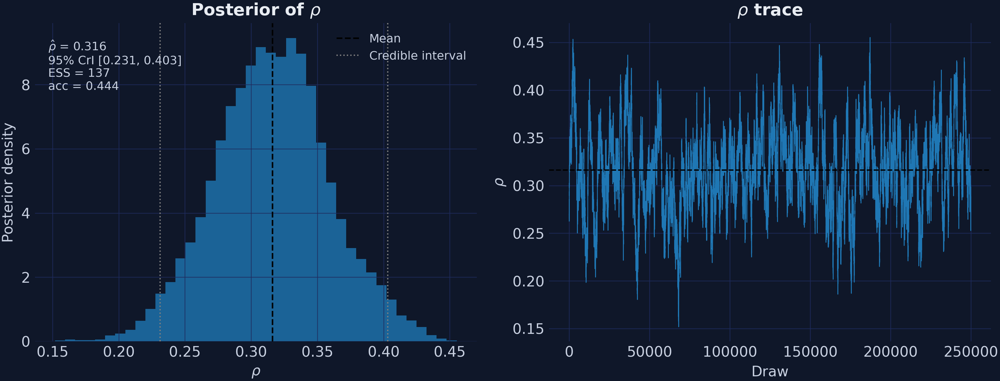

*Figure 9. `result.plot(kind="rho")` and `result.plot(kind="trace")`. The trace moves more slowly than a well-mixed chain, which is what an effective sample size of 137 out of 250,000 draws looks like.*

### 9.6 The spillover received by each donor

The second estimand is a full panel, with one spillover per donor per year, rather than a single number. Section 9.3 showed that every spillover is a ripple of the effect on California, starting at Nevada. The question is how far the ripple reaches.

<div class="learn-card predict-card">
<p class="learn-card-kicker">Predict first</p>

Only Nevada borders California, and $\\hat\\rho = 0.316$. Which donors will rank second and third by mean spillover, and will their spillovers be about half that of Nevada, about a tenth, or about a hundredth? Commit to an answer before running the code.

<details class="learn-card-reveal">
<summary>Reveal the answer</summary>

**Answer.** Idaho (−0.49) and Utah (−0.49), the two donors that border Nevada, at about a tenth of the −5.50 on Nevada. Each receives the Nevada spillover scaled by $\\rho$ and by its own share of neighbours: Idaho and Utah each count Nevada as one of their four donor neighbours. Wyoming, one step further out, receives −0.06.

</details>
</div>

```python
spill = result.spillover_panel.loc[TREAT_YEAR:]      # post-treatment rows only
means = spill.mean()
ranked = means.reindex(means.abs().sort_values(ascending=False).index)
print(ranked.head(6).round(4).rename_axis(None).to_string())
```

```text
Nevada     -5.4995
Idaho      -0.4929
Utah       -0.4917
Wyoming    -0.0590
Montana    -0.0466
Colorado   -0.0311
```

Nevada absorbs **11.2 times** the next-largest effect. Idaho and Utah, the two donors that border Nevada and sit one step further out on the contiguity graph, pick up about half a pack each. Beyond that second ring the spillovers are another order of magnitude smaller, about −0.06 for Wyoming and below that for every other donor.

One caveat applies to reading this panel. The pre-treatment rows are fit residuals, not causal spillovers, because nothing had leaked in 1975. Slicing from `TREAT_YEAR` onward, as above, avoids averaging signal with noise.

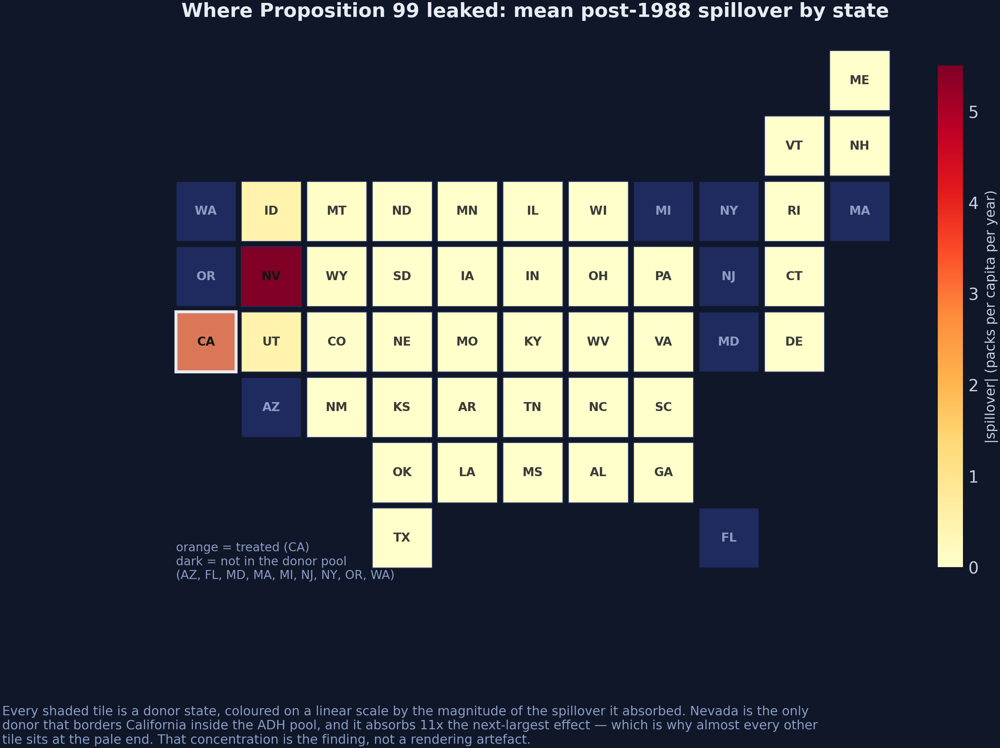

*Figure 10. Mean post-1988 spillover by state on a linear colour scale. California is the treated unit; dark tiles are states outside the donor pool.*

The concentration in that map is the finding, not a rendering artefact. On a linear scale almost every tile sits at the pale end, because one state absorbs an order of magnitude more than any other. Section 9.7 lets us vary $\\rho$ and watch that concentration change.

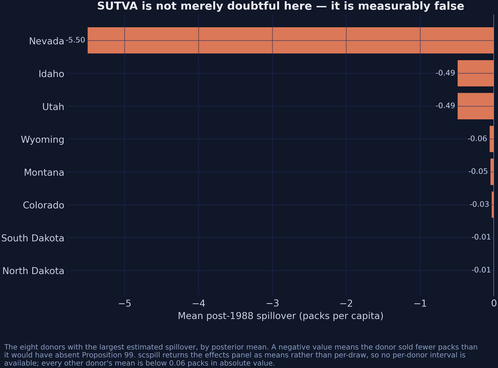

*Figure 11. The eight donors with the largest estimated spillover, by posterior mean. These are point estimates: `scspill` returns the effects panel as posterior means rather than per draw, so no interval is available for the spillover of an individual donor.*

That last sentence states a real limitation. The 95% credible interval reported for $\\rho$ covers the spatial parameter, and the one reported for the ATT covers the treated unit, but nothing in this pipeline puts an interval around the −5.50 for Nevada. Every statement in this post about which donors matter is therefore a statement about relative magnitude, not about posterior tail probability.

With that caveat, the evidence against SUTVA rests on $\\rho$ rather than on any individual donor. The interval for $\\rho$ excludes zero, so the model detects a spatial channel, and the point estimates say that the channel is concentrated almost entirely in one state. A single identifiable leak is a more tractable outcome than diffuse contamination would have been, because it can be modelled, and here it has been.

### 9.7 The ripple, interactively

Section 9.3 showed that, given $\\rho$, the weights and the effect on California, the spillovers follow from one line of linear algebra. The lab below evaluates that line live, so we can see how the ripple spreads. It uses the posterior mean weights and plug-in values rather than the full posterior, which is why its default Nevada spillover is −5.48 rather than the posterior mean of −5.50.



Three experiments are worth running. First, set the ripple to one round: only Nevada moves, by exactly $\\rho$ times the effect on California (−5.33 packs at the defaults), and every other state stays at zero. Second, add rounds one at a time: Idaho and Utah light up in round two, and Wyoming and the other neighbours of Idaho and Utah follow in round three. By round four the map is within 0.01 packs of the full solution, because each round is damped by another factor of $\\rho$ and diluted by the row normalisation.

Third, slide $\\rho$ across its credible interval, from 0.23 to 0.40. The Nevada spillover moves roughly in proportion, from about −3.9 to −7.1 packs, and the bias of the contaminated estimate moves with it, from about +0.8 to +1.5 packs. Even at the top of the interval, the correction remains small relative to an effect of about 17 packs, which anticipates the conclusion of section 12.

## 10. Why these numbers differ from the R edition

There is an [R edition of this post](/tutorials/r_sc_bayes_spatial/) on this site. It runs the same three stages on the same panel with the R and C++ replication code of the authors, and it reports **an ATT of −16.59 with a 95% credible interval of [−16.78, −16.39]**, against −16.87 with [−23.05, −10.33] in this post. The point estimates are close, but the intervals are not remotely close: one is 0.38 packs wide and the other 12.71, a factor of 33.

A difference in programming language cannot explain a factor of 33. `scspill` departs from the R replication code in six ways, which section 10.2 lists. Three of them (departures 2 to 4) can be switched back with a single argument, so we can put the Python code into the R specification and see whether it reproduces the R numbers; the other three cannot be switched back cleanly, so the reproduction will be close rather than exact.

### 10.1 Reproducing the R specification

`R_SPEC` below is the R specification: the ridge prior on the covariate coefficients, weights held at their posterior mean, and a fixed Metropolis step. If the gap between the two editions were a porting error, this configuration would not reproduce the numbers of the R edition. We run it at the R budget of 5,000 iterations.

```python
R_SPEC = dict(beta_prior="ridge",        # departure 2: flat-plus-ridge, not horseshoe
              propagate_alpha=False,     # departure 3: alpha fixed at its posterior mean
              adapt_rho=False,           # departure 4: fixed Metropolis step
              step_rho=0.01)

rspec = SCSPILL({**panel.config_kwargs(), "m_iter": 5_000, "burn": 2_500,
                 "seed": SEED, "display_graphs": False, **R_SPEC}).fit()

print(f"ATT {rspec.att:.4f}  CrI [{rspec.att_ci[0]:.4f}, {rspec.att_ci[1]:.4f}]  "
      f"width {rspec.att_ci[1] - rspec.att_ci[0]:.3f}  rho {rspec.rho_hat:.4f}")
```

```text
ATT -16.2858  CrI [-16.5914, -16.1093]  width 0.482  rho 0.2282
```

Run at the R budget of 5,000 iterations, the agreement is close enough to settle the question. The table below puts the two side by side. The Python reproduction lands within 0.006 of $\\hat\\rho$ and within 0.03 packs of the Nevada spillover.

| Quantity | R edition | scspill, R spec, R budget | Difference |
|---|---:|---:|---:|
| ATT | −16.590 | −16.286 | 0.304 |
| 95% CrI width | 0.384 | 0.482 | 0.098 |
| $\\hat\\rho$ | 0.2226 | 0.2282 | 0.0056 |
| ESS($\\rho$) | 2.93 | 3.27 | 0.34 |
| Nevada spillover | −3.750 | −3.778 | 0.028 |

Independent code in a different language therefore reproduces the R results closely, **including the pathology**. An effective sample size of 3.27 is not a coincidence to be explained away, because it is the behaviour of the R sampler, faithfully reproduced. The remaining 0.30-pack gap in the ATT is what the three departures without a switch leave behind.

The next step is to change one thing at a time. The table below adds a longer chain, then the corrected defaults, then an independent port of the same paper. Each row differs from the one above it in a single respect, apart from the last.

| Specification | Iterations | ATT | 95% CrI | Width | $\\hat\\rho$ | ESS($\\rho$) | Acceptance |
|---|---:|---:|---|---:|---:|---:|---:|
| R edition (published) | 5,000 | −16.590 | [−16.78, −16.39] | 0.384 | 0.2226 | 2.9 | not reported |
| scspill, R spec | 5,000 | −16.286 | [−16.59, −16.11] | 0.482 | 0.2282 | 3.3 | 0.264 |
| scspill, R spec | 500,000 | −16.796 | [−17.16, −16.46] | 0.702 | 0.3134 | 66.9 | 0.254 |
| **scspill, corrected** | **500,000** | **−16.868** | **[−23.05, −10.33]** | **12.713** | **0.3161** | **136.8** | **0.444** |
| mlsynth `SPILLSYNTH(sar)` | 500,000 | −16.525 | [−16.93, −16.18] | 0.757 | 0.2476 | 135.2 | not reported |

The third row rules out the explanation that most people reach for first. **Running the R specification for a hundred times as many iterations barely widens the interval.** The width goes from 0.482 to 0.702, still more than an order of magnitude too narrow, while the effective sample size climbs from 3.3 to 66.9, so chain length was never the main problem.

The width comes from **departure 3**, `propagate_alpha`. The R code varies $\\rho$ across draws while holding the donor weights $\\alpha$ fixed at their posterior mean. The reported interval therefore reflects uncertainty about the spatial parameter and *none at all* about which states make up the synthetic California, even though section 8 showed that those weights have wide credible intervals. Switching on paired $(\\alpha^{(m)}, \\rho^{(m)})$ draws restores the missing uncertainty, and the interval grows by a factor of 18.

Effective sample size and interval width answer different questions here, and it helps to keep them apart. A chain can be long enough and still produce an incomplete interval, or complete and still too short. The list below states the two questions.

- **ESS asks whether the interval is *reliable***, that is, whether the chain visited enough of the posterior for its quantiles to mean anything. At an ESS of 3 they do not.
- **`propagate_alpha` asks whether the interval is *complete***, that is, whether it accounts for everything the model is uncertain about. With $\\alpha$ pinned, it does not.

The interval of the R edition failed both tests. That is why it is 33 times narrower than the corrected one, and why its apparent precision was not real. Neither failure would have been visible from the point estimate, which is close in both editions.

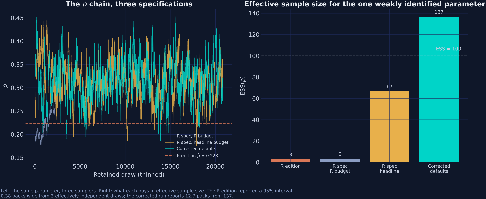

*Figure 12. Left: the ρ chain under three specifications. Right: effective sample size, with the conventional floor of 100 marked.*

The fifth row is the cross-check that matters most. `mlsynth.SPILLSYNTH(method="sar")` is an **independent port of the same paper by a different author**, written separately from `scspill`. At the same budget it reports an ATT of −16.525 against −16.868 from `scspill`, which is 0.34 packs apart, and an ESS of 135 against 137. Its interval is narrow because it follows the R convention on $\\alpha$, so two independent implementations agree on the point estimate and on the diagnostics while differing exactly where their conventions differ.

### 10.2 The six departures

The table below summarises the six differences between `scspill` and the R replication code. The script `analysis.py` stores the same table as `scspill_departures.csv`. The last column says whether each departure changes the California answer.

| # | Area | R replication code | scspill | Switch back with | Changes the answer? |
|---|---|---|---|---|---|
| 1 | Covariates | scrambled by a $(T,N,K)$ versus $(N,T,K)$ memory-layout mismatch | a proper $(T, N, K)$ array throughout | only by dropping the covariates | likely; not isolated here |
| 2 | Prior on $\\beta$ | flat-plus-ridge conditional | the horseshoe of the paper | `beta_prior="ridge"` | modestly |
| 3 | ATT bands | vary $\\rho$ only, $\\alpha$ at its posterior mean | paired $(\\alpha, \\rho)$ draws | `propagate_alpha=False` | **yes, the interval** |
| 4 | $\\rho$ sampler | fixed Metropolis step | Robbins–Monro toward 44% acceptance | `adapt_rho=False` | the interval, not the point |
| 5 | Factor scales | inconsistent $\\omega\_k$ conditionals; $\\mathcal{C}^{+}(0,1)$ hyperprior | $\\mathcal{N}(0, \\sigma^2\_\\eta \\omega\_k)$ with $\\mathcal{C}^{+}(0,10)$ | none | little, but the sampler was invalid |
| 6 | FFBS initialisation | $\\gamma\_1$ inconsistent with its own conditionals | coherent $\\gamma\_0 = 0$ | none | little, but the sampler was invalid |

Departure 1 deserves a paragraph of its own, because it is the most instructive kind of bug. The covariate array in the R code was indexed as though it were $(N, T, K)$ when it was laid out as $(T, N, K)$, which silently shuffles which price goes with which sales figure. Nothing crashes and nothing looks wrong; the estimate simply answers a slightly different question from the one asked. Because the only way to switch it back is to drop the covariates, which trades one specification error for another, this post does not isolate its effect, but it is the most plausible source of the 0.30-pack gap that remains in section 10.1.

### 10.3 What a joint distribution test catches

Departures 5 and 6 are errors in the latent-factor block, and they are not the kind of error that shows up in output. The documentation of `scspill` reports that validation against the replication package uncovered two such inconsistencies. A **Geweke joint distribution test** ([Geweke, 2004](https://doi.org/10.1198/016214504000001132)) is the tool designed to catch them, and they are the best argument for running one.

The idea fits in a few sentences. Draw parameters from the prior and simulate data from them, which gives samples from the joint distribution of parameters and data; this is the *marginal-conditional* route. Alternatively, simulate data once and then alternate between one sweep of the Gibbs sampler and a fresh simulation of the data, repeatedly; if every conditional distribution in the sampler is correct, this *successive-conditional* route targets the **same** joint distribution. The mean of any statistic must then agree between the two routes, and a systematic disagreement means that at least one conditional is wrong.

An $\\omega\_k$ conditional that treats $\\omega$ as a variance while its neighbours treat it as a precision produces exactly such a disagreement, and so does an FFBS initialisation that is inconsistent with its own conditionals. Neither changes the California answer much. Both mean, however, that the R sampler did not target the posterior stated in the paper, so its output had no clean interpretation.

This is the general argument for the test. A sampler with an incoherent conditional does not announce itself. It produces plausible numbers, converges, passes trace-plot inspection, and is still wrong.

## 11. Diagnostics

Three checks, all shipped as functions in `scspill.validation`, should run before any of the numbers above are believed. They take the inputs of the model directly rather than the fitted result. We therefore pull those inputs off the fit once.

```python
# result.inputs carries everything the sampler saw, already aligned.
Y0 = np.asarray(result.inputs.Y0, dtype=float).ravel()      # treated outcome, (T,)
Yc = np.asarray(result.inputs.Yc, dtype=float)              # donor outcomes, (T, N)
if Yc.shape[0] != Y0.size:
    Yc = Yc.T
X = None if result.inputs.X is None else np.asarray(result.inputs.X, dtype=float)

T0_idx = result.inputs.T0
Y0_pre, Yc_pre = Y0[:T0_idx], Yc[:T0_idx]
X_pre = None if X is None else X[:T0_idx]

print(f"Y0_pre {Y0_pre.shape}   Yc_pre {Yc_pre.shape}   "
      f"X_pre {None if X_pre is None else X_pre.shape}")
```

```text
Y0_pre (18,)   Yc_pre (18, 38)   X_pre (18, 38, 1)
```

The shape of `X_pre` is a proper $(T\_0, N, K)$ array. That third dimension is exactly where departure 1 of section 10.2 went wrong, because the R code indexed the same block as though it were $(N, T\_0, K)$. In Python the layout is checked by the shape itself.

### 11.1 Prior predictive check

A prior predictive check asks whether the prior generates data that look anything like the data we have. If it does not, the posterior is a contest between a badly specified prior and the likelihood, and the likelihood does not always win. We draw 2,000 parameter sets from the prior of the fitted model, including its single latent factor (`p=1`), simulate a donor panel from each, and compare nine summary statistics with their observed values.

```python
from scspill.validation import prior_predictive, plot_prior_predictive

W_raw, w_raw = result.inputs.W_raw, result.inputs.w_raw

ppc = prior_predictive(Y0_pre, W_raw, w_raw, result.alpha_hat,
                       Yc_obs=Yc_pre, X=X_pre, p=1,      # one latent factor, as in the fit
                       a0=3.0, b0=1.0, n_draws=2000, seed=SEED)

# PriorPredictiveResult carries `observed`, `stats` and `p_values` rather than
# a ready-made table; assemble the two that matter.
ppc_tab = pd.DataFrame({"statistic": list(ppc.p_values.keys()),
                        "observed": [ppc.observed[k] for k in ppc.p_values],
                        "p_value": list(ppc.p_values.values())})
print(ppc_tab.round(4).to_string(index=False))
```

```text
        statistic   observed  p_value
          yc_mean   131.4999   0.9105
       log_yc_var     6.9842   0.6990
spatial_quadratic 17844.7200   0.8205
      corr_y0_wyc     0.9449   0.6680
              ac1     0.8938   0.9950
              ac2     0.8105   1.0000
          pve_pc1     0.6248   0.0355
     avg_skewness    -0.3964   0.4565
     avg_kurtosis    -0.9427   0.7185
```

Each `p_value` is the share of prior draws whose statistic falls at or below the observed value. Values near 0.5 are unremarkable, while values near 0 or 1 mean that the observed statistic sits in a tail of what the prior expects. Six of the nine statistics land comfortably inside, and three do not.

The three tail statistics describe two different misfits. `ac1` (0.995) and `ac2` (1.000) say that the observed lag-1 and lag-2 autocorrelations of the donor series, 0.894 and 0.810, sit above almost every prior draw, so the prior under-predicts how persistent cigarette sales are. `pve_pc1` (0.036) says the opposite kind of thing about common movement: the first principal component explains 62.5% of the variance of the donor block, which is *less* than in 96% of the prior draws, so the prior expects panels even more dominated by one common component than the data are.

This is a mild warning rather than a failure. Both misfits concern the shape of the prior over whole donor panels, not the parameters that enter the effects, and 18 years of data on 38 donors carry far more information than these priors. The right response is the one taken in section 11.3, which checks whether reasonable changes to the priors move the answer.


*Figure 13. Observed statistics against their prior predictive distributions, drawn by `plot_prior_predictive`.*

### 11.2 The Geweke joint distribution test

Section 10.3 explained what the test does, and running it well requires care. The documentation of the function explains why: the successive-conditional simulator mixes slowly, so an under-resolved run flags **spurious** failures. Two rules follow from that, and both are in the documentation.

- Keep the test panel small. A large $T\_0 \\times N$ makes the $\\rho$ chain diffuse slowly, so $T\_0 = 4$ and $N = 4$ is what the function prescribes.
- Test the simplified kernel rather than the production one. The half-Cauchy scale hierarchies of the production kernel are funnel-shaped and, in the words of the documentation, "effectively untestable at feasible chain lengths", which is why the replication package only ever tested the simplified kernel, and then at two million draws.

The documentation also explains how to tell a real problem from a mixing artefact: *a genuine incoherence shows up as a stable, sign-consistent z across seeds and scales; mixing artifacts flip sign and shrink as the chain grows.* We therefore run the test twice, at two chain lengths. A real error should survive the longer run.

```python
from scspill.validation import geweke_test

for m in (20_000, 200_000):
    rep = geweke_test(kernel="simple", T0=4, N=4, K=0, p=1,
                      m_iid=m, m_mcmc=m, burn=5_000, seed=SEED)
    tab = pd.DataFrame(rep.table)
    # GewekeReport does the Bonferroni bookkeeping itself.
    print(f"m = {m:>7,}   max |z| = {tab['z'].abs().max():.2f}   "
          f"flagged {rep.n_flagged} of {len(tab)} at |z| > {rep.z_crit:.2f}   "
          f"passed = {rep.passed}")
```

```text
m =  20,000   max |z| = 3.48   flagged 1 of 8 at |z| > 2.73   passed = False
m = 200,000   max |z| = 2.50   flagged 0 of 8 at |z| > 2.73   passed = True
```

At 20,000 draws one statistic (`log_yc_var`, $z = 3.48$) crosses the Bonferroni threshold of 2.73, and the report comes back `passed = False`. At 200,000 draws nothing crosses it, and the maximum score falls from 3.48 to 2.50. Across the eight statistics, $|z|$ shrinks for six, and the flagged statistic flips sign, from +3.48 to −1.70.

That is the documented signature of a mixing artefact, not of an incoherent conditional. One statistic, `yc_mean`, moves the other way, from 0.17 to 2.50, but it also changes sign and stays below the threshold, which is again what slow mixing looks like. Had the sampler contained a real error, the flagged score would have held its sign and grown as the standard errors tightened around a genuinely wrong mean.

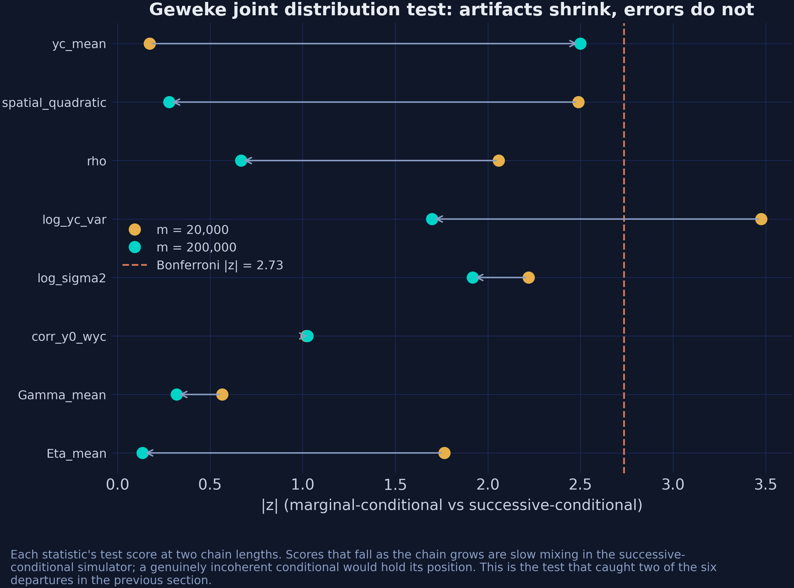

*Figure 14. The |z| of each statistic at 20,000 and 200,000 draws. Arrows show the direction of change; scores that fall are slow mixing, not incoherence.*

The pedagogical point is worth more than the result. A single Geweke run that flags a failure says little on its own. Two runs at different scales reveal which kind of failure it is.

### 11.3 Prior sensitivity

The last check varies the priors and asks whether the answer follows. The grid below moves the inverse-gamma hyperparameters $(a\_0, b\_0)$ of the error variance, the Metropolis step, and in one row the support of $\\rho$. Each row is a separate short run.

```python
from scspill.validation import prior_sensitivity

grid = pd.DataFrame([
    dict(a0=1.0, b0=1.0, rho_lo=-0.99, rho_hi=0.99, step_rho=0.05),
    dict(a0=3.0, b0=1.0, rho_lo=-0.99, rho_hi=0.99, step_rho=0.05),
    dict(a0=0.1, b0=0.1, rho_lo=-0.99, rho_hi=0.99, step_rho=0.05),
    dict(a0=1.0, b0=1.0, rho_lo=-0.50, rho_hi=0.50, step_rho=0.05),   # truncated
    dict(a0=1.0, b0=1.0, rho_lo=-0.99, rho_hi=0.99, step_rho=0.01),
    dict(a0=5.0, b0=2.0, rho_lo=-0.99, rho_hi=0.99, step_rho=0.05),
])
sens = prior_sensitivity(Yc, W_raw, w_raw, result.alpha_hat, grid, X=X, p=1,
                         m_burn=5_000, m_keep=20_000, base_seed=SEED)

# prior_sensitivity returns a PriorSensitivityResult, not a dataframe. The long
# table -- 18 rows over six parameter labels -- is on `.table`. Only rho here.
print(sens.table.query("parameter == 'rho'")
               .drop(columns="parameter").round(4).to_string(index=False))
```

```text
 grid_row  step_rho  rho_hi  rho_lo  b0  a0   mean     sd   q025   q975
        0      0.05    0.99   -0.99 1.0 1.0 0.8526 0.0073 0.8387 0.8672
        1      0.05    0.99   -0.99 1.0 3.0 0.7825 0.0103 0.7620 0.8025
        2      0.05    0.99   -0.99 0.1 0.1 0.7827 0.0107 0.7619 0.8040
        3      0.05    0.50   -0.50 1.0 1.0 0.4990 0.0010 0.4964 0.5000
        4      0.01    0.99   -0.99 1.0 1.0 0.8425 0.0232 0.7740 0.8638
        5      0.05    0.99   -0.99 2.0 5.0 0.8441 0.0239 0.7749 0.8662
```

**A caveat comes before reading these numbers.** `prior_sensitivity` runs the *simplified* Step-2 kernel (`kernel="simple"`), not the production sampler, so the level of $\\rho$ here is not the headline 0.316 and should not be compared with it. What is informative is the variation *across rows*, and there the finding is sharp.

Across the five rows with an unrestricted support, sweeping $a\_0$ from 0.1 to 5, $b\_0$ from 0.1 to 2 and the Metropolis step size by a factor of five moves the posterior mean of $\\rho$ by **0.070**. Row 3 truncates the support to $[-0.5, 0.5]$, and the posterior lands at **0.4990**, pinned against the bound with a standard deviation of 0.001. That is a shift of about 0.32 from the other rows, roughly **five times the movement produced by all the conventional prior settings together.**

The lesson is not that the inverse-gamma hyperparameters are irrelevant. It is that **the support constraint is a prior too**, and it is the one that nobody thinks to report. In the headline configuration the bound is $|\\rho| < 0.95$ and the posterior sits at 0.316, nowhere near it, so this model is not being squeezed; had we chosen a "conservative-looking" range of $[-0.5, 0.5]$ for this kernel, the answer would have been set by that choice rather than by the data.

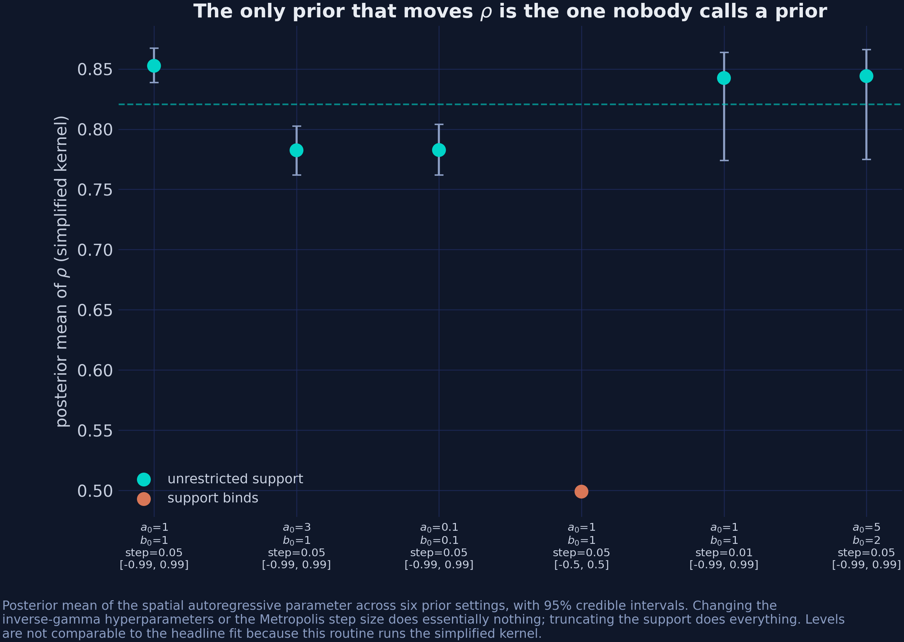

*Figure 15. Posterior mean of ρ across six prior settings, with 95% credible intervals. Orange marks the row where the support constraint binds.*

## 12. What the leak actually cost

Section 4.3 derived the bias of a SUTVA-imposing estimator as $-\\sum\_j \\alpha\_j \\xi^{c}\_{j}$ and verified it on three donors. The real panel supplies all the pieces, so the identity can be checked directly. The weights are the posterior means from Step 1, and the spillovers are the post-1988 means from section 9.6.

<div class="learn-card predict-card">
<p class="learn-card-kicker">Predict first</p>

The plug-in bias is $-\\sum\_j \\alpha\_j \\xi^{c}\_{j}$. Nevada has a weight of 0.20 and a spillover of −5.50, while Idaho and Utah have spillovers near −0.49. What share of the total bias will Nevada supply: about half, about three quarters, or nearly all of it? Commit to an answer before running the code.

<details class="learn-card-reveal">
<summary>Reveal the answer</summary>

**Answer.** Nearly all of it: 97%. Nevada contributes −1.098 of a total of −1.130, because its spillover is eleven times larger and its weight is far from zero. Utah comes second with −0.018, because its weight is larger than that of Idaho.

</details>
</div>

```python
alpha = pd.Series(np.asarray(result.alpha_hat, dtype=float), index=donors)
xi = means.reindex(donors)                 # post-1988 mean spillovers, section 9.6

contrib = (alpha * xi).sort_values()
print(contrib.head(4).round(4).to_string())
print(f"\nsum_j alpha_j * xi_j             : {contrib.sum():+.4f}")
print(f"att (purged) - att_scm (contam.) : {result.att - result.effects_detail.att_scm:+.4f}")
```

```text
Nevada    -1.0984
Utah      -0.0178
Idaho     -0.0060
Montana   -0.0060

sum_j alpha_j * xi_j             : -1.1295
att (purged) - att_scm (contam.) : -1.1863
```

The identity holds to 0.057 packs. The small residual arises because the purged ATT averages over paired $(\\alpha, \\rho)$ draws, while the plug-in decomposition uses the posterior mean $\\hat\\alpha$ alone. Three things follow from those four numbers.

**Nevada is 97% of the story.** Its contribution of −1.098 out of −1.130 comes from a weight of 0.200 multiplied by a spillover of −5.50. Utah has a spillover per capita comparable to that of Idaho but contributes three times as much bias, because Utah carries more weight, which is the "damage is a product of two things" point from section 4.3 in a real table.

**The direction is the one that section 4.3 predicted.** The spillovers are negative and the weights are positive, so the bias is positive, and the contaminated estimate is *closer to zero* than the purged one. With the horseshoe weights, ignoring the leak shrinks the estimated effect on California by 1.19 packs per capita per year, roughly 7% of the effect. Applying the same plug-in to the *simplex* weights, where Nevada carries 0.242 rather than 0.200, gives 1.51 packs, about 8% of the simplex estimate, because the constraint pushed more weight onto the one leaking donor.

A comparison across rows needs care. The simplex estimate of −18.43 is further from zero than the purged spatial estimate of −16.87, even though the simplex estimate is the more contaminated of the two. That is not a contradiction, because the two use different weights: the bias statement compares each estimate with its own purged version, not with the other stages.

**The correction is small.** After a spatial model, half a million MCMC draws and a rejected SUTVA restriction, the correction to the headline number is 1.2 packs out of 17. The honest summary is that **the spillover is detectable but substantively modest for California.** It was not modest for Nevada, which is a different question, and the one that classical synthetic control could not have asked.

## 13. The rest of the catalogue

`mlsynth` ships 69 estimator classes, and eight more of them will run on this panel. That gives nine configurations, because `SPILLSYNTH` has two methods worth separating. The table at the end of this section adds one column that keeps it honest: whether each estimator targets the same estimand as the ladder.

Two of the eight need input that the bare panel does not supply, and both say so with a clear error. `SpSyDiD` wants the 39 × 39 unit-inclusive matrix, and `BPSCS` wants point coordinates, which the block below builds from the contiguity graph itself rather than from a map. Using the graph keeps a single source of truth for who neighbours whom.

```python
# Two of the eight need something the bare panel does not supply.
# SpSyDiD wants the 39x39 UNIT-INCLUSIVE matrix, not the 38x38 donor block:
units = ["California"] + donors
W39 = pd.DataFrame(0.0, index=units, columns=units)
W39.loc[donors, donors] = W.values
W39.loc["California", donors] = w.to_numpy()
W39.loc[donors, "California"] = w.to_numpy()

# BPSCS wants point coordinates. Rather than hard-coding state centroids -- a
# second source of truth that could disagree with W -- embed the rook graph
# itself in 2-D by classical MDS on its shortest-path distances. These are NOT
# geographic coordinates, and the results table says so.
D_graph = scipy.sparse.csgraph.shortest_path(W39.to_numpy(), unweighted=True)
D_graph[~np.isfinite(D_graph)] = np.nanmax(D_graph[np.isfinite(D_graph)]) + 1.0

n = len(units)
J = np.eye(n) - np.ones((n, n)) / n          # the centring matrix
B = -0.5 * J @ (D_graph ** 2) @ J            # double-centred squared distances
ev, evec = np.linalg.eigh(B)
top2 = np.argsort(ev)[::-1][:2]
coords = pd.DataFrame(evec[:, top2] * np.sqrt(np.clip(ev[top2], 0, None)),
                      index=units, columns=["mds_1", "mds_2"])
df_coords = df.merge(coords.rename_axis("state").reset_index(), on="state", how="left")

print(coords.loc[["California", "Nevada", "Maine"]].round(3).to_string())
```

```text
            mds_1  mds_2
California -0.039  4.791
Nevada      0.511  3.811
Maine      -7.975 -0.182
```

The embedding passes a simple sanity check. California and Nevada land 1.12 apart while California and Maine land 9.36 apart, so the embedding has recovered the coarse geography of the graph without ever being shown a map. `df_coords` is what the `BPSCS` row below is fitted on.

The block below runs all nine configurations with the same configuration dictionary. The slow rows (`BVSS`, `BFSC` and `SPILLSYNTH(sar)`) take several minutes each, so the whole loop takes about half an hour. The loop records the time of each fit, which the discussion below uses.

```python
import time

BENCH = [   # label, class, extra settings, same estimand as the ladder?
    ("BVSS", mlsynth.BVSS, dict(n_iter=1000, burn_in=500, seed=SEED), True),
    ("MVBBSC", mlsynth.MVBBSC,
     dict(n_warmup=1000, n_samples=1000, n_chains=4, seed=SEED), True),
    ("BFSC", mlsynth.BFSC,
     dict(n_factors=8, n_warmup=500, n_samples=500, n_chains=4, seed=SEED), True),
    ("BPSCS", mlsynth.BPSCS,
     dict(df=df_coords, covariates=["retprice"], coords=["mds_1", "mds_2"],
          n_warmup=1000, n_samples=1000, n_chains=4, seed=SEED), True),
    ("SPILLSYNTH(sar)", mlsynth.SPILLSYNTH,
     dict(method="sar", spatial_W=W, spatial_w=w, p_factors=1, mcmc_iter=M_ITER,
          mcmc_burn=BURN, step_rho=0.01, mcmc_seed=SEED), True),
    ("SPILLSYNTH(cd)", mlsynth.SPILLSYNTH,
     dict(method="cd", affected_units=["Nevada"]), False),
    ("SpSyDiD", mlsynth.SpSyDiD, dict(spatial_matrix=W39), False),
    ("ISCM", mlsynth.ISCM, dict(inference=True, n_draws=2000, random_state=SEED), False),
    ("SPOTSYNTH", mlsynth.SPOTSYNTH,
     dict(selection="S1", forecast="loo", n_samples=2000, n_warmup=1000, seed=SEED), True),
]

fits, rows = {}, []
for label, cls, extra, comparable in BENCH:
    t0 = time.time()
    fits[label] = r = cls({**common, **extra}).fit()
    sar_part = getattr(r, "sar", None)          # SPILLSYNTH(sar) keeps its band here
    ci = sar_part.ate_ci if sar_part is not None else getattr(r, "att_ci", None)
    rows.append(dict(estimator=label, comparable=comparable, att=float(r.att),
                     lo95=float(ci[0]) if ci is not None else np.nan,
                     hi95=float(ci[1]) if ci is not None else np.nan,
                     seconds=time.time() - t0))

print(pd.DataFrame(rows).round(2).to_string(index=False))
```

```text
      estimator  comparable    att    lo95   hi95  seconds
           BVSS        True -16.32  -33.83  -6.55   222.28
         MVBBSC        True -23.13  -29.14 -17.10    18.95
           BFSC        True -18.10  -34.96  -0.65   280.36
          BPSCS        True -17.19  -32.04   1.80    94.06
SPILLSYNTH(sar)        True -16.52  -16.93 -16.18  1385.08
 SPILLSYNTH(cd)       False  -2.77     NaN    NaN     0.46
        SpSyDiD       False -17.11     NaN    NaN     0.04
           ISCM       False -37.76 -136.28  60.76     0.48
      SPOTSYNTH        True -26.32  -29.22 -23.86    10.81
```

The table below adds the family of each estimator to the same numbers. The intervals are those that each package reports, so they are not all of the same kind. Some are posterior intervals, and others come from resampling or from asymptotic approximations.

| Estimator | Family | Comparable? | ATT | 95% interval |
|---|---|---|---:|---|
| `BVSS`: soft simplex, spike-and-slab | Bayesian | yes | −16.32 | [−33.83, −6.55] |
| `MVBBSC`: Martinez and Vives-i-Bastida | Bayesian | yes | −23.13 | [−29.14, −17.10] |
| `BFSC`: Bayesian factor SC | Bayesian | yes | −18.10 | [−34.96, −0.65] |
| `BPSCS`: penalised SC under spillovers | spillover | yes | −17.19 | [−32.04, +1.80] |
| `SPILLSYNTH(sar)`: the same paper, ported | spillover | yes | −16.52 | [−16.93, −16.18] |
| `SPOTSYNTH`: spillover-detecting SC | spillover | yes | −26.32 | [−29.22, −23.87] |
| `SPILLSYNTH(cd)`: [Cao and Dowd (2019)](https://arxiv.org/abs/1902.07343) | spillover | **no** | −2.77 | none |
| `SpSyDiD`: spatial synthetic DiD | spillover | **no** | −17.11 | none |
| `ISCM`: inclusive SC ([Di Stefano and Mellace, 2024](https://arxiv.org/abs/2403.17624)) | spillover | **no** | −37.76 | [−136.28, +60.76] |

All nine configurations ran, and none raised an error. That is itself worth noting for a library this large, because several of these estimators need inputs beyond a plain panel. Four observations follow, and the first concerns the column that keeps this table honest.

**The `comparable` column does real work.** The three "no" rows are not failures; they are estimators answering different questions, and reading them against the ladder would produce nonsense. The list below explains each one.

- `SPILLSYNTH(cd)` measures against its *own* no-spillover baseline of about −10.5, not the simplex estimate of −18.43, so its −2.77 is a difference from a different starting point. Its Nevada spillover comes out at **+12.77**, opposite in sign to every other estimate here, because the construction of Cao and Dowd demeans the data and leaves one unit out.
- `SpSyDiD` reports three effects at once: a direct effect of −17.11, a total effect of −20.16, and an average indirect effect of **+14.88**. Quoting the first without the other two would be a choice, not a reading.
- `ISCM` returns −37.76 with an interval spanning [−136, +61]. It is not wrong, but it is uninformative on 18 pre-treatment periods, and its interval says so.

**Among the comparable rows, the spread is real but bounded.** Six estimators with six different prior structures span −16.3 to −26.3. `MVBBSC` and `SPOTSYNTH` sit furthest out: the first imposes a hard simplex with a Bernstein–von Mises interval, and the second removes suspected contaminated donors from the pool entirely rather than modelling them. Both are defensible designs, and neither changes the sign or the order of magnitude.

**Runtime spans four to five orders of magnitude**, from a fraction of a second for `SpSyDiD` to between 15 and 25 minutes for `SPILLSYNTH(sar)` at the headline budget, depending on the machine and its load. That is not a quality ranking. It is the difference between a closed-form estimator and a half-million-draw MCMC, which matters before putting one inside a bootstrap loop.

**Two of the eight needed input that the panel does not carry.** `SpSyDiD` raised `MlsynthDataError: Spatial matrix W has shape (38, 38); expected (39, 39)` until given the unit-inclusive matrix, and `BPSCS` raised `MlsynthConfigError: BPSCS coordinate column(s) not in the panel: ['lon','lat']` until given coordinates. Both are good errors, because they are loud, specific, and name the fix.

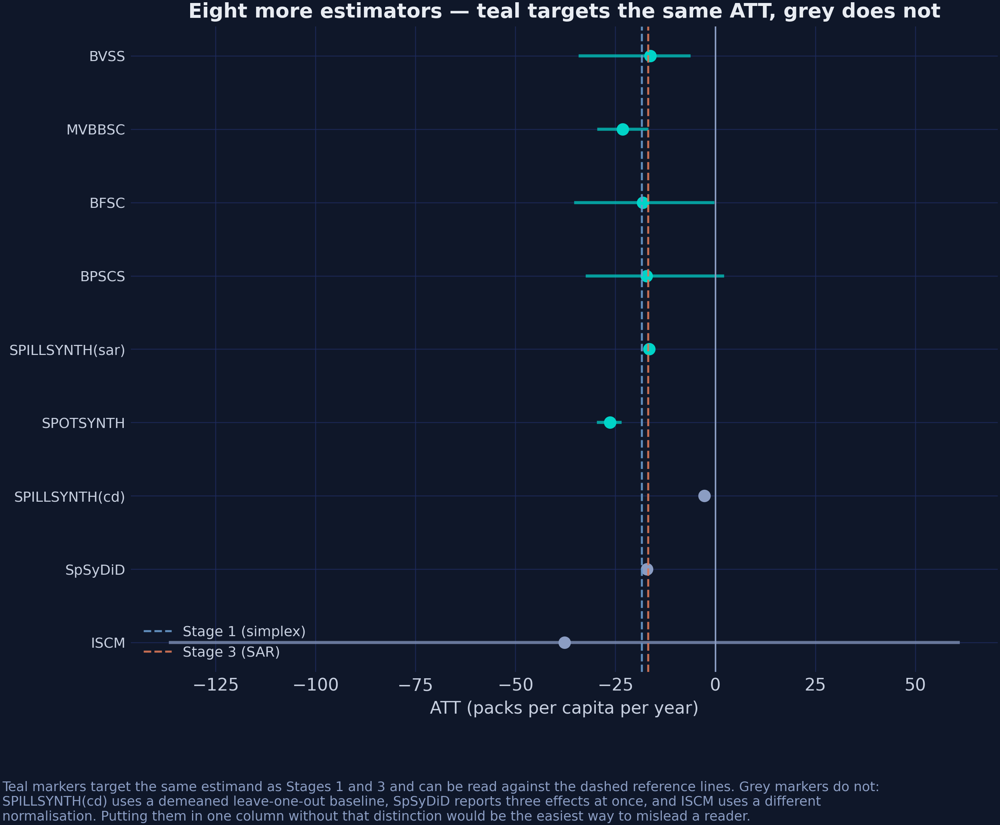

*Figure 16. Teal markers target the same estimand as Stages 1 and 3 and can be read against the dashed reference lines. Grey markers cannot.*

## 14. How long must the chain be?

Section 9.5 used 500,000 iterations to estimate a 13-year effect. That choice needs a justification, and the justification is not "more is better". The block below refits the corrected model at six chain lengths, from 5,000 to 500,000 iterations, which takes about five minutes in total.

<div class="learn-card predict-card">
<p class="learn-card-kicker">Predict first</p>

As the chain grows a hundredfold, from 5,000 to 500,000 iterations, two quantities change: the ATT and the effective sample size of $\\rho$. Which of the two will settle first, and will the ATT move by more than one pack across the ladder? Commit to an answer before running the code.

<details class="learn-card-reveal">
<summary>Reveal the answer</summary>

**Answer.** The ATT settles first, and it moves by only 0.34 packs across the whole ladder. The ESS of $\\rho$ climbs from 2.8 to 136.8 and crosses the conventional floor of 100 only at 500,000 iterations. The quantity of interest converges early, while the nuisance parameter sets the budget.

</details>
</div>

```python
for m in (5_000, 20_000, 50_000, 100_000, 250_000, 500_000):
    r = SCSPILL({**panel.config_kwargs(), "m_iter": m, "burn": m // 2,
                 "seed": SEED, "display_graphs": False,
                 "max_effect_draws": 5_000}).fit()
    print(f"{m:>7,}  ATT {r.att:+.4f}  width {r.att_ci[1] - r.att_ci[0]:6.3f}  "
          f"rho {r.rho_hat:.4f}  ESS {r.rho_ess:7.2f}  acc {r.acc_rho:.3f}")
```

```text
  5,000  ATT -16.6683  width 11.819  rho 0.3183  ESS    2.75  acc 0.403
 20,000  ATT -16.9258  width 12.520  rho 0.3486  ESS    5.82  acc 0.435
 50,000  ATT -17.0050  width 12.770  rho 0.3454  ESS   13.30  acc 0.435
100,000  ATT -16.8962  width 12.417  rho 0.3361  ESS   24.22  acc 0.443
250,000  ATT -16.8458  width 12.632  rho 0.3224  ESS   74.60  acc 0.444
500,000  ATT -16.8680  width 12.713  rho 0.3161  ESS  136.78  acc 0.444
```

| Iterations | ATT | CrI width | $\\hat\\rho$ | ESS($\\rho$) | Acceptance |
|---:|---:|---:|---:|---:|---:|
| 5,000 | −16.668 | 11.82 | 0.3183 | 2.8 | 0.403 |
| 20,000 | −16.926 | 12.52 | 0.3486 | 5.8 | 0.435 |
| 50,000 | −17.005 | 12.77 | 0.3454 | 13.3 | 0.435 |
| 100,000 | −16.896 | 12.42 | 0.3361 | 24.2 | 0.444 |
| 250,000 | −16.846 | 12.63 | 0.3224 | 74.6 | 0.444 |
| **500,000** | **−16.868** | **12.71** | **0.3161** | **136.8** | **0.444** |

Two columns move at completely different rates. **The ATT spans 0.337 packs across the whole ladder**, so a hundredfold increase in compute buys a third of a pack, which is small next to the 3.17-pack spread across estimators in section 16. **ESS($\\rho$) spans 2.8 to 136.8**, and it does not cross the conventional floor of 100 until half a million draws.

That is the whole argument for the budget. The estimand we came for converges early, while the nuisance parameter that makes the third stage *possible* does not. The budget is therefore set by $\\rho$, not by the ATT.

The first row also deserves a reading against section 10. At only 5,000 iterations, the corrected configuration already reports an interval 11.82 packs wide, against 0.384 in the R edition at the same budget. **The width was never about the chain length**; it was about propagating $\\alpha$.

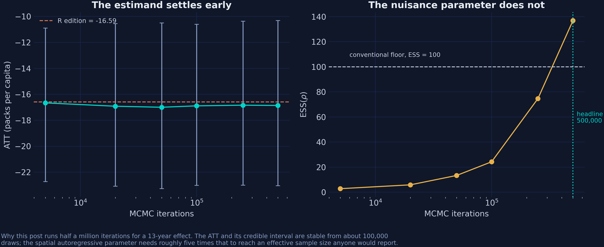

*Figure 17. Teal: the ATT and its credible interval. Gold: the effective sample size for ρ, against the conventional floor of 100.*

The last column is best read as a rate rather than a level. From 20,000 iterations onward the table delivers roughly **0.00055 effective draws per kept draw** (5.8 / 10,000, then 13.3 / 25,000, 24.2 / 50,000, 74.6 / 125,000 and 136.8 / 250,000, which range from 0.00048 to 0.00060). Effective sample size therefore grows roughly *linearly* in chain length, with no diminishing-returns cliff at which to stop, only a fixed and poor exchange rate. At that rate an ESS of 400 costs about 1.5 million iterations, or a few more minutes of sampling, and exercise 4 asks whether that purchase changes anything.

## 15. Monte Carlo: does modelling the leak pay?

Everything so far has used one panel, where the truth is unknown. `scspill` ships a simulation module, so the same question can be asked where the truth is planted. The design below uses a 4 × 4 rook lattice, 20 pre-periods, 10 post-periods and 60 replications per cell, at seven known spillover intensities, and three estimators see each simulated data set.

<div class="learn-card predict-card">
<p class="learn-card-kicker">Predict first</p>

In the simulation, the Bayesian synthetic control without a spatial layer (BSCM) is fitted to data in which the true $\\rho$ is −0.6. Its bias will be modest, around −0.14. Will its nominal 95% credible interval still cover the truth in most replications, in about half, or almost never? Commit to an answer before running the code.

<details class="learn-card-reveal">
<summary>Reveal the answer</summary>

**Answer.** Almost never: the coverage is 0.002. Its intervals are far narrower than its bias, so a modest bias is enough to push the truth outside them in essentially every replication. The spatial model covers at 0.983 in the same cell.

</details>
</div>

```python
from scspill.simulate import mc_grid

mc = mc_grid(Ns=(16,), T0s=(20,), T1=10,
             rhos=(-0.6, -0.3, -0.1, 0.0, 0.1, 0.3, 0.6),
             sims_per=60, K=1, beta=(1.0,), sigma2=0.1,
             treated=(0, 1, 2, 3), m_iter=3_000, burn=1_000,
             step_rho=0.05, seed=SEED)

print(mc.round(4).to_string(index=False))
```

```text
 N  T0  T1  rho  method  bias_point  rmse_point  cover95_point
16  20  10 -0.6     SCM     -0.0848      0.4111            NaN
16  20  10 -0.6    BSCM     -0.1356      0.1896         0.0017
16  20  10 -0.6 SCSPILL     -0.0003      0.0041         0.9833
16  20  10 -0.3     SCM     -0.0877      0.3690            NaN
16  20  10 -0.3    BSCM     -0.0705      0.0995         0.0033
16  20  10 -0.3 SCSPILL     -0.0012      0.0069         0.9833
16  20  10 -0.1     SCM     -0.0080      0.3353            NaN
16  20  10 -0.1    BSCM     -0.0260      0.0363         0.0050
16  20  10 -0.1 SCSPILL     -0.0029      0.0093         0.9500
16  20  10  0.0     SCM      0.0069      0.3268            NaN
16  20  10  0.0    BSCM     -0.0000      0.0000         1.0000
16  20  10  0.0 SCSPILL      0.0005      0.0083         1.0000
16  20  10  0.1     SCM      0.0147      0.3057            NaN
16  20  10  0.1    BSCM      0.0285      0.0403         0.0067
16  20  10  0.1 SCSPILL     -0.0000      0.0113         0.9517
16  20  10  0.3     SCM      0.0787      0.3121            NaN
16  20  10  0.3    BSCM      0.0978      0.1443         0.0017
16  20  10  0.3 SCSPILL     -0.0015      0.0170         0.9033
16  20  10  0.6     SCM      0.2392      0.4709            NaN
16  20  10  0.6    BSCM      0.2880      0.4041         0.0000
16  20  10  0.6 SCSPILL      0.0033      0.0263         0.9667
```

The table below extracts the bias and coverage columns for the three estimators. The truth is planted, so bias here is a real bias rather than a difference between models. Coverage is the share of replications in which the 95% interval contains the truth.

| True $\\rho$ | Bias: SCM | Bias: BSCM | Bias: SCSPILL | Coverage: BSCM | Coverage: SCSPILL |
|---:|---:|---:|---:|---:|---:|
| −0.6 | −0.085 | −0.136 | −0.0003 | 0.002 | 0.983 |
| −0.3 | −0.088 | −0.071 | −0.0012 | 0.003 | 0.983 |
| −0.1 | −0.008 | −0.026 | −0.0029 | 0.005 | 0.950 |
| 0.0 | +0.007 | −0.000 | +0.0005 | 1.000 | 1.000 |
| +0.1 | +0.015 | +0.029 | −0.0000 | 0.007 | 0.952 |
| +0.3 | +0.079 | +0.098 | −0.0015 | 0.002 | 0.903 |
| +0.6 | +0.239 | +0.288 | +0.0033 | 0.000 | 0.967 |

The bias column behaves as the identity of section 9.1 predicts. **BSCM is unbiased at $\\rho = 0$ and biased everywhere else**, with a bias that grows with $|\\rho|$ in the direction of the spillover; SCM follows the same pattern at $\\rho = \\pm 0.6$, although its smaller cells are within Monte Carlo error of each other. SCSPILL sits within 0.004 of zero at every value, including $\\rho = \\pm 0.6$.

The coverage column is more striking and needs care. SCSPILL intervals cover at 0.90–1.00 against a nominal 0.95, which is good, although the 0.903 at $\\rho = 0.3$ is a noticeable dip. BSCM intervals cover at **essentially zero everywhere except $\\rho = 0$**. That is not because BSCM is broken, but because its posterior intervals in this design are far narrower than its bias: at $\\rho = -0.6$ its root-mean-square error across replications is 0.19, of which 0.136 is bias, yet its intervals are narrow enough that a bias of that size falls outside them in almost every replication. The interval describes the precision of the posterior, not the accuracy of the estimator, and under a misspecified model those are different things.

One detail is easy to over-read. At $\\rho = 0$ exactly, the bias and RMSE of BSCM are both **0.0000**, while the RMSE of classical SCM is 0.327. In this design the untreated outcome of the treated unit is an exact unconstrained combination of the donors by construction, so with no spillover an unconstrained estimator recovers the truth exactly, while the simplex cannot; the third of a unit of error at $\\rho = 0$ is the price of the constraint, as section 4.2 priced it by hand.

Two caveats apply. Sixty replications per cell give a Monte Carlo standard error of about 0.028 on a coverage of 0.95, so differences of a percentage point or two are noise; the simulation study in the paper uses 1,000 replications. In addition, the inner sampler of `mc_grid` fixes `adapt_rho=False` to mirror the reference study, so this section isolates the *modelling* question, not the *sampling* fix of section 10.

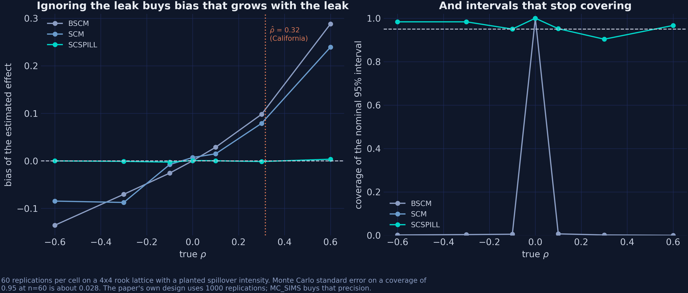

*Figure 18. Left: bias against the planted ρ. Right: coverage of the nominal 95% interval, with the estimated ρ̂ for California marked.*

At the value of $\\rho$ that this post estimates for California, 0.316, the simulation says that a SUTVA-imposing estimator carries a bias of around 0.08 to 0.10 in the units of that design. The simulated outcome is on a different scale, so the two numbers are not convertible. The direction and the relative size agree, however, with 1.19 packs against an effect of 16.87.

## 16. The whole ladder

Every number above fits in one table. The block below assembles it from the fits already in memory, with the R edition alongside. The column `gap_to_R` is the honest measure of how much the implementation choice mattered.

```python
# Stage 1 interval: resample the 13 post-treatment gaps, as the R edition does.
gap_sc = y_treated - np.asarray(sc.time_series.counterfactual_outcome, dtype=float).ravel()
rng = np.random.default_rng(SEED)
boot = [rng.choice(gap_sc[post], size=post.sum(), replace=True).mean() for _ in range(2000)]
sc_lo, sc_hi = np.quantile(boot, [0.025, 0.975])

ss = fits["SPILLSYNTH(sar)"]
ladder = pd.DataFrame({
    "stage": ["1. Classical SC", "2a. Bayesian SC (BSCM)", "2b. Bayesian SC (rho = 0)",
              "3. Bayesian spatial SC", "3'. Bayesian spatial SC"],
    "engine": ["mlsynth", "mlsynth", "scspill", "scspill", "mlsynth"],
    "att": [sc.att, bscm.att, result.effects_detail.att_scm, result.att, ss.att],
    "lo95": [sc_lo, bscm.att_ci[0], np.nan, result.att_ci[0], ss.sar.ate_ci[0]],
    "hi95": [sc_hi, bscm.att_ci[1], np.nan, result.att_ci[1], ss.sar.ate_ci[1]],
    "r_edition": [-18.46, np.nan, -15.84, -16.59, -16.59],
})
ladder["gap_to_R"] = ladder["att"] - ladder["r_edition"]
print(ladder.round(3).to_string(index=False))
```

```text
                    stage  engine     att    lo95    hi95  r_edition  gap_to_R
          1. Classical SC mlsynth -18.428 -22.078 -14.295     -18.46     0.032
   2a. Bayesian SC (BSCM) mlsynth -18.847 -26.457  -9.988        NaN       NaN
2b. Bayesian SC (rho = 0) scspill -15.682     NaN     NaN     -15.84     0.158
   3. Bayesian spatial SC scspill -16.868 -23.045 -10.332     -16.59    -0.278
  3'. Bayesian spatial SC mlsynth -16.525 -16.933 -16.176     -16.59     0.065
```

The table below adds the number of active donors to the same results. It also rounds the intervals for reading. The intervals are not all of the same kind, which the paragraph after the table explains.

| Stage | Engine | ATT | 95% interval | Active donors | R edition | Gap |
|---|---|---:|---|---:|---:|---:|
| 1. Classical SC | mlsynth | −18.428 | [−22.08, −14.30] | 5 | −18.46 | +0.032 |
| 2a. Bayesian SC (BSCM) | mlsynth | −18.847 | [−26.46, −9.99] | 26 | none | none |
| 2b. Bayesian SC ($\\rho = 0$) | scspill | −15.682 | none | 25 | −15.84 | +0.158 |
| 3. Bayesian spatial SC | scspill | −16.868 | [−23.05, −10.33] | 25 | −16.59 | −0.278 |
| 3′. Bayesian spatial SC | mlsynth | −16.525 | [−16.93, −16.18] | not reported | −16.59 | +0.065 |

The intervals differ in kind. The Stage 1 interval resamples the 13 yearly gaps and ignores all uncertainty about the weights, so it is a descriptive band, comparable with the R edition but not a valid confidence interval for synthetic control; the Bayesian intervals are model-based credible intervals. Formal inference for a single treated unit usually relies on placebo or permutation tests ([Abadie, 2021](https://doi.org/10.1257/jel.20191450)), which this post does not repeat. Three observations close the argument.

**Every stage agrees on the sign, and the spread is 3.17 packs.** The estimates run from −18.85 to −15.68 across two libraries, four prior structures and one spatial layer. Within the assumptions of these designs, Proposition 99 reduced per-capita cigarette sales in California by somewhere between 15 and 19 packs a year, and no modelling choice on this ladder moves the estimate outside that band.

**The maximum disagreement with the R edition is 0.278 packs, across four comparable stages.** Two implementations in two languages, one using hand-written C++ and the other a pip-installable package, agree to within about 1.7% on every stage. That agreement is strong evidence that both code their estimators correctly.

**The active donor count is the unstable quantity, not the effect.** It is five under the simplex and 25–26 under every prior. A conclusion of the form "the ATT is about −17" barely depends on the modelling choices, whereas a conclusion of the form "synthetic California is mostly Utah, Nevada, Montana and Connecticut" rests entirely on a constraint that we chose.

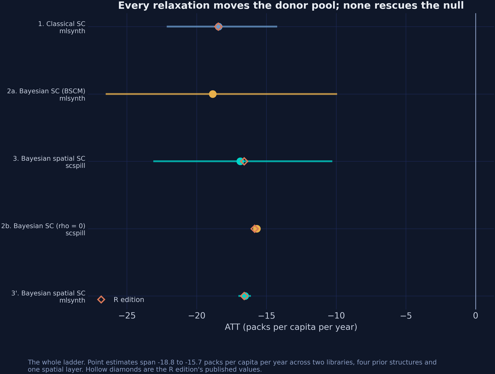

*Figure 19. Point estimates and intervals across the ladder. Hollow diamonds are the published values of the R edition.*

## 17. Which estimator should we choose?

Nothing in this post argues that the spatial model is always the right one. It argues that the spatial model answers a question the others cannot, and that the question should be settled before the estimator is chosen. The decision tree below orders the three questions that matter.

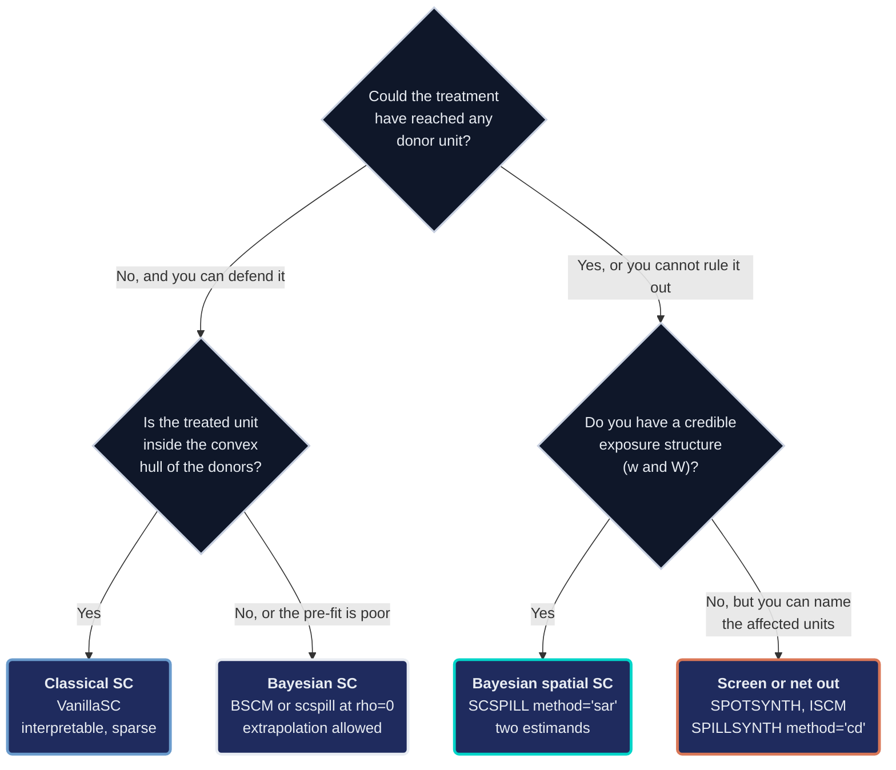

The first question is the one that gets skipped, and it is the only one with no statistical answer. Whether Proposition 99 could plausibly have reached Nevada is a question about cigarettes, borders, tourism and advertising, not about panels. The data can tell us how large the leak was *given* that we allowed for one, but they cannot tell us to look.

The second question is a diagnostic we already have. A classical fit with a poor pre-treatment RMSE relative to the scale of the outcome signals that the treated unit is hard to reach from inside the hull, which is exactly the situation that section 4.2 constructed. Here the RMSE was 1.60 against a mean of 117.7, so the simplex was not obviously straining.

The third question is the practical constraint. The spatial model needs someone to supply $\\mathbf{w}$ and $W$, and those are modelling choices that carry real content. Contiguity is a natural default for a tax, but trade flows, migration or commuting intensity may suit other policies better, and the Sudan application shipped with `scspill` uses bilateral trade for exactly that reason.

## 18. Common misconceptions

Several tempting readings of this analysis are wrong, and each of them can be checked against a number already in the post. The cards below state each myth and then what is actually true. They are worth opening after a first read, as a check on what has stuck.

<details class="learn-card misconception-card">
<summary><span class="learn-card-kicker">Misconception</span> "Any contaminated donor biases a synthetic control."</summary>

**What is actually true.** The bias is the product of a weight and a spillover, $-\\sum\_j \\alpha\_j \\xi^{c}\_j$, so a contaminated donor with zero weight does no harm. Idaho and Utah receive spillovers of about −0.49 each, but with small weights they contribute only −0.006 and −0.018 to the bias, whereas Nevada, with a weight of 0.20, contributes −1.098 of the total of −1.130 (section 12).

</details>

<details class="learn-card misconception-card">
<summary><span class="learn-card-kicker">Misconception</span> "A credible interval for rho that excludes zero proves that Proposition 99 leaked into Nevada."</summary>

**What is actually true.** One $\\rho$ governs both the exposure to California and the co-movement among neighbouring donors (section 9.2), so the interval [0.231, 0.403] is first of all evidence of spatial dependence among donor outcomes. The model reads part of that dependence as a leak because it ties the two channels together, so the Nevada spillover of −5.50 is a model-based estimate, and a different graph or separate intensities could apportion it differently.

</details>

<details class="learn-card misconception-card">
<summary><span class="learn-card-kicker">Misconception</span> "The R edition reported a narrow interval because its chain was too short."</summary>

**What is actually true.** Running the R specification for 100 times as many iterations widens the interval only from 0.482 to 0.702 packs (section 10.1). The width comes from holding the donor weights fixed at their posterior mean; propagating $\\alpha$ widens it to 12.71 packs, and even at 5,000 iterations the corrected sampler already reports 11.82 (section 14).

</details>

<details class="learn-card misconception-card">
<summary><span class="learn-card-kicker">Misconception</span> "A narrower credible interval means a better estimator."</summary>

**What is actually true.** In the simulation of section 15, the Bayesian synthetic control without a spatial layer reports narrow intervals that cover the truth in 0.2% of replications at $\\rho = -0.6$, while the spatial model covers in 98.3%. An interval describes the precision of a posterior under its model; when the model ignores the leak, a narrow interval only means a confident wrong answer.

</details>

<details class="learn-card misconception-card">
<summary><span class="learn-card-kicker">Misconception</span> "The spatial model deals with contamination by dropping Nevada from the donor pool."</summary>

**What is actually true.** Stage 3 keeps Nevada, with a posterior weight of 0.20, and reconstructs its untreated path instead (section 9.3). Dropping contaminated donors is a different design, which `SPOTSYNTH` implements, and it reports −26.32 rather than −16.87 (section 13), so the choice between modelling and screening is consequential.

</details>

## 19. Discussion

Section 1 asked how much of the Proposition 99 answer each assumption was carrying. The analysis gives three answers, and one statement of what it does not establish. We take them in turn.

**The effect on California is robust.** Across two libraries, four prior structures, one spatial layer and an independent third implementation, every estimator *on the ladder* reports between −15.7 and −18.8 packs per capita per year, and every interval on the ladder excludes zero. Widening to the six comparable estimators of section 13 stretches the range to between −16.3 and −26.3 without ever changing the sign, and only `BPSCS`, whose interval spans [−32.04, +1.80], leaves zero inside its interval. Under the identifying assumptions of these designs, the evidence consistently points to a large reduction in sales, and on the ladder no modelling choice moves the estimate by more than about 20%.

**The composition of the donor pool is not robust at all.** The same data support five active donors or 25, depending entirely on whether sparsity is imposed by a constraint or expressed as a prior. Sentences of the form "synthetic California is mostly Utah, Nevada, Montana and Connecticut" read like findings but are closer to artefacts of $\\Delta$. The gap between what is stable (the ATT) and what is not (the weights) is worth internalising, because the weights are the part that tends to get narrated.

**The model detects a spillover, and its direction is the surprise.** Nevada receives an estimated spillover of −5.50 packs per capita per year, an order of magnitude more than any other state, with a credible interval for $\\rho$ that excludes zero. The prior expectation was that cross-border shopping would *raise* sales in Nevada, yet the estimate says that they came in below their no-treatment path. The model cannot identify the mechanism: the anti-smoking campaign may have crossed the border, or the many Californian visitors who buy cigarettes in Nevada may have bought fewer, and both are hypotheses rather than findings.

That has a consequence for how the policy is described. If the spillover is real, reporting only the number for California understates the total reduction in recorded cigarette sales associated with Proposition 99, because sales in a neighbouring state that never voted on it also fell. It also means that, for any fixed set of donor weights, the contaminated estimate is biased *toward zero*, so the classical estimate was slightly conservative relative to its own purged version, for a reason it could not have reported.

**What this post does not establish.** The SAR layer does not make anything causal that was not causal before, because it is a model of how outcomes co-move across a fixed, researcher-supplied graph, and swapping contiguity for a different graph would produce different spillovers. The identifying assumption of section 9.3, that some fixed unconstrained combination of donors reproduces California exactly, is strong and cannot be tested after 1988. Finally, $\\rho$ mixes slowly even at half a million draws, so an effective sample size of 137 is reportable but not comfortable, and the right deliverable is the interval together with its ESS, not the point estimate on its own.

## 20. Summary and next steps

The list below condenses the post into six points. Each one points back to the section that supports it. Together they are the minimum worth remembering.

- **Method.** Three nested estimators run on one panel. The simplex constrains the weights to a convex combination, the horseshoe replaces that constraint with a prior that prefers zero without forbidding anything, and the SAR layer drops SUTVA on the donor pool and adds a second estimand. Each stage keeps everything the previous one assumed but one thing.
- **Data.** The Abadie–Diamond–Hainmueller Proposition 99 panel covers 39 states over 1970–2000 and comes bundled with rook-contiguity weights in which Nevada is the only donor-pool neighbour of California. The treatment is pinned at 1988 throughout, so all three stages share a post-period.
- **Result.** The ATT is −18.43 under the simplex, −15.68 under the horseshoe and −16.87 under the spatial model, with $\\hat\\rho = 0.316$ (interval excluding zero) and a Nevada spillover of −5.50 packs, 11 times the next-largest donor. Modelling the leak makes the estimate *larger* than its no-spillover counterpart with the same weights, because the contaminated donor moved in the same direction as the treated unit.
- **Inferential lesson.** The R edition of this post reported a 95% interval 0.38 packs wide from a chain whose ESS for $\\rho$ this post recomputes as 2.93. The corrected run reports 12.71 packs from an ESS of 137, with nothing about the policy changed. An effective sample size belongs beside every credible interval, and the interval must also propagate the uncertainty in the weights.
- **Limitation.** $\\rho$ is the slowest-mixing parameter in the model. Its posterior is tight, with a standard deviation of 0.043 on a support 1.9 wide, but its chain is heavily autocorrelated, because the two-step sampler moves it by random-walk Metropolis, and half a million draws buy an ESS of 137. The evidence for a leak also rests on a single $\\rho$ shared with the ordinary spatial co-movement of donors.
- **Next step.** Everything here conditions on a contiguity graph that nobody estimated. The natural follow-up is [Bayesian estimation of the spatial weight matrix itself](/tutorials/r_estimateW/), which asks the data who the neighbours are rather than assuming that a border settles it.

The [R edition of this post](/tutorials/r_sc_bayes_spatial/) runs the same three stages with the R and C++ code of the authors. The [synthetic control ladder in Python](/tutorials/python_sc_dsc_sdid/) climbs a different set of stages, from difference-in-differences to synthetic difference-in-differences ([Arkhangelsky et al., 2021](https://doi.org/10.1257/aer.20190159)), on the Brexit referendum. Together the three posts cover the main families of synthetic control estimators on two case studies.

## 21. Exercises

The five exercises below run from a warm-up to two stretch problems. Each one reuses objects created earlier in the post, so they should be run after the main code. Every solution was run at the headline budget, and its printed output is shown verbatim.

### 21.1 Warm-up: Move the treatment year

Rebuild `df["treated"]` with 1989 rather than 1988 as the first treated year, following the Abadie–Diamond–Hainmueller convention, and rerun the stages. You should compare how much each ATT moves with the gap between the simplex and the horseshoe. Then explain why one post-treatment year matters as much, or as little, as it does.

<details class="learn-card solution-card">
<summary><span class="learn-card-kicker">Solution</span> Show the code and the numbers</summary>

```python
df89 = df.copy()
df89["treated"] = ((df89["state"] == "California") & (df89["year"] >= 1989)).astype(int)

sc89 = mlsynth.VanillaSC({**common, "df": df89}).fit()
sar89 = SCSPILL({**panel.config_kwargs(), "df": df89, "m_iter": M_ITER, "burn": BURN,
                 "seed": SEED, "display_graphs": False, "max_effect_draws": 5_000}).fit()

print(f"Stage 1, simplex   : 1988 {sc.att:+.3f}   1989 {sc89.att:+.3f}")
print(f"Stage 2, rho = 0   : 1988 {result.effects_detail.att_scm:+.3f}   "
      f"1989 {sar89.effects_detail.att_scm:+.3f}")
print(f"Stage 3, spatial   : 1988 {result.att:+.3f}   1989 {sar89.att:+.3f}")
```

```text
Stage 1, simplex   : 1988 -18.428   1989 -19.514
Stage 2, rho = 0   : 1988 -15.682   1989 -13.376
Stage 3, spatial   : 1988 -16.868   1989 -14.478
```

The simplex estimate grows in magnitude by about one pack, because dropping a largely untreated year from the post-period removes a gap of only −3.2. The two Bayesian estimates move the other way, by 2.3 and 2.4 packs, because one more pre-treatment year changes the Step 1 weights themselves. A single year therefore matters less through the averaging than through the weights, and its effect is comparable to the 3.17-pack spread across estimators.

</details>

### 21.2 Core: Misplace the graph on purpose

Move the exposure from Nevada to Utah, as if Utah rather than Nevada bordered California, and refit the spatial model. Setting `spatial_w` to zero everywhere is not an option, because `scspill` requires at least one exposed donor. You should ask whether $\\hat\\rho$ still excludes zero and which state now receives the largest spillover, and what that implies about what $\\rho$ measures.

<details class="learn-card solution-card">
<summary><span class="learn-card-kicker">Solution</span> Show the code and the numbers</summary>

```python
w_utah = pd.Series(0.0, index=w.index, name=w.name)
w_utah["Utah"] = 1.0                      # pretend Utah, not Nevada, borders California

r_utah = SCSPILL({**panel.config_kwargs(), "spatial_w": w_utah,
                  "m_iter": M_ITER, "burn": BURN, "seed": SEED,
                  "display_graphs": False, "max_effect_draws": 5_000}).fit()

sp = r_utah.spillover_panel.loc[TREAT_YEAR:].mean()
print(f"rho {r_utah.rho_hat:.4f}  CrI [{r_utah.rho_ci[0]:.4f}, {r_utah.rho_ci[1]:.4f}]  "
      f"ATT {r_utah.att:+.3f}  (true graph {result.att:+.3f})")
top = sp.reindex(sp.abs().sort_values(ascending=False).index).head(4)
print(top.round(3).rename_axis(None).to_string())
```

```text
rho 0.2921  CrI [0.2141, 0.3716]  ATT -16.075  (true graph -16.868)
Utah      -4.831
Nevada    -0.787
Idaho     -0.445
Wyoming   -0.281
```

With the wrong graph, $\\hat\\rho$ is still 0.29 with an interval that excludes zero, and the model now assigns the largest spillover to Utah. The interval for $\\rho$ therefore mostly measures spatial dependence among the donors, which exists whatever we assume about the border, and the location of the leak comes from the graph we supply. This is the strongest argument in the post for treating the Nevada spillover as a model-based estimate rather than a finding.

</details>

### 21.3 Core: Widen the exposure

Give Idaho and Utah, the two donors two steps from California through Nevada, an exposure weight of 0.5 alongside Nevada, and refit. You should compare $\\hat\\rho$, the ATT and the spillovers on the three states with the rook-contiguity results. Then decide which conclusions of the post survive this change.

<details class="learn-card solution-card">
<summary><span class="learn-card-kicker">Solution</span> Show the code and the numbers</summary>

```python
w2 = w.copy()
w2[["Idaho", "Utah"]] = 0.5               # two steps from California, through Nevada

r_w2 = SCSPILL({**panel.config_kwargs(), "spatial_w": w2,
                "m_iter": M_ITER, "burn": BURN, "seed": SEED,
                "display_graphs": False, "max_effect_draws": 5_000}).fit()

sp2 = r_w2.spillover_panel.loc[TREAT_YEAR:].mean()
print(f"rho {r_w2.rho_hat:.4f}  ATT {r_w2.att:+.3f}  (rook: rho {result.rho_hat:.4f}, "
      f"ATT {result.att:+.3f})")
print(sp2[["Nevada", "Idaho", "Utah"]].round(3).rename_axis(None).to_string())
```

```text
rho 0.3220  ATT -16.487  (rook: rho 0.3161, ATT -16.868)
Nevada   -3.239
Idaho    -1.772
Utah     -1.768
```

The ATT on California barely moves, from −16.87 to −16.49, and $\\hat\\rho$ hardly changes at all. The spillovers, however, are redistributed: Nevada falls from −5.50 to −3.24, while Idaho and Utah rise to about −1.77 each. The effect on California survives the change of graph, whereas the geography of the spillover is largely a property of the graph we assume.

</details>

### 21.4 Stretch: Buy a better $\\rho$

Section 14 shows effective sample size growing almost linearly in chain length, at about 0.00055 effective draws per kept draw. You should extrapolate how many iterations an ESS of 400 would take, run it, and check whether the linear rate holds that far out. Then decide whether the longer chain changes anything you would report.

<details class="learn-card solution-card">
<summary><span class="learn-card-kicker">Solution</span> Show the code and the numbers</summary>

```python
r_long = SCSPILL({**panel.config_kwargs(), "m_iter": 1_500_000, "burn": 750_000,
                  "seed": SEED, "display_graphs": False,
                  "max_effect_draws": 5_000}).fit()

print(f"ATT {r_long.att:+.4f}  width {r_long.att_ci[1] - r_long.att_ci[0]:.3f}  "
      f"rho {r_long.rho_hat:.4f}  ESS {r_long.rho_ess:.1f}")
print(f"ESS per kept draw: {r_long.rho_ess / 750_000:.6f}  "
      f"(500k run: {result.rho_ess / 250_000:.6f})")
```

```text
ATT -16.8137  width 12.724  rho 0.3231  ESS 267.2
ESS per kept draw: 0.000356  (500k run: 0.000547)
```

At 0.00055 effective draws per kept draw, an ESS of 400 needs about 730,000 kept draws, so about 1.5 million iterations with half discarded as burn-in. The run delivers an ESS of 267 instead, because the rate falls to 0.00036, which is a reminder that ESS estimates from a slowly mixing chain are themselves noisy and the linear rule is only a rough guide. Nothing reportable changes, however: the ATT moves to −16.81 and the interval width to 12.72, so the 500,000-iteration run was already adequate for the estimand, and the extra draws only make the summary of $\\rho$ more trustworthy.

</details>

### 21.5 Stretch: A second case study

`scspill.data.load_sudan()` ships the other application of the paper: 34 African countries from 2000 to 2015, with Sudan treated by the 2011 secession of South Sudan and exposure weights built from bilateral trade rather than borders. You should run the simplex, the $\\rho = 0$ case and the spatial model on it. Then check whether a dense trade-based graph identifies $\\rho$ better than sparse contiguity did.

<details class="learn-card solution-card">
<summary><span class="learn-card-kicker">Solution</span> Show the code and the numbers</summary>

```python
from scspill.data import load_sudan

sudan = load_sudan()
cfg_sd = sudan.config_kwargs()
sc_sd = mlsynth.VanillaSC({"df": cfg_sd["df"], "outcome": cfg_sd["outcome"],
                           "treat": cfg_sd["treat"], "unitid": cfg_sd["unitid"],
                           "time": cfg_sd["time"], "display_graphs": False}).fit()
r_sd = SCSPILL({**cfg_sd, "m_iter": M_ITER, "burn": BURN, "seed": SEED,
                "display_graphs": False, "max_effect_draws": 5_000}).fit()

print(f"Stage 1, simplex : ATT {sc_sd.att:,.1f}")
print(f"Stage 2, rho = 0 : ATT {r_sd.effects_detail.att_scm:,.1f}")
print(f"Stage 3, spatial : ATT {r_sd.att:,.1f}  CrI [{r_sd.att_ci[0]:,.1f}, {r_sd.att_ci[1]:,.1f}]")
print(f"rho {r_sd.rho_hat:.4f}  CrI [{r_sd.rho_ci[0]:.4f}, {r_sd.rho_ci[1]:.4f}]  "
      f"ESS {r_sd.rho_ess:.1f}  (California: {result.rho_ess:.1f})")
```

```text
Stage 1, simplex : ATT -67.0
Stage 2, rho = 0 : ATT -30.2
Stage 3, spatial : ATT -29.3  CrI [-156.2, 95.1]
rho 0.4075  CrI [0.2656, 0.5376]  ESS 155.1  (California: 136.8)
```

The outcome here is GDP per capita in constant 2015 US dollars, so the effects are in dollars, and the spatial interval for Sudan spans zero. Despite the dense trade graph, $\\rho$ is not better identified: its ESS of 155 is close to the 137 for California, and its interval is wider. Density of the graph does not cure the slow mixing of the random-walk Metropolis step, which depends on the sampler rather than on the graph.

</details>

## 22. References

1. Abadie, A., Diamond, A. and Hainmueller, J. (2010). Synthetic control methods for comparative case studies: estimating the effect of California's tobacco control program. *Journal of the American Statistical Association*, 105(490), 493–505. [https://doi.org/10.1198/jasa.2009.ap08746](https://doi.org/10.1198/jasa.2009.ap08746)
2. Abadie, A. and Gardeazabal, J. (2003). The economic costs of conflict: a case study of the Basque Country. *American Economic Review*, 93(1), 113–132. [https://doi.org/10.1257/000282803321455188](https://doi.org/10.1257/000282803321455188)
3. Abadie, A. (2021). Using synthetic controls: feasibility, data requirements, and methodological aspects. *Journal of Economic Literature*, 59(2), 391–425. [https://doi.org/10.1257/jel.20191450](https://doi.org/10.1257/jel.20191450)
4. Sakaguchi, S. and Tagawa, H. (2026). Identification and Bayesian inference for synthetic control methods with spillover effects. *The Econometrics Journal*. [https://doi.org/10.1093/ectj/utag006](https://doi.org/10.1093/ectj/utag006). Working paper: [arXiv:2408.00291](https://arxiv.org/abs/2408.00291). Replication package: [Zenodo 10.5281/zenodo.19066186](https://doi.org/10.5281/zenodo.19066186)
5. Carvalho, C. M., Polson, N. G. and Scott, J. G. (2010). The horseshoe estimator for sparse signals. *Biometrika*, 97(2), 465–480. [https://doi.org/10.1093/biomet/asq017](https://doi.org/10.1093/biomet/asq017)
6. Makalic, E. and Schmidt, D. F. (2016). A simple sampler for the horseshoe estimator. *IEEE Signal Processing Letters*, 23(1), 179–182. [https://doi.org/10.1109/LSP.2015.2503725](https://doi.org/10.1109/LSP.2015.2503725)
7. Kim, S., Lee, C. and Gupta, S. (2020). Bayesian synthetic control methods. *Journal of Marketing Research*, 57(5), 831–852. [https://doi.org/10.1177/0022243720936230](https://doi.org/10.1177/0022243720936230)
8. LeSage, J. and Pace, R. K. (2009). *Introduction to Spatial Econometrics*. Chapman and Hall/CRC. [https://doi.org/10.1201/9781420064254](https://doi.org/10.1201/9781420064254)
9. Geweke, J. (2004). Getting it right: joint distribution tests of posterior simulators. *Journal of the American Statistical Association*, 99(467), 799–804. [https://doi.org/10.1198/016214504000001132](https://doi.org/10.1198/016214504000001132)
10. Robbins, H. and Monro, S. (1951). A stochastic approximation method. *The Annals of Mathematical Statistics*, 22(3), 400–407. [https://doi.org/10.1214/aoms/1177729586](https://doi.org/10.1214/aoms/1177729586)
11. Gelman, A., Roberts, G. O. and Gilks, W. R. (1996). Efficient Metropolis jumping rules. In J. M. Bernardo, J. O. Berger, A. P. Dawid and A. F. M. Smith (eds.), *Bayesian Statistics 5*, 599–607. Oxford University Press. [https://doi.org/10.1093/oso/9780198523567.003.0038](https://doi.org/10.1093/oso/9780198523567.003.0038)
12. Roberts, G. O., Gelman, A. and Gilks, W. R. (1997). Weak convergence and optimal scaling of random walk Metropolis algorithms. *The Annals of Applied Probability*, 7(1), 110–120. [https://doi.org/10.1214/aoap/1034625254](https://doi.org/10.1214/aoap/1034625254)
13. Carter, C. K. and Kohn, R. (1994). On Gibbs sampling for state space models. *Biometrika*, 81(3), 541–553. [https://doi.org/10.1093/biomet/81.3.541](https://doi.org/10.1093/biomet/81.3.541)
14. Vehtari, A., Gelman, A., Simpson, D., Carpenter, B. and Bürkner, P.-C. (2021). Rank-normalization, folding, and localization: an improved $\\widehat{R}$ for assessing convergence of MCMC. *Bayesian Analysis*, 16(2), 667–718. [https://doi.org/10.1214/20-BA1221](https://doi.org/10.1214/20-BA1221)
15. Cao, J. and Dowd, C. (2019). Estimation and inference for synthetic control methods with spillover effects. [arXiv:1902.07343](https://arxiv.org/abs/1902.07343)
16. Di Stefano, R. and Mellace, G. (2024). The inclusive synthetic control method. [arXiv:2403.17624](https://arxiv.org/abs/2403.17624)
17. Arkhangelsky, D., Athey, S., Hirshberg, D. A., Imbens, G. W. and Wager, S. (2021). Synthetic difference-in-differences. *American Economic Review*, 111(12), 4088–4118. [https://doi.org/10.1257/aer.20190159](https://doi.org/10.1257/aer.20190159)
18. Mendez, C., Sakaguchi, S. and Tagawa, H. (2026). `scspill`: synthetic control models with spillover effects. Python package version 0.2.1. [https://quarcs-lab.github.io/scspill/](https://quarcs-lab.github.io/scspill/)
19. Greathouse, J. (2026). `mlsynth`: a Python library for synthetic control and related methods. [https://mlsynth.readthedocs.io/](https://mlsynth.readthedocs.io/)
20. Cunningham, S. (2021). *Causal Inference: The Mixtape*. Yale University Press. [https://mixtape.scunning.com/](https://mixtape.scunning.com/)
21. Mendez, C. (2026). Bayesian spatial synthetic control: California's Proposition 99 in R. [https://carlos-mendez.org/tutorials/r_sc_bayes_spatial/](https://carlos-mendez.org/tutorials/r_sc_bayes_spatial/)

### Further reading

- Grossi, G., Mariani, M., Mattei, A., Lattarulo, P. and Öner, Ö. (2025). Direct and spillover effects of a new tramway line on the commercial vitality of peripheral streets. *Journal of the Royal Statistical Society Series A*, 188(1). [https://doi.org/10.1093/jrsssa/qnae052](https://doi.org/10.1093/jrsssa/qnae052)

### Acknowledgements

This tutorial was prepared with the assistance of AI tools for code generation, drafting and editing. All analytical choices and interpretations are those of the author. Any remaining errors are also the responsibility of the author.
